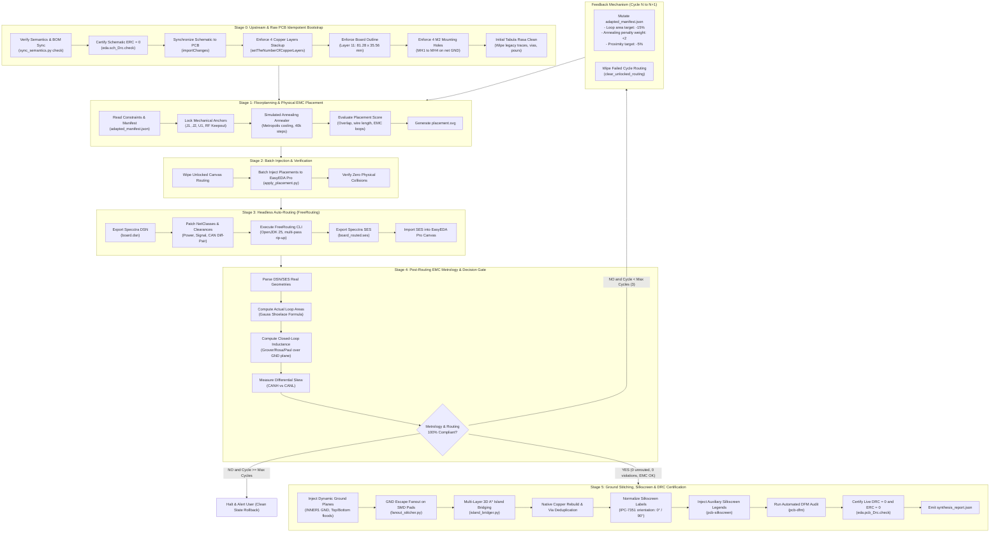
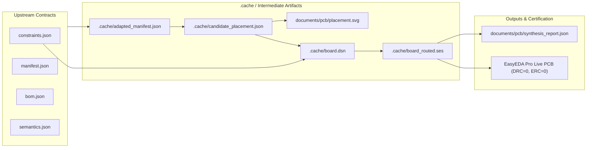

# PCB Synthesizer — Macro-Cycle Architecture & Pipeline Specification

## 1. Executive Summary & Purpose

The **PCB Synthesizer** pipeline (`synthesizer_pipeline.py`) coordinates the automated, closed-loop physical design of the 4-layer ESP32-S3 automotive OBD-II scanner board. It unites schematic validation, physical placement, auto-routing, post-routing electromagnetic compatibility (EMC) metrology, ground plane stitching, and Design for Manufacturing (DFM) verification into a single deterministic, contract-driven architecture.

```
       CONTRACTS (JSON)                      CAD ENVIRONMENT                   AUTOMATED ENGINES
 ┌───────────────────────────┐         ┌──────────────────────────┐         ┌─────────────────────┐
 │ constraints.json          │ ──────► │ EasyEDA Pro v2.2+        │ ◄─────► │ pcb-placer          │
 │ manifest.json             │         │ (WebSocket/HTTP Bridge)  │         │ freerouting (CLI)   │
 │ semantics.json / bom.json │         │ Port 49620               │         │ pcb-stitcher        │
 └───────────────────────────┘         └──────────────────────────┘         │ dsn_metrics         │
                                                                            └─────────────────────┘
```

The pipeline operates on three foundational principles:
1. **Deterministic Invariants:** Mechanical boundaries (81.28 × 35.56 mm outline, 4 M2 mounting holes, connector anchors `J1`, `J2`, and SoC `U1`) and electrical rules (ERC = 0, 4 copper layers) remain immutable across iterations.
2. **Tabula Rasa Boundary:** Run N+1 never inherits stale traces, copper pours, or vias from run N. Any pre-existing routing is systematically cleared before new placement cycles.
3. **Adaptive Feedback Loop:** If post-routing metrology detects non-compliant switching loop areas or differential skew, algorithmic feedback mutates local constraints in `.cache/adapted_manifest.json` and initiates a new placement-routing cycle (up to 3 cycles).

---

## 2. End-to-End Macro-Cycle Architecture

The overall macro-cycle transitions linearly through six stages (Stages 0 to 5), with an adaptive feedback loop returning from Stage 4 to Stage 1 when metrological criteria require tighter geometric convergence:



---

## 3. Pipeline Invariants Across Cycle Boundaries

A key requirement of automated hardware generation is state determinism. The following table specifies the preservation and reset behavior across every pipeline boundary:

| Boundary / Transition | Preserved Invariants (What Remains Strictly Intact) | Reset / Mutated Artifacts (What is Wiped or Adapted) | Justification & Guarantee |
| :--- | :--- | :--- | :--- |
| **Pipeline Entry (Stage 0: Bootstrap)** | - Schematic connectivity & netlist.<br/>- 4-layer copper stackup (`TOP`, `INNER1`, `INNER2`, `BOTTOM`).<br/>- Board outline on Layer 11 (81.28 × 35.56 mm).<br/>- 4 M2 mounting holes (`MH1`–`MH4` on net `GND`). | - **WIPED:** All pre-existing copper tracks.<br/>- **WIPED:** All signal and ground vias.<br/>- **WIPED:** All copper polygon pours.<br/>- **MUTATED:** Component positions synchronized from schematic. | Guarantees Tabula Rasa idempotence: run N+1 cannot be contaminated by routing artifacts or copper fragments from run N. |
| **Stage 1 -> Stage 2 (Placement -> CAD)** | - Fixed anchors (`J1` JST-XH, `J2` USB-C, `U1` ESP32-S3 module).<br/>- Keepout zones (RF antenna clearance, board edges).<br/>- Netlist topology and component packages. | - **MUTATED:** Candidate coordinates (x, y, θ) of movable components in `.cache/candidate_placement.json`.<br/>- **REGENERATED:** `documents/pcb/placement.svg`. | The placer operates in pure algorithmic space without mutating the live CAD canvas until validation succeeds. |
| **Stage 2 -> Stage 3 (CAD -> FreeRouting)** | - Live component positions injected into EasyEDA Pro.<br/>- NetClasses definitions (trace width, clearance matrix).<br/>- Board boundary and keepout geometries. | - **WIPED:** Previous FreeRouting scratch files (`board.dsn`, `board_routed.ses`).<br/>- **GENERATED:** Fresh Specctra DSN export. | Ensures FreeRouting receives the exact spatial layout committed to the CAD canvas. |
| **Stage 4 -> Stage 1 (Feedback Loop: Cycle N -> Cycle N+1)** | - Board outline & 4 M2 mounting holes.<br/>- Fixed anchor coordinates (`J1`, `J2`, `U1`).<br/>- Schematic netlist and component library. | - **WIPED:** All copper traces routed during cycle N.<br/>- **WIPED:** All signal vias created during cycle N.<br/>- **MUTATED:** `.cache/adapted_manifest.json` (tighter loop area target, higher penalty weights). | Routing cannot survive re-placement. Components must be free to relocate closer to their switching nodes without trace entanglement. |
| **Stage 4 -> Stage 5 (Metrology -> Stitching)** | - Component placements certified compliant.<br/>- All signal, power, and differential pair traces.<br/>- All signal vias. | - **ADDED:** Ground escape fanout vias on SMD pads.<br/>- **ADDED:** 3D A* stitching vias for ground islands.<br/>- **GENERATED:** Copper pours on all 4 layers.<br/>- **ADDED:** Silkscreen annotation labels. | Only after signal routing and critical switching loop geometry pass metrology are ground planes and stitching poured. |

---

## 4. Stage Breakdown & Micro-Cycles

Each stage of the macro-cycle contains internal micro-cycles that ensure local convergence before advancing:

### Stage 0: Upstream Quality Gates & Raw PCB Idempotent Bootstrap
- **Micro-Steps:**
  1. `sync_semantics.py check`: Audits `documents/schema/bom.json` against `documents/schema/semantics.json`.
  2. `run_erc()`: Switches to schematic sheets, invokes `eda.sch_Drc.check(true, false, true)`, certifies ERC = 0, and restores the PCB tab.
  3. `update_pcb_from_schematic()`: Pulls upstream schematic modifications into the PCB layout.
  4. `set_copper_layers(4)`: Configures the 4-layer copper stackup.
  5. `ensure_board_outline()`: Validates or instantiates the 81.28 × 35.56 mm outline polygon on Layer 11 (`BOARD_OUTLINE`).
  6. `ensure_mounting_holes()`: Validates or places `MH1` to `MH4` (2.2 mm drill, 3.6 mm pad, net `GND`).
  7. `clear_unlocked_routing()`: Wipes any existing traces, vias, or copper fills.

### Stage 1: Floorplanning & Physical EMC Simulated Annealing (`pcb-placer`)
- **Micro-Cycle (Annealing Schedule):**
  - Fixes immutable anchors (`J1`, `J2`, `U1`).
  - Initializes components in random legal positions within the board boundary.
  - Executes 4 independent random starts with 40,000 cooling steps each.
  - Temperature decay: $T_k = T_0 \cdot \alpha^k$.
  - Energy function minimized at each micro-step:
    $$E = w_{\text{overlap}} E_{\text{overlap}} + w_{\text{wire}} E_{\text{wire}} + w_{\text{decoupling}} E_{\text{decoupling}} + w_{\text{loop}} E_{\text{loop}} + w_{H} E_{H} + w_{E} E_{E}$$
  - Enforces physical design rules: decoupling capacitors within 2.0 mm of IC power pins, RF keepout zone preserved, switching loop components clustered.
  - Emits candidate placement and recalculated vector graphic `documents/pcb/placement.svg`.

### Stage 2: Batch Injection & Verification (`apply_placement`)
- **Micro-Steps:**
  - Connects to local EasyEDA Pro bridge (`http://localhost:49620`).
  - Calls `clear_unlocked_routing()` to ensure the canvas is completely clean.
  - Injects component coordinate batch (x, y, θ) via `apply_placement.py`.
  - Audits board canvas to verify zero overlapping component bounding boxes.

### Stage 3: Headless Auto-Routing (`freerouting`)
- **Micro-Cycle (Rip-Up & Reroute Passes):**
  - Exports canvas geometry to Specctra DSN format.
  - Injects NetClasses: assigns trace widths (0.50 mm for power rails, 0.254 mm for signals), clearance rules (0.20 mm default, 0.23 mm for stitching), and differential pair constraints (CAN 120 Ω pair).
  - Headless FreeRouting engine executes multiple iterative passes (typically 10 passes):
    - Topological route generation.
    - Rip-up and reroute conflict resolution.
    - Via reduction and trace length optimization passes.
  - Emits Specctra SES file and imports routed geometries back into EasyEDA Pro.

### Stage 4: Post-Routing EMC Metrology & Decision Gate (`dsn_metrics`)
- **Micro-Steps:**
  - Parses actual routed copper paths from DSN and SES files.
  - Identifies critical high-di/dt and high-dv/dt loops (e.g. Buck input pulse loop: Vin cap -> High-side switch -> Catch diode -> GND -> Vin cap).
  - Calculates true closed-loop polygonal area using Gauss's Shoelace formula:
    $$A_{\text{loop}} = \frac{1}{2} \left| \sum_{i=1}^{n} (x_i y_{i+1} - x_{i+1} y_i) \right|$$
  - Evaluates effective partial loop inductance over continuous ground plane using the Rosa/Grover and Paul return-path model:
    $$L_{\text{loop}} \approx \mu_0 h \cdot \frac{\mathcal{P}}{w}$$
  - Computes differential pair trace length skew ($|\Delta L| = |L_{\text{CANH}} - L_{\text{CANL}}| \le 0.5\text{ mm}$).
  - Evaluates compliance against threshold targets. If non-compliant, triggers feedback mutation.

### Stage 5: Ground Stitching, Silkscreen & DRC Certification
- **Micro-Steps:**
  - Injects solid ground planes on `INNER1` (Layer 3) and ground floods on `TOP` (Layer 1) and `BOTTOM` (Layer 2).
  - `fanout_stitcher.py`: Adds GND escape vias for disconnected SMD pads.
  - `island_bridger.py`: Uses 3D A* maze router to bridge isolated copper islands across layers.
  - Native copper rebuild (`rebuildCopperRegion`) and duplicate via elimination.
  - `label_placer.py`: Normalizes silkscreen text orientation to 0° or 90° per IPC-7351.
  - `pcb-silkscreen`: Injects diagnostic legends, test points, and jumper markings (`JP1`, `JP2`).
  - `pcb-dfm`: Audits drill aspect ratios, annular rings, solder mask webs, and pad-to-via clearances.
  - Live DRC certification via `eda.pcb_Drc.check()`, ensuring 0 DRC errors and 0 ERC errors.
  - Emits [`documents/pcb/synthesis_report.json`](../../../documents/pcb/synthesis_report.json).

---

## 5. Feedback Loop Dynamics & Mutation Rules

When Stage 4 determines that routed geometry does not meet target criteria (e.g. Buck loop area > 25.0 mm², differential skew > 0.5 mm, or unrouted tracks > 0), the pipeline executes a feedback mutation without user intervention:

```
                  POST-ROUTING AUDIT FAILS
                             │
                             ▼
 ┌─────────────────────────────────────────────────────────────┐
 │ 1. Mutate Local Constraints (.cache/adapted_manifest.json)  │
 │    • Target Loop Area:    A_new = 0.85 * A_old (-15%)       │
 │    • Annealing Penalty:   w_new = w_old + 2    (+25%)       │
 │    • Proximity Distance:  d_new = 0.95 * d_old (-5%)        │
 └───────────────────────────┬─────────────────────────────────┘
                             │
                             ▼
 ┌─────────────────────────────────────────────────────────────┐
 │ 2. Clear Unlocked Routing in EasyEDA Pro                    │
 │    • Delete all signal & power tracks from Cycle N          │
 │    • Delete all signal vias from Cycle N                    │
 │    • Retain board outline, anchors, and mounting holes      │
 └───────────────────────────┬─────────────────────────────────┘
                             │
                             ▼
 ┌─────────────────────────────────────────────────────────────┐
 │ 3. Restart Placement Engine at Stage 1 with Cycle N + 1     │
 └─────────────────────────────────────────────────────────────┘
```

### Convergence Guardrails:
- **Maximum 3 Cycles:** In accordance with `AGENTS.md` Rule 2, the pipeline is limited to a maximum of 3 feedback iterations.
- **Fail-Safe Abort:** If after 3 cycles the layout does not converge to DRC = 0 and compliant metrology, the pipeline halts, preserves a clean state rollback, and alerts the user with the exact geometric bottleneck.

---

## 6. Data Flow & Configuration Artifacts



- **Upstream Contracts (Read-Only):**
  - [`documents/pcb/constraints.json`](../../../documents/pcb/constraints.json): Mechanical boundaries, mounting holes, layer stackup, NetClasses (track widths, clearances).
  - [`documents/pcb/manifest.json`](../../../documents/pcb/manifest.json): EMC critical loop topologies, decoupling capacitor assignments, RF keepout boundaries.
  - [`documents/schema/bom.json`](../../../documents/schema/bom.json) & [`documents/schema/semantics.json`](../../../documents/schema/semantics.json): Component library and semantic net mappings.
- **Transient Artifacts (Isolated in `.cache/`):**
  - `.cache/adapted_manifest.json`: Dynamic manifest mutated by feedback iterations.
  - `.cache/candidate_placement.json`: Intermediate component coordinates.
  - `.cache/board.dsn` & `.cache/board_routed.ses`: Specctra auto-routing geometries.
- **Final Deliverables:**
  - [`documents/pcb/placement.svg`](../../../documents/pcb/placement.svg): Vector floorplan representation updated on each placement run.
  - [`documents/pcb/synthesis_report.json`](../../../documents/pcb/synthesis_report.json): Machine-readable audit report recording DRC count, unrouted nets, computed loop areas, and differential skew.
  - Live EasyEDA Pro PCB canvas certified at DRC = 0 and ERC = 0.
