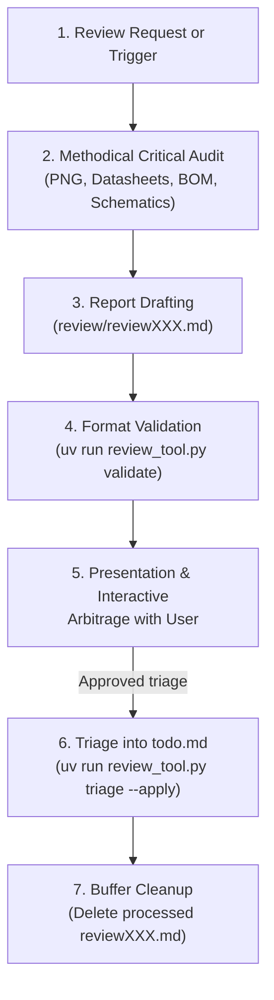

# Skill: Review (Hardware Technical Audit & Review Processing)

This skill provides a **comprehensive methodological and algorithmic framework** for conducting, formally validating, and interactively processing electronic design reviews (schematics, BOM, PCB layout, routing, and automotive compliance).

In accordance with Rule 1 of [`agents.md`](../../../agents.md), this skill is **completely agnostic**:
* No components, nets, or values are hardcoded into Python scripts.
* It operates on abstractions (design rules, logic threshold validations, switching loops, thermal criteria).
* All input data originates from project files (`documents/schema/bom.json`, `documents/pcb/constraints.json`, `review/*.md`), CLI arguments, or JSON configurations.

---

## 0. Auditor Posture: Tabula Rasa & Exclusive Physical Evidence

> [!IMPORTANT]
> **Golden Rule of the Audit: Memory Erasure & Absolute Impartiality**
> Throughout the technical review, the reviewer agent **must disregard all prior conversational memory or preconceived project knowledge**. It must adopt the strict, impartial posture of an independent third-party auditor discovering the board for the very first time.

1. **No reliance on memories or assumptions:**
   The agent must never presume a design choice is "normal," "already approved," or "obvious" because it was discussed in earlier chat sessions. Any technical decision not formalized in versioned repository files is considered non-existent.
2. **Analysis based exclusively on physical repository artifacts (*Evidence-Based*):**
   Every finding must be grounded in directly observable and verifiable evidence within the repository:
   * **High-resolution graphical exports:** Meticulous visual inspection of schematic diagrams ([`documents/schema/*.png`](../../../documents/schema/)), printed circuit board exports ([`documents/pcb/pcb.png`](../../../documents/pcb/pcb.png)), and 3D mechanical renders.
   * **Contractual design documents and BOM:** [`documents/schema/bom.json`](../../../documents/schema/bom.json), [`hardware.md`](../../../documents/hardware.md), [`documents/pcb/constraints.json`](../../../documents/pcb/constraints.json), and actual progress state in [`todo.md`](../../../todo.md).
   * **Official manufacturer datasheets:** Original PDF datasheets archived in [`documents/datasheets/references/`](../../../documents/datasheets/references/) and audit synthesis in [`datasheets.md`](../../../documents/datasheets/datasheets.md).
3. **Mandatory critical confrontation:**
   Internal documentation or prior task items in `todo.md` must never be taken at face value. The auditor has an imperative duty to confront every recommendation with manufacturer datasheet reality (e.g., verifying the actual internal pin structure of a transceiver before recommending a supply rail change). If project documents contain inconsistencies or technical fallacies, the auditor must refute them supported by calculations and datasheet excerpts.

---

## 1. Skill Directory Tree

```
.agents/skills/review/
├── SKILL.md                          # Methodological documentation and guide (this file)
├── scripts/
│   ├── review_tool.py                # Agnostic CLI engine: generation, validation, and triage
│   └── schematic_auditor.py          # Automated algorithmic auditor against design rules
└── templates/
    └── audit_rules.json              # Audit rules repository (logic levels, EMC, thermals)
```

> [!NOTE]
> **Single Source of Truth (SSOT):** The standardized review template is not duplicated. It is dynamically extracted by `review_tool.py generate` directly from Section 5 of [`review/guidelines.md`](../../../review/guidelines.md).

---

## 2. Methodical 6-Axis Audit Matrix

During any schematic or architectural review, the reviewer agent must systematically investigate these 6 critical axes:

### Axis 1: Power Distribution & Electrical Survival
* **Absolute Maximum Input Voltage (`VIN,abs`):** Compare the peak clamping voltage of the TVS diode (`VCL`) against the absolute maximum rating of downstream regulators (e.g., 30V max buck converter rating facing automotive 12V alternator transients).
* **MOSFET Gate Protection (`VGS`):** Ensure every gate connected to a variable input potential features a resistive divider or Zener clamp to never exceed absolute ratings (`±20 V`).
* **Reverse Polarity Protection & Resettable Fuse (PPTC):** Verify P-MOSFET body diode orientation and thermal derating of the fuse at 60°C–70°C in-cabin ambient (`IH` derated by ~30%).

### Axis 2: Regulation & Closed-Loop Stability
* **Switch-Mode Buck Converter:**
  - Verify the presence of a soft-start capacitor (*Slow-Start* on SS pin) to suppress inrush current and turn-on overshoot.
  - Verify the small-signal compensation network (phase margin `Φm > 60°` and gain margin `> 10 dB`).
* **Linear LDO Regulator:**
  - Strict compliance with minimum output capacitance (`COUT >= 4.7 µF`) placed immediately adjacent to the `VOUT` pin.
  - **Strict prohibition** of placing a ferrite bead directly on the LDO output without an upstream decoupling capacitor (high-frequency LC oscillation risk).

### Axis 3: Bus Transceivers & Logic Level Translation
* **Biasing & Operating Modes:**
  - Verify mode control pins (e.g., pin `S` Silent Mode on CAN transceivers) are tied to the active potential (ground).
  - Verify each IC's ground reference is solidly connected to GND (prevent VCC-GND shorts).
* **Logic Thresholds & 5V Tolerance:**
  - **Critical Alert:** 3.3V microcontrollers (e.g., ESP32-S3) are not 5V tolerant (`VIO,max = 3.60 V`).
  - Check whether transceiver RX outputs feature internal pull-ups to their supply rail before considering a 5V supply.
  - Use a dedicated `VIO` logic supply pin (e.g., TJA1051T/3) or appropriate level translator.

### Axis 4: Microcontroller & Strapping Pins
* **Reset Pin Immunity (`EN`):** External RC network (10 kΩ / 1 µF, `τ >= 10 ms`) routed close to the pin to prevent spurious resets during RF transmission bursts.
* **Strapping (Boot) Pins:** Strong external pull-up (10 kΩ) on critical lines (e.g., GPIO0) to immunize boot selection against noise picked up by test points.
* **Pinout Assignment:**
  - Avoid assigning power bus or communication signals to system console pins (UART0), which spit bootloader ASCII log frames during startup.
  - Verify ADC analog channel compatibility with active Wi-Fi operation.

### Axis 5: EMC, Decoupling & Boundary Protection
* **Connector Boundary:** TVS diodes, ESD suppression arrays, and filtering placed immediately at external connector entry pins.
* **Local Decoupling:** Every IC power pin must have its dedicated high-frequency ceramic capacitor (100 nF) routed with minimum trace length (< 2 mm).
* **Pi Filters:** Damped `C - Ferrite - C` networks isolating noisy digital domains from sensitive analog/RF domains.

### Axis 6: Thermals, Packages & Bill of Materials (DFM)
* **Dissipation under Load:** Compute `PD = ΔV × I` across linear regulators and USB protection diodes under peak load.
* **Basic Parts Optimization:** Systematically swap *Extended* passives or discretes for JLCPCB *Basic Parts* to minimize assembly setup surcharges.

---

## 3. CLI Tool Usage (`scripts/review_tool.py`)

> [!IMPORTANT]
> All scripts must be executed via `uv run` in accordance with project rules.

### A. Generate a Standardized Blank Review Skeleton
Extracts the template directly from Section 5 of [`review/guidelines.md`](../../../review/guidelines.md) and creates the next available review file (e.g., `review/review001.md`, `review/review002.md`):
```bash
uv run .agents/skills/review/scripts/review_tool.py generate
```
To specify a custom path or point to an alternative guidelines file:
```bash
uv run .agents/skills/review/scripts/review_tool.py generate -o review/review_audit.md --guidelines review/guidelines.md
```

### B. Validate Review Report Compliance
Verifies mandatory metadata fields, executive summary presence, and strict formatting for each observation (Components, Observation, Rationale, Recommendation fields):
```bash
uv run .agents/skills/review/scripts/review_tool.py validate review/review.md
```
For automated agent integration (JSON output):
```bash
uv run .agents/skills/review/scripts/review_tool.py validate review/review.md --json
```

### C. Triage a Review into `todo.md` (Triage & Arbitrage)
Displays the formatted action items categorized by severity (`🔴 Blocking`, `🟠 Important`, `🟢 Minor`) and detects collisions with existing entries in `todo.md`:
```bash
uv run .agents/skills/review/scripts/review_tool.py triage review/review.md --todo-file todo.md
```

Following explicit user approval, inject tasks directly under the targeted section:
```bash
uv run .agents/skills/review/scripts/review_tool.py triage review/review.md --todo-file todo.md --section "### 1.1 Correctifs critiques" --apply
```

To delete the processed review file once triage is complete (in compliance with Rule 5):
```bash
uv run .agents/skills/review/scripts/review_tool.py triage review/review.md --todo-file todo.md --apply --delete-review
```

---

## 4. Automated Rule Auditor (`scripts/schematic_auditor.py`)

Executes static agnostic verification on a Markdown bill of materials or netlist:
```bash
uv run .agents/skills/review/scripts/schematic_auditor.py --rules .agents/skills/review/templates/audit_rules.json --bom documents/schema/bom.json
```
JSON output for programmatic processing:
```bash
uv run .agents/skills/review/scripts/schematic_auditor.py --rules .agents/skills/review/templates/audit_rules.json --bom documents/schema/bom.json --json
```

---

## 5. Review Lifecycle (Rule 4 `agents.md`)


