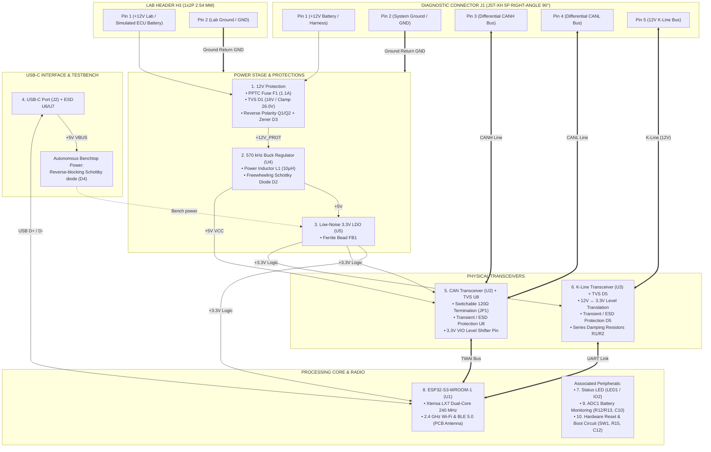
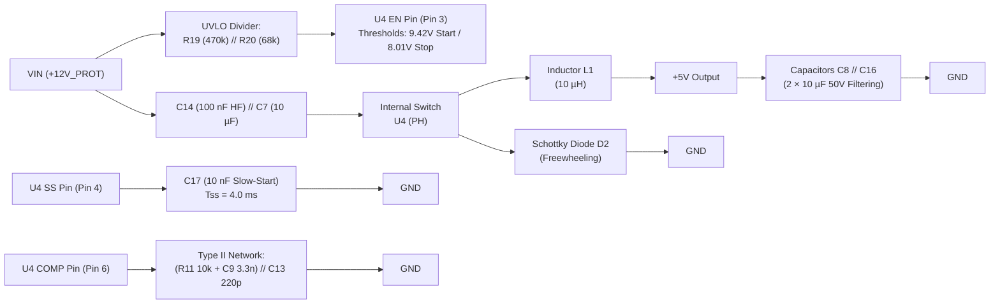
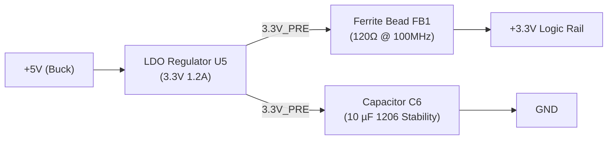
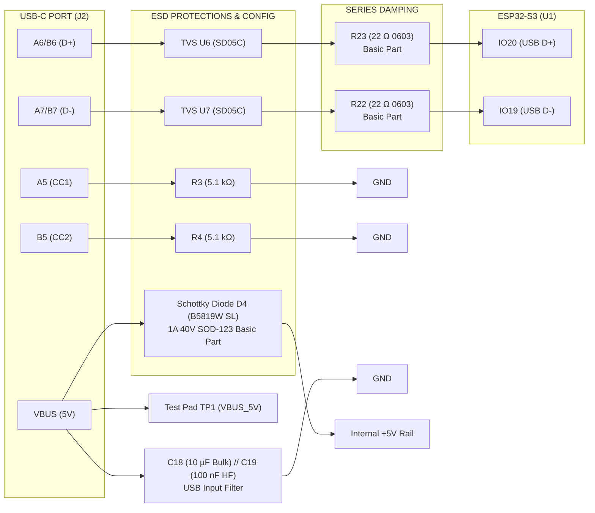
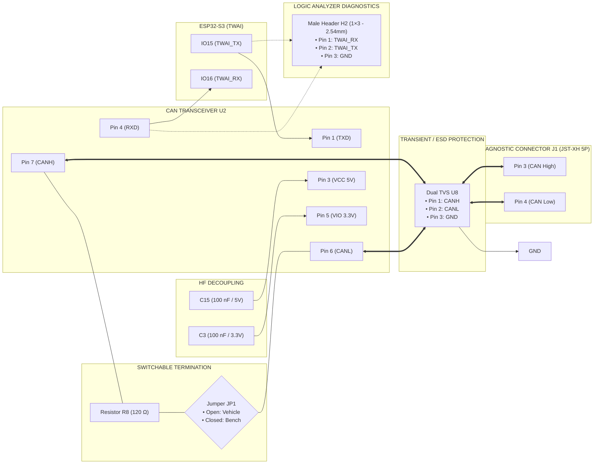
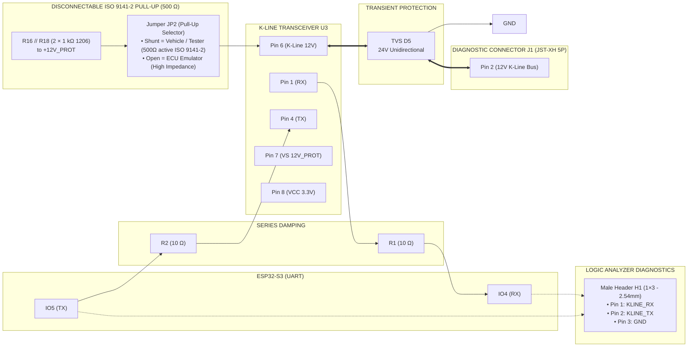
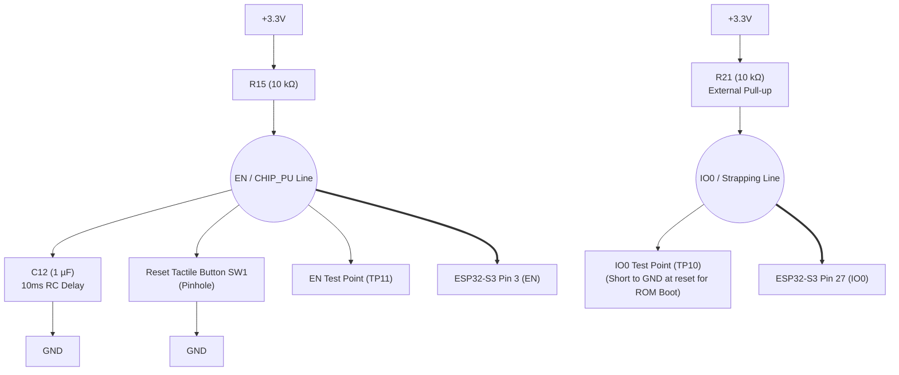
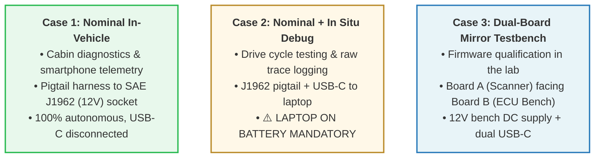

# Hardware Architecture & Electronic Anatomy

This document details the complete electronic architecture of the ESP32 OBD-II scanner: harsh automotive environment constraints, physical roles of each component group, theoretical sizing equations, equipotential netlist directory, and test points.

---

## 1. Automotive Environment & Specific Design Constraints

A 12V vehicle battery network is neither clean nor stable:
* **Engine Cranking:** Severe voltage dips dropping down to 8V or even 6V.
* **Inductive Transients (*Load Dump*):** When the battery is accidentally disconnected while the alternator is charging, inductive energy dumps can exceed **40V to 60V**.
* **High-Frequency Noise:** Ignition interference, injector PWM switching noise, and 3-phase alternator ripple.
* **Reverse Polarity:** Operator error during emergency jump-start clamp connections.
* **Heterogeneous Communication Buses:** High-speed differential CAN bus (2.5V to 3.5V) and single-wire K-Line (half-duplex 0V / 12V battery voltage).

The printed circuit board is partitioned into **10 interconnected functional blocks**, designed to condition incoming power, protect sensitive silicon, and guarantee reliable bidirectional communications.

> [!NOTE]
> **Formal Modeling & Schematic Intent (`semantics.json`):**
> All 70 physical components (85 total components including TP test pads), their functional roles, electrical constraints (voltage ratings, tolerances, power dissipation, dielectrics), and substitution policies are formally codified in machine-readable format in [`schema/semantics.json`](schema/semantics.json). This file serves as a semantic contract verified at every design iteration by the synchronization tool (`uv run python .agents/skills/stingy-schematics/scripts/sync_semantics.py check`).

---

## 2. Overall Functional Diagram & Power Tree



---

## 3. Engineering Walkthrough: Role of Each Component Group

### Block 1: 12V Protection & Polarity (`J1`, `H3`, `F1`, `D1`, `Q1`, `Q2`, `R5`, `R7`, `D3`, `R14`, `R17`)

```mermaid
%%{init: {
  'themeVariables': {
    'fontFamily': 'Consolas, "Courier New", monospace',
    'fontSize': '12px'
  },
  'flowchart': {
    'curve': 'stepBefore',
    'nodeSpacing': 25,
    'rankSpacing': 30
  }
}}%%
flowchart LR
    IN1["+12V Connector J1
(Pin 1)"] --> F1["PPTC Fuse F1
(1.1A / 33V)"]
    IN2["+12V Lab Header H3
(Pin 1 - ECU Sim)"] --> F1
    F1 --> Q1_S["P-MOSFET Q1
Source (+12V_FUSED)"]
    Q1_S --> Q1_D["P-MOSFET Q1
Drain (+12V_PROT)"]
    F1 --> D1["TVS D1 (16V)"] --> GND1["GND"]
    Q1_S --- D3_R7["D3 (12V Zener) // R7 (10k)"] --- Q1_G["Gate Q1 (GATE_PMOS)"]
    Q1_G --> R14["R14 (10k)"] --> Q2_D["Drain Q2"]
    Q2_S["Source Q2"] --> GND2["GND"]
    Q1_D -.->|Divider R5/R17 (+12V_PROT)| Q2_G["Gate Q2"]
```

* **PPTC Resettable Fuse `F1` (1.1A / 33V):**
  * *Operating Principle & Dimensioning:* Built with conductive polymeric material (PPTC), it shields the 12V line against destructive overcurrent. Calibrated at IHOLD = 1.10 A (ITRIP ≈ 2.0 A) with a breakdown rating of **VMAX = 33.0 V** (1812 footprint), it maintains IHOLD >= 0.75 A even at 60°C cabin ambient temperature in summer, eliminating spurious trips during Wi-Fi transmission bursts or engine cranking, while maintaining an ultra-low series resistance (R <= 0.15 Ω) and total immunity against automotive voltage transients up to 33 V.
* **Transient Voltage Suppressor (TVS) Diode `D1` (16V):**
  * *Operating Principle:* A TVS diode remains completely high-impedance under normal battery voltage (VRWM = 16.0 V). As soon as a transient surge exceeds its avalanche breakdown voltage (VBR = 17.8 V ~ 19.7 V), it turns on within picoseconds, shunting excess surge energy directly to ground (GND).
  * *Optimal Sizing for the Buck Converter:* With a peak clamping voltage Vcl of **26.0 V** under a 23.1 A surge pulse (600W @ 10/1000 µs), TVS diode `D1` guarantees that the input voltage never exceeds the **30.0 V absolute maximum rating** of Buck converter `U4`, providing a **robust 4.0 V safety margin** below the silicon destruction threshold.
  * *Negative Transient Clamping (ISO 7637-2 Pulse 1, –100 V):* During an inductive negative transient on the 12V harness, the unidirectional TVS diode `D1` forward-biases and shunts the negative energy to ground with minimal forward drop (VF ≈ –0.7V to –1.0V), while the body diode and channel of P-MOSFET `Q1` hermetically block any reverse potential from entering the downstream regulation stages.
* **Active Reverse-Polarity Protection via P-MOSFET `Q1` and N-MOSFET `Q2`:**
  * *Why not a standard silicon diode?* A conventional rectifier diode introduces a continuous 0.7V to 1.0V forward voltage drop, generating wasted heat dissipation (P = V × I).
  * *MOSFET Operating Behavior:*
    * **Under normal polarity (+12V connected correctly):** Positive voltage reaches the gate of Q2 through the 1:2 voltage divider formed by `R5` (10 kΩ) and `R17` (10 kΩ). This divider halves the voltage, strictly capping Vgs to a maximum of **13.0 V** during worst-case alternator load dumps (where D1 clamps at 26.0 V), ensuring a 7.0 V safety margin below the ±20 V absolute maximum rating of the 2N7002. In nominal operation (12V to 14.4V), Vgs = 6.0V to 7.2V, driving Q2 into deep saturation. Q2 pulls the bottom of R14 to ground (0V). The gate-source voltage Vgs of Q1 becomes negative (~ –12V, clamped by D3), fully turning on Q1. P-MOSFET `Q1` (VDS max –30V, ID –4A in SOT-23) presents an ultra-low on-resistance Rds(on) (~0.046 Ω), with negligible voltage drop (< 0.05V). Its 30V VDS rating easily handles automotive transients and TVS D1 clamping levels (~26.0V).
    * **Under accidental reverse polarity:** Q2 gate receives zero/negative bias and stays off. The gate of Q1 remains pulled to its source potential (Vgs = 0V via R7), leaving Q1 completely off. Zero destructive reverse current can enter the board.
* **Gate Protection via Zener Diode `D3` (12V - `BZX84C12`) & Series Resistor `R14` (10 kΩ):**
  * *Why clamp Vgs?* The gate oxide of MOSFET Q1 only tolerates an absolute maximum Vgs of ±20V. During an automotive transient where the 12V rail rises toward 30V, without a Zener clamp, the gate pulled to 0V would experience a destructive Vgs of nearly –30V.
  * *Role of D3 and R14:* D3 is placed directly across the Source (`+12V_FUSED`) and Gate of Q1. As soon as Vgs reaches 12V, D3 enters Zener breakdown, locking Vgs strictly to –12V. Resistor R14 (10 kΩ) in series with the drain of Q2 absorbs the remaining voltage drop, keeping Zener current below 2 mA.

---

### Block 2: 12V -> 5V Buck Converter (570 kHz) (`U4`, `L1`, `D2`, `C5`, `C7`, `C8`, `C16`, `C14`, `C17`, `R9`, `R10`, `R11`, `R19`, `R20`, `C9`, `C13`)

The ESP32 and logic ICs draw up to 300 mA to 500 mA during active Wi-Fi radio transmissions.
* Using a linear regulator to drop 12V to 5V under 500 mA would dissipate excessive heat:
  > **P_dissipated = (Vin - Vout) × I = (12V - 5V) × 0.5A = 3.5 Watts!**
* The **Buck switching regulator (`U4`)** switches at high frequency (**570 kHz**) with an efficiency exceeding **85%**.



* **Power Inductor `L1` (10 µH Shielded - `YNR6045-100M`):** Magnetic energy reservoir. When the internal switch opens, it opposes current interruption (V = L · di/dt) and discharges stored energy. Saturation current Isat = 3.6A provides a 4.5× safety margin above the maximum peak inductor current (~0.79A).
* **Freewheeling Schottky Diode `D2` (3A / 40V):** Allows continuous closed-loop current flow from ground through the inductor with ultra-fast reverse recovery time (< 10 ns) and low forward voltage drop (~0.35V).
* **UVLO Undervoltage Lockout Divider `R19` (470 kΩ) and `R20` (68 kΩ) (0805):** Connected between `+12V_PROT`, pin 3 (`EN`) of `U4`, and ground `GND`. Calibrates a sharp turn-on threshold at Vstart ≈ 9.42 V and a clean cutoff threshold at Vstop ≈ 8.01 V with a wide 1.41 V hysteresis (ΔVhys = 3 µA × R19). This prevents chattering during vehicle engine cranking dips and eliminates brownout cycling during ESP32 Wi-Fi bursts, safeguarding NVS Flash integrity.
* **Bootstrap Capacitor `C5` (100 nF 50V X7R ceramic - `0603`):** Connected between `BOOT` and `PH`, forms a flying charge pump that boosts drive voltage to saturate the internal high-side N-MOSFET. The 100 nF (0.1 µF) value is explicitly mandated by Texas Instruments (datasheet SLVS839 §8.2.2.8 "Bootstrap Capacitor Selection" recommending a 0.1 µF X5R or better ceramic capacitor) to guarantee dynamic gate recharge across all load conditions and cold starts.
* **Bulk Input Capacitor `C7` (10 µF 50V X5R ceramic - `1206`):** Supplies the 570 kHz high-current switching pulses with generous 50V voltage rating headroom.
* **High-Frequency Input Decoupling Capacitor `C14` (100 nF 50V X7R ceramic - `0603`):** Placed in direct parallel with C7, routed directly against pin 2 (`VIN`) of U4 (< 1.5 mm). Absorbs switching harmonics (> 20 MHz) and locally shunts input di/dt loops.
* **Output Capacitors `C8` and `C16` (2 × 10 µF 50V X5R ceramic - `1206`):** Placed in direct parallel to achieve an effective capacitance of ~18 µF under 5V DC (low DC-bias derating thanks to 50V rating), halving ESR and keeping output voltage ripple < 10 mV peak-to-peak.
* **Soft-Start Capacitor `C17` (10 nF 50V X7R ceramic - `0603`):** Connected between pin 4 (`SS`) of `U4` and ground `GND`. Charged by the internal Iss = 2 µA current source to produce a linear 4.0 ms ramp:
  $$T_{SS} = \frac{C_{SS} \times V_{REF}}{I_{SS}} = \frac{10\,\text{nF} \times 0.8\,\text{V}}{2\,\mu\text{A}} = 4.0\,\text{ms}$$
  This suppresses inrush current and eliminates output overshoot on the 5V rail during hot-plugging into the vehicle.
* **Feedback Voltage Divider `R9` (27 kΩ) and `R10` (5.1 kΩ - Basic Parts):**
  > **Vout = 0.8V × (1 + R9 / R10) = 0.8V × (1 + 27 000 / 5 100) = 0.8 × 6.2941 ≈ 5.035 V (+0.71%)**
  The selected standardized E24 pair (`R9`: 27 kΩ, `R10`: 5.1 kΩ) minimizes no-load quiescent current. Quiescent divider current is limited to Idiv ≈ 157 µA (PR9 = 0.66 mW, PR10 = 0.13 mW), maintaining light-load efficiency while presenting a low-impedance feedback node immune to switching noise.
* **Type II Compensation Network `R11` (10 kΩ), `C9` (3.3 nF), and `C13` (220 pF X7R 0603):**
  * *Proportional-Integral Compensator R11 / C9:* Sets compensation zero Fz = 4.82 kHz to cancel the LC power stage pole, stabilizing unity-gain crossover at Fco = 19.1 kHz.
  * *HF Noise Rejection Pole C13:* Placed in direct parallel across R11 + C9 to GND, C13 adds a high-frequency pole at Fp1 = 77.2 kHz that rolls off 570 kHz switching noise entering the internal transconductance error amplifier (gm = 92 µA/V, Ro = 8 MΩ).
  * *Verified Loop Stability:* Nominal phase margin of **66.3°** (unconditional stability across the entire 100 mA to 500 mA load envelope) and gain margin > 20 dB.

---

### Block 3: 3.3V LDO & HF Filter (`U5`, `FB1`, `C6`)

The Buck converter emits residual 570 kHz harmonics. The ESP32-S3 SoC and its 2.4 GHz RF front-end require clean, noise-free supply rails.



* **Linear LDO Regulator `U5` (3.3V - SOT-223):** Delivers regulated 3.3V with power supply ripple rejection (PSRR) > 75 dB. Pins 2 and 4 (`VOUT` and Tab) are tied together to net `3.3V_PRE` to maximize thermal heat dissipation into the PCB copper plane.
* **Ferrite Bead `FB1` (`BLM18PG121SN1D` - 0603):** Provides an impedance of **120 Ω at 100 MHz**, blocking high-frequency digital switching noise from feeding back toward sensitive transceivers and ADC circuits.
* **Stability & Output Capacitor `C6` (10 µF 50V X5R ceramic - `1206`):** Connected to intermediate net `3.3V_PRE` directly at the output of `U5` (upstream of ferrite bead `FB1`), satisfying the manufacturer stability requirement (Cout >= 4.7 µF) from the [LDO U5 manufacturer documentation](datasheets/datasheets.md#u5--low-noise-ldo-voltage-regulator--ldl1117s33r).

---

### Block 4: USB-C, Bench Power, Damping & ESD Protections (`J2`, `D4`, `U6`, `U7`, `R3`, `R4`, `R22`, `R23`)



* **Bulk Input Capacitor `C18` (10 µF 50V 1206) & HF Decoupling `C19` (100 nF 50V 0603):** Placed in direct parallel across `VBUS_5V` immediately at connector `J2`. Bulk capacitor `C18` absorbs mechanical contact bounce and damps inductive LC cable ringing during hot-plugging on the development bench, while `C19` shunts fast switching transients and high-frequency noise (> 20 MHz) to ground.
* **Power Schottky Diode `D4` (SOD-123):**
  * *Autonomous Benchtop Power:* Allows powering all logic (3.3V LDO, ESP32, CAN transceiver) from the USB-C port without requiring a 12V OBD power source.
  * *Absolute Reverse-Current Blocking:* Once connected to a vehicle (12V present, Buck active), the cathode is biased at +5.035 V, reverse-biasing the diode and completely preventing reverse current from flowing into the host computer's USB port.
  * *Current Rating & Low Forward Drop:* Rated for **IF = 1.0 A continuous** (surge capability IFSM = 9 A) and reverse voltage VR = 40 V, it easily handles Wi-Fi radio current peaks (~500 mA) with low forward drop (VF ≈ 0.45 V), preventing thermal buildup or brownouts during flashing and testbench sessions.
  * *Bench Validation of the VBUS → D4 → U5 Chain:* Under USB-only power (no 12V battery), the voltage entering LDO U5 is `VBUS - VF(D4) ≈ 5.0 V - 0.45 V = 4.55 V`. With a specified dropout of only 350 mV at 500 mA for regulator U5, the headroom is very comfortable (~900 mV above the 3.65 V dropout boundary). A confirmation check with a multimeter at `TP6` (3.3V) and `TP1` (VBUS) during Wi-Fi transmission bursts verifies absence of brownouts.
* **Configuration Resistors `R3` and `R4` (5.1 kΩ pull-down — `R0805`):** Essential for USB-C negotiation, signaling the host to supply 5V as a standard downstream device (Sink).
* **Electrostatic Discharge (ESD) Protection Diodes `U6` and `U7` (`SD05C` — SOD-323):** Bidirectional TVS diodes clamping discharges up to ±30 kV in < 1 ns with ultra-low parasitic capacitance (< 3 pF).
* **Series Damping Resistors `R22` and `R23` (22 Ω 0603 1%):** Inserted in strict series on USB data lines between ESD diodes (`U6`/`U7`) and the ESP32-S3 SoC (`R22` on `USB_D-` to IO19, `R23` on `USB_D+` to IO20). Compliant with Espressif hardware design guidelines, they match line impedance to 90 Ω, damp fast-edge reflections, and eliminate switching ringing caused by host USB cable parasitic inductance.

---

### Block 5: CAN Transceiver & ESD Protection (`U2`, `U8`, `R8`, `JP1`, `C3`, `C15`)



* **Differential Bus Principles (`CANH` and `CANL`):**
  * Recessive bit (1): CANH = 2.5V, CANL = 2.5V (differential = 0V).
  * Dominant bit (0): CANH = 3.5V, CANL = 1.5V (differential = +2.0V).
  * Common-mode noise affects both wires equally and is cancelled out through differential subtraction.
* **Dual Bidirectional TVS Diode Array `U8` (SOT-23):**
  * *Boundary Placement:* Located directly adjacent to CANH (Pin 3) and CANL (Pin 4) of input connector `J1`, it immediately diverts electrostatic discharges (IEC 61000-4-2 Level 4 qualified, Contact ±30 kV, Air ±30 kV per onsemi datasheet) and vehicle harness transient surges to ground before they reach transceiver `U2`.
  * *Standoff Voltage VRWM = 24 V:* Withstands automotive common-mode voltage excursions (–12V to +12V) and 24V jump-start fault conditions without conducting.
  * *Ultra-Low Parasitic Capacitance (< 10 pF to 30 pF):* Preserves fast signal edges for high-speed CAN communication up to 1 Mbps.
* **Termination Resistor `R8` (120 Ω 1206) & Selector Jumper `JP1`:**
  * *Enhanced Thermal Sizing (1206, 250 mW):* Specified in a 1206 footprint (power rating doubled to 1/4 W vs 1/8 W in 0805, surface area 3.2 × 1.6 mm) to absorb thermal transients and prevent overheating if CANH accidentally shorts to the +12V/+14V battery rail while jumper `JP1` is shunted.
  * *In-Vehicle (OBD-II Socket):* The automotive network already includes two 120 Ω endpoint termination resistors (60 Ω equivalent). **Jumper JP1 must remain OPEN (WITHOUT shunt)**.
  * *On Testbench / Simulator:* No line terminators exist on the bench. **Insert a standard 2.54 mm jumper shunt on JP1** to engage R8.
* **Logic Analyzer Diagnostic Header `H2` (Straight 1×3 2.54 mm Pitch THT Header):**
  * Enables direct connection of female Dupont jumper wires from a USB logic analyzer (e.g., 24 MHz 8-channel) to capture CAN frames at 3.3V logic levels:
    * **Pin 1:** `TWAI_RX` (received CAN data from transceiver)
    * **Pin 2:** `TWAI_TX` (transmitted CAN data from ESP32)
    * **Pin 3:** `GND` (ground reference for analyzer)
* **Dedicated Decoupling Capacitors `C15` and `C3` (100 nF 50V 0603):**
  * `C15` (100 nF): Pin 3 decoupling (`VCC` +5V rail). Placed within 2 mm of pin 3 of `U2`, supplying high transient currents during dominant/recessive output driver switching.
  * `C3`: Pin 5 decoupling (`VIO` 3.3V rail), ensuring clean logic-level translation to the ESP32 SoC.

---

### Block 6: K-Line Transceiver & ESD Protection (`U3`, `D5`, `R1`, `R2`, `R16`, `C4`)



* **ISO 9141-2 / ISO 14230 Protocol:** Single-wire bidirectional *half-duplex* line referenced to vehicle battery voltage (0V = low/dominant, 12V = high/recessive).
* **Standardized Pull-Up Network `R16` and `R18` (2 × 1 kΩ 1206 1/4W in parallel) & Selector Jumper `JP2`:**
  * *Automotive Standard Compliance (ISO 9141-2 / ISO 14230-4):* Testbench and diagnostic tester specifications mandate a pull-up to +12V of 510 Ω ±5% to guarantee fast rise times (tr < 2 µs) across capacitive wiring harness loads (up to 2 nF). Placing two 1 kΩ resistors in parallel yields Req = 500 Ω (a deviation of only –1.96% from nominal 510 Ω, well within the ±5% specification).
  * *Standardized Diagnostic Tester Role (ISO 9141-2 / ISO 14230) & Jumper `JP2`:*
    * **In In-Vehicle / Scanner Mode (Case 1 and Case 2):** ISO 9141-2 (§4.2.1) and the [K-Line transceiver U3 manufacturer documentation (Fig. 4)](datasheets/datasheets.md#u3--iso-9141-k-line-transceiver--e-l9637d013tr-l9637d) mandate that the diagnostic tool (*Diagnostic Tester*, our scanner) must provide the 510 Ω pull-up to vehicle +12V, as the vehicle ECU only presents high impedance (Rin >= 100 kΩ). **Jumper `JP2` MUST BE CLOSED (with shunt)** in-vehicle to actively pull up the K-Line.
    * **In Dual-Board Testbench Mode (Case 3):** Only one board closes jumper `JP2` (Board A Scanner), while Board B (ECU Simulator) leaves `JP2` **OPEN (without shunt)** to faithfully replicate the passive high-impedance state of an engine ECU.
  * *Controlled Thermal Dissipation (1206 Footprints):* When the line is driven to 0V by the open-collector output transistor with jumper JP2 shunted, total peak dissipation under 14.4 V is Ptot = V² / Req = (14.4V)² / 500 Ω ≈ 0.415 W. This power is shared equally: each 1206 resistor dissipates P = (14.4V)² / 1000 Ω ≈ 0.207 W, comfortably below the 250 mW rating per package without requiring bulky 2010/2512 Extended parts.
* **Unidirectional TVS Diode `D5` (24V - SOD-123FL):**
  * *Boundary Placement & Direct Clamping:* Connected between pin 2 of `J1` (`K_LINE`) and ground `GND` (cathode to K line, anode to GND), it absorbs ESD strikes and harsh ignition transients. Its unidirectional design provides instant forward-conduction clamping below –1.0 V during negative transients, safeguarding the –24.0 V absolute maximum rating of pin 6 (`K`) on transceiver `U3`.
  * *Standoff Voltage VRWM = 24 V:* Remains transparent during continuous 12V–14.4V operation and K-Line signal toggling.
  * *Breakdown Voltage VBR = 26.7 V ~ 29.5 V & Peak Clamping VCL = 38.9 V (200W @ 10/1000 µs):* Capping positive voltage spikes below the destructive ceiling of transceiver `U3`.
* **Dedicated Transceiver `U3` & Decoupling `C4` (100 nF):** Robust bidirectional 12V ↔ 3.3V translation with short-circuit protection and thermal shutdown. Pin 3 (VCC) is powered from 3.3V (operating range 3.0V to 7.0V) to directly match the RX logic level with ESP32-S3 GPIO4 (which is not 5V-tolerant) via transceiver U3's internal pull-up. Decoupling capacitor `C4` is placed within 2 mm of pin 3 (VCC). Pin 7 (VS) is powered from the protected `+12V_PROT` rail. Unused input `LI` (pin 8) is tied directly to adjacent pin 7 (VS), locking the internal comparator in the inactive state (VLI = VS > 0.55 VS), eliminating antenna pickup and dropping static quiescent draw to zero (0 µA).
* **Series Damping Resistors `R1` and `R2` (10 Ω - `R0805`):** Suppress line reflections and limit current spikes entering the ESP32 GPIOs.
* **Logic Analyzer Diagnostic Header `H1` (Straight 1×3 2.54 mm Pitch THT Header):**
  * Enables direct connection of female Dupont jumper wires from a USB logic analyzer (e.g., 24 MHz 8-channel) to capture K-Line UART traffic at 3.3V logic levels:
    * **Pin 1:** `KLINE_RX` (received UART frames from vehicle via transceiver)
    * **Pin 2:** `KLINE_TX` (transmitted UART commands from MCU to transceiver)
    * **Pin 3:** `GND` (ground reference for analyzer)

---

### Block 7: Status LED (`LED1`, `R6`)

* **Red LED `LED1` (0603) & Resistor `R6` (100 Ω):** Driven by microcontroller pin `IO2` (compatible with hardware PWM modulation via the LEDC peripheral).
* **Operating Current & Daylight Visibility:**
  > **I_LED = (3.30V - 2.00V) / 100 Ω = 13.0 mA** (optimal luminous intensity for daylight readability inside the vehicle cabin through the light pipe; thermal dissipation on R6 is ~16.9 mW, well within the 125 mW rating for an 0805 package, and current draw respects the 20 mA maximum GPIO limit of the ESP32-S3).

---

### Block 8: ESP32-S3-WROOM-1 SoC & Local Decoupling (`U1`, `C1`, `C2`, `C11`, `C12`, `R15`, `SW1`)

* Xtensa LX7 dual-core 32-bit microcontroller running at 240 MHz with **16 MB Flash** and **2 MB PSRAM** (`ESP32-S3-WROOM-1-N16R2` variant certified for –40°C to +85°C automotive cabin temperature).
* Native USB OTG controller (direct flashing and debugging without an external USB-to-UART bridge).
* Native hardware **TWAI** controller (CAN 2.0B compatible).
* 2.4 GHz meander PCB antenna (Wi-Fi 802.11 b/g/n + BLE 5.0).
* **Local Decoupling Trio & Bulk Reservoir (`C11`, `C1`, `C2`):**
  * *Bulk Reservoir Capacitor `C11` (10 µF 25V X5R 0805):* Critical anti-brownout role. Wi-Fi radio bursts draw instantaneous current pulses of **450 to 500 mA** for hundreds of microseconds. `C11` provides local energy storage to prevent voltage dips below the ESP32 brownout threshold (2.8V). Routed within 2 mm of pins 1 (`GND`) and 2 (`3V3`). Its 25V rating prevents capacitance loss due to DC-bias (> 85% effective capacitance retained at 3.3V).
  * *HF Decoupling Capacitors `C1` and `C2` (100 nF 50V X7R 0603):* Ceramic MLCCs placed directly against pins 1 and 2 to filter fast 240 MHz clock switching noise.
* **Hardware Reset Circuit (`R15`, `C12`, `SW1`):** External 10 kΩ pull-up (`R15`) to 3.3V and 1 µF capacitor (`C12`) to GND forming a clean RC power-on reset delay, assisted by tactile pushbutton `SW1`.

---

### Block 9: Battery Voltage Monitoring (`R12`, `R13`, `C10`, `D6`)

```mermaid
%%{init: {
  'themeVariables': {
    'fontFamily': 'Consolas, "Courier New", monospace',
    'fontSize': '12px'
  },
  'flowchart': {
    'curve': 'stepBefore',
    'nodeSpacing': 20,
    'rankSpacing': 30
  }
}}%%
flowchart LR
    VBAT["+12V_PROT
(Protected by F1/Q1)"] --> R12["R12 (100 kΩ)"]
    R12 --> SENSE(("VBAT_SENSE
(Ratio ~1/9.33)"))
    SENSE --> R13["R13 (12 kΩ)"] --> GND1["GND"]
    SENSE --> C10["C10 (100 nF)
148 Hz Low-Pass Filter"] --> GND2["GND"]
    GND3["GND"] -->|Anode D6a| D6["Dual Diode BAV199
Rail-to-Rail Clamp"] -->|Cathode D6b| V33["+3.3V Rail (3.95V Ceiling)"]
    SENSE <-->|Pin 3 (Midpoint)| D6
    SENSE ==> ADC["ESP32-S3 Pin 39
IO1 (ADC1_CH0 Channel)"]
```

* **Optimized Voltage Divider (Ratio k ≈ 0.1071 / 1:9.33):**
  > **k = R13 / (R12 + R13) = 12 / (100 + 12) = 12 / 112 ≈ 0.10714**
  * 12.0V battery → 1.286V ADC.
  * 14.4V (active alternator) → 1.543V ADC.
  * 18.0V (normal peak voltage) → 1.929V ADC.
  * 26.0V (clamping ceiling of TVS D1 (16V)) → **2.785V ADC**: remains strictly below 3.3V without saturating the ADC converter!
* **Divider Quiescent Current:** `I = 12V / 112 kΩ ≈ 107 µA` (completely negligible battery discharge).
* **Low-Pass Anti-Aliasing Filter `C10` (100 nF):** With `Req = 100k // 12k ≈ 10.71 kΩ`, cutoff frequency is `fc ≈ 148 Hz`, rejecting alternator ripple and ignition EMI.
* **Ultra-Low-Leakage Rail-to-Rail Silicon Clamp Diode `D6` (SOT-23):**
  * *Hardware Protection & Measurement Accuracy:* Replacing the former `BAT54WS` Schottky (whose 5 to 10 µA reverse leakage at 70°C induced an error of > 0.5 V on battery estimation via `ΔVBAT = IR × R12`), the `BAV199` features a typical reverse leakage of only **3 pA** at 25°C (< 100 pA at 85°C, guaranteed < 5 nA max at 75V). Measurement error on battery voltage is practically zero (**ΔVBAT < 0.01 mV**, less than 0.001 LSB of the ADC).
  * *Integrated Rail-to-Rail Architecture:* In its SOT-23 package, pin 1 (anode D6a) connects to `GND` to clamp negative ringing below –0.65V, pin 2 (cathode D6b) connects to `3.3V` to clamp transients above 3.95V, and pin 3 (midpoint) connects directly to node `VBAT_SENSE`.
* **ADC1 Channel:** Pin `IO1` belongs to **ADC1**, ensuring analog conversions remain unaffected during active Wi-Fi radio transmissions (unlike ADC2 pins).

---

### Block 10: Secure Reset & Bootloader Circuit (`SW1`, `R15`, `C12`, `TP10`, `TP11`)



* **Power-On-Reset Delay `R15` (10 kΩ) & `C12` (1 µF):** Time constant `τ = 10 ms` guarantees that the 3.3V rail is fully stabilized before the ESP32 exits reset.
* **External Strapping Pull-Up `R21` (10 kΩ 0805):** Firmly pulls `IO0` HIGH (3.3V) at startup, preventing the ESP32 from inadvertently entering bootloader mode under automotive transient noise, while allowing manual ground strapping via `TP10` for emergency recovery.
* **Tactile Reset Pushbutton `SW1` (`TS-1187A`):** Allows resetting the device through an enclosure pinhole without pulling on the OBD connector (40 to 60 N mating force).
* **Emergency Bootloader Test Point `TP10` (`IO0`):** Enables forcing ROM download mode by grounding the pad during reset in case of bootloop.
* **Placement:** `C12` and `R15` are placed within 2 mm of pin 3 (`EN`) to protect this high-impedance trace from 2.4 GHz RF coupling.

---

## 4. Vehicle Constraints vs Electronic Solutions Summary Table

| Vehicle Constraint | Hazard to Electronics | Implemented Technical Solution | Dedicated Components |
| :--- | :--- | :--- | :--- |
| **Alternator Load Dump Voltage Spikes** | Instant breakdown destruction (> 30V) | Surge clamping below 26.0V to ground (4.0V safety margin) | 16V TVS `D1` |
| **Accidental Reverse Polarity** | Destructive short circuit across silicon ICs | Low-loss active MOSFET isolation | P-MOS `Q1` (60V) + N-MOS `Q2` |
| **Harness Short Circuits** | Overheating, trace melting | Resettable thermal overcurrent trip (maintains >= 0.75A at 60°C) | 1.1A / 33V PPTC Fuse `F1` (`1812L110/33MR`) |
| **12V → 5V High Current Step-Down** | Extreme overheating with linear regulators | 570 kHz switching conversion (efficiency > 85%) | Buck `U4` + `L1` + `D2` |
| **Hot-Plug Inrush Current & 5V Overshoot** | Destructive 5V transient overshoot during connection | 4.0 ms linear soft-start via slow-start capacitor | `U4(SS)`, `C17` (10 nF) |
| **Switching Noise & Buck Loop Stability** | Unstable 5V regulation, loop oscillation | Type II network (66.3° phase margin) + HF cap `C13` (220pF) + VIN decoupling `C14` | `U4`, `R11`, `C9`, `C13`, `C14` |
| **Switching Noise Entering RF Radio** | Degraded Wi-Fi/BLE range, ADC instability | Dual-stage filtering: LDO regulator + Ferrite bead | LDO `U5` + `FB1` + `C6` |
| **Brownouts & ESP32 Wi-Fi RF Bursts** | Voltage drops below 2.8V, spurious MCU brownout resets | HF decoupling < 2 mm + local 10 µF bulk reservoir | Capacitors `C1`–`C4` + Bulk `C11` (25V 0805) |
| **Battery Monitoring & Ignition Sensing** | Inability to diagnose alternator state, ADC overvoltage | Protected 1/9.33 divider + ultra-low-leakage silicon clamp `D6` + 148 Hz low-pass | `R12`, `R13` (12k), `C10`, `D6` (`BAV199`) to ADC1 (`IO1`) |
| **Ignition Noise on CAN Bus** | Corrupted or unreadable diagnostic frames | Symmetrical differential signaling + switchable termination | CAN Transceiver `U2` + Termination `R8`/`JP1` |
| **CAN Bus Switching Transients** | VCC dips on U2 during dominant states | Direct HF decoupling at pin 3 (< 2 mm) | `C15` (100 nF 50V) |
| **12V High-Voltage K-Line Signals** | Destruction of MCU GPIOs rated for 3.3V | Bidirectional level translation 12V ↔ 3.3V | K-Line Transceiver `U3` + `R1`, `R2` |
| **K-Line Rise Time & ISO Compliance** | Frame decode failure due to slow edge (> 2 µs) | Standardized switchable 500 Ω pull-up (2 × 1 kΩ 1206) | `R16` // `R18` (1 kΩ 1206) + `JP2` |
| **USB Electrostatic Discharges (ESD)** | Silicon gate breakdown on USB transceivers | Shunting 30 kV ESD pulses in < 1 ns | Bidirectional ESD diodes `U6`, `U7` |
| **CAN Bus Static & Transient Discharges** | Differential gate breakdown on transceiver U2 | Fast bidirectional 24V clamping (< 10 pF) | Dual 24V TVS `U8` |
| **K-Line Static & Transient Discharges** | Breakdown of high-voltage output stage on U3 | Shunting 24V transient spikes directly to ground | Unidirectional 24V TVS diode `D5` |
| **USB Type-C Power Delivery Negotiation** | No 5V power delivered by host charger | Automatic downstream device detection (Sink) | 5.1 kΩ pull-down resistors `R3`, `R4` |
| **Bench Power & USB Reverse-Current** | Buck 5V backfeeding into PC USB port or test brownout | 1A / 40V reverse-blocking Schottky power diode | Schottky Diode `D4` (`B5819W SL`) |

---

## 5. Netlist Directory (Equipotential Nets Table)

| Net Name | Connected Components (Pins) | Electrical Function & Role | Domain / Block |
| :--- | :--- | :--- | :--- |
| **`+12V`** | Connector `J1` (Pin 1), Header `H3` (Pin 1), `F1(1)` | Raw 12V supply (vehicle battery via J1 or bench power via H3). | Power / Input |
| **`+12V_FUSED`** | `F1(2)`, `Q1(3)` | 12V supply protected against overcurrent by PPTC fuse. | Power / Safety |
| **`+12V_PROT`** | `Q1(2)`, `D3(3)`, `R7(1)`, `R5(1)`, `C7(1)`, `C14(1)`, `U4(2)`, `R19(1)`, `R12(1)`, `R16(1)`, `R18(1)`, `U3(7,8)`, `TP4` | Reverse-polarity-protected 12V rail supplying Buck, K-Line transceiver (VS and LI), and battery divider. | Power / Safety |
| **`GATE_PMOS`** | `Q1(1)`, `D3(1)`, `R7(2)`, `R14(1)` | P-MOS gate drive clamped to 12V by Zener D3 and pulled by Q2 via R14. | Switching / Control |
| **`DRAIN_NMOS`** | `Q2(3)`, `R14(2)` | Connection between N-MOS Q2 drain and resistor R14. | Switching / Control |
| **`GATE_NMOS`** | `Q2(1)`, `R5(2)`, `R17(1)` | N-MOS Q2 gate bias via 1:2 divider R5/R17 (protects Vgs <= 14.6V). | Switching / Control |
| **`VBAT_SENSE`** | `R12(2)`, `R13(1)`, `C10(1)`, `D6(3)` (midpoint), `U1(39)`, `TP9` | Attenuated battery voltage (~1/9.33 ratio) to ADC1_CH0 (`IO1`), clamped by D6 (`BAV199`). | Battery Sensing |
| **`SS_BUCK`** | `U4(4)`, `C17(1)` | Buck U4 soft-start timing node (Tss = 4.0 ms). | Power / Buck |
| **`PH_BUCK`** | `U4(8)`, `L1(1)`, `D2(1)`, `C5(2)`, `TP12` | High-frequency switching phase node (570 kHz). | Power / Buck |
| **`BOOT (U4)`** | `U4(1)`, `C5(1)` | Local bootstrap node boosting high-side MOSFET gate drive. | Power / Buck |
| **`VSENSE_BUCK`** | `U4(5)`, `R9(1)`, `R10(1)` | Feedback divider midpoint regulating 5V output against internal 0.8V reference. | Power / Buck |
| **`COMP_BUCK`** | `U4(6)`, `R11(1)`, `C13(1)`, `TP13` | Error amplifier output connected to Type II compensation network. | Power / Buck |
| **`RC_COMP`** | `R11(2)`, `C9(1)` | Series node of RC phase lead compensator. | Power / Buck |
| **`+5V`** | `L1(2)`, `C8(1)`, `C16(1)`, `U5(3)`, `R9(2)`, `U2(3)`, `C15(1)`, `TP5`, `D4(3)` | Regulated 5.0V rail from Buck or back-fed from USB-C via D4. | Power / 5V Rail |
| **`3.3V_PRE`** | `U5(2,4)`, `FB1(1)`, `C6(1)`, `TP14` | Raw 3.3V LDO output before RF ferrite bead harmonic filtering. | Power / LDO |
| **`3.3V`** | `FB1(2)`, `C1-C4(1)`, `C11(1)`, `U1(2)`, `U2(5)`, `U3(3, VCC)`, `R15(1)`, `D6(2)` (cathode D6b), `TP6` | Filtered 3.3V logic supply for ESP32, transceivers, and D6 clamp. | Power / 3.3V Rail |
| **`GND`** | Connector `J1` (Pin 5), Header `H3` (Pin 2), ground planes, shields, capacitors (`C1-C19`), transceivers, `U8(3)`, `D5(2)`, `D6(1)`, `TP3`, `H1(3)`, `H2(3)` | Common zero-volt (0V) reference potential tying board and power grounds together. | Reference / Ground |
| **`LED_STATUS`** | `U1(38)` (`IO2`), `R6(1)` | Digital output driving status LED indicator. | Interface / Status |
| **`LED_ANODE`** | `R6(2)`, `LED1(1)` | Current-limited node (13.0 mA) feeding the red LED anode. | Interface / Status |
| **`VBUS_5V`** | `J2(A4,B9,A9,B4)`, `C18(1)`, `C19(1)`, `TP1`, `D4` (anode) | 5V supply from USB-C host with 10 µF bulk capacitor (C18) and 100 nF HF decoupling (C19). | Interface / USB-C |
| **`USB_CC1`** | `J2(A5)`, `R3(1)` | USB-C configuration channel 1 (5.1 kΩ Sink pull-down). | Interface / USB-C |
| **`USB_CC2`** | `J2(B5)`, `R4(1)` | USB-C configuration channel 2 (5.1 kΩ Sink pull-down). | Interface / USB-C |
| **`USB_D+`** | `J2(A6,B6)`, `U6(1)`, `R23(1)` | USB differential data positive line (damped to `U1(14)` / `IO20` via `R23` 22 Ω). | Interface / USB-C |
| **`USB_D-`** | `J2(A7,B7)`, `U7(1)`, `R22(1)` | USB differential data negative line (damped to `U1(13)` / `IO19` via `R22` 22 Ω). | Interface / USB-C |
| **`CANH`** | `U2(7)`, `R8(1)`, `U8(1)`, Connector `J1` (Pin 3), `TP7` | CAN differential bus high line, ESD protected. | Communication / CAN |
| **`CAN_TERM_MID`** | `R8(2)`, `JP1(1)` | Series node between 120 Ω termination resistor and jumper JP1. | Communication / CAN |
| **`CANL`** | `U2(6)`, `JP1(2)`, `U8(2)`, Connector `J1` (Pin 4), `TP8` | CAN differential bus low line, ESD protected. | Communication / CAN |
| **`TWAI_TX`** | `U1(8)` (`IO15`), `U2(1)`, `H2(2)` | 3.3V TWAI (CAN) transmit from SoC to CAN transceiver and header H2. | Communication / CAN |
| **`TWAI_RX`** | `U1(9)` (`IO16`), `U2(4)`, `H2(1)` | 3.3V TWAI (CAN) receive from CAN transceiver to SoC and header H2. | Communication / CAN |
| **`K_PULLUP_MID`** | `R16(2)`, `R18(2)`, `JP2(1)` | Intermediate series node connecting 500 Ω pull-up to selector jumper JP2. | Communication / K-Line |
| **`K_LINE`** | `U3(6)`, `D5(1)`, `JP2(2)`, Connector `J1` (Pin 2), `TP2` | 12V bidirectional automotive diagnostic bus, TVS protected, selectable via JP2. | Communication / K-Line |
| **`K_RX_IC`** | `U3(1)`, `R1(1)` | 3.3V receive output from K-Line transceiver ahead of series damping resistor. | Communication / K-Line |
| **`KLINE_RX`** | `R1(2)`, `U1(4)` (`IO4`), `TP15`, `H1(1)` | Damped UART receive signal reaching ESP32 and header H1 (K-Line RX). | Communication / K-Line |
| **`K_TX_IC`** | `U3(4)`, `R2(1)` | Transmit line into K-Line transceiver after series damping resistor. | Communication / K-Line |
| **`KLINE_TX`** | `R2(2)`, `U1(5)` (`IO5`), `H1(2)` | UART transmit signal from ESP32 to series damping resistor and header H1 (K-Line TX). | Communication / K-Line |
| **`ESP_EN`** | `U1(3)`, `R15(2)`, `C12(1)`, `SW1(1,2)`, `TP11` | ESP32 hardware reset and enable line. | Control / Reset |
| **`IO0`** | `U1(27)`, `R21(1)`, `TP10` | Bootloader strapping line with 10 kΩ pull-up (R21) and test pad (TP10) to force ROM flashing. | Control / Bootloader |

---

## 6. Consolidated Test Points (TP1 to TP15) & Diagnostic Headers Directory

### 6.1 SMD Copper Test Point Pads (TP1 to TP15)

| Designator | Associated Net | Functional Domain | Schematic Coords | Expected Voltage / Signal | Role & Testing Condition |
| :--- | :--- | :--- | :--- | :--- | :--- |
| **`TP1`** | **`VBUS_5V`** | USB Power | (X=575, Y=760) | +5.0 V DC (± 5%) | Checks presence of 5V rail from host USB-C cable. |
| **`TP2`** | **`K_LINE`** | K-Line Diagnostics | (X=765, Y=395) | 12.0 V idle / 0 V active | Monitored for 10.4 kbps serial frames and 5-baud init sequences. |
| **`TP3`** | **`GND`** | Reference / Ground | (X=640, Y=275) | 0.0 V (Ground) | Local common ground reference for oscilloscope probe crocodile clips. |
| **`TP4`** | **`+12V_PROT`** | Vehicle Power | (X=325, Y=375) | +11.5 V to +14.8 V DC | Protected 12V rail after resettable fuse F1 and reverse-polarity stage Q1. |
| **`TP5`** | **`+5V`** | Regulated Power | (X=360, Y=665) | +5.00 V DC (± 2%) | Regulated 5V rail from Buck switching stage U4. |
| **`TP6`** | **`3.3V`** | Logic Power | (X=520, Y=650) | +3.30 V DC (± 1.5%) | Filtered 3.3V logic supply downstream of LDO regulator U5 and FB1. |
| **`TP7`** | **`CANH`** | Differential CAN Bus | (X=700, Y=555) | 2.5 V recessive / 3.5 V dominant | CAN differential bus high line. Validates 120 Ω bus termination. |
| **`TP8`** | **`CANL`** | Differential CAN Bus | (X=700, Y=515) | 2.5 V recessive / 1.5 V dominant | CAN differential bus low line. Measures Vdiff = CANH - CANL. |
| **`TP9`** | **`VBAT_SENSE`** | Analog ADC Sensing | (X=400, Y=755) | ~ 1.29 V (for 12V bat, ~1/9.33 ratio) | ADC calibration and check of 148 Hz low-pass filter (C10) and D6 clamp. |
| **`TP10`** | **`IO0`** | Emergency Bootloader | (X=1060, Y=570) | 3.3 V idle / 0 V to force ROM | Grounded to force ROM download mode if firmware locks up. |
| **`TP11`** | **`ESP_EN`** | Reset Control | (X=650, Y=295) | 3.3 V idle / 0 V during reset | Direct measurement of RC Power-On-Reset charge ramp (10 ms). |
| **`TP12`** | **`PH_BUCK`** | Buck Switching Node | (X=510, Y=640) | 0V / ~12V square wave (570 kHz) | Inspection of duty cycle, rise/fall times, and absence of destructive ringing. |
| **`TP13`** | **`COMP_BUCK`** | Buck Loop Control | (X=355, Y=530) | 0.5 V to 2.0 V analog | Inspection of PWM setpoint and small-signal injection for stability audits (Bode). |
| **`TP14`** | **`3.3V_PRE`** | Raw LDO Output | (X=815, Y=740) | +3.30 V DC (± 1.5%) | Verifies LDO stability with C6 and measures dynamic voltage drop across FB1. |
| **`TP15`** | **`KLINE_RX`** | K-Line UART Diagnostics| (X=640, Y=615) | 3.3 V idle / 0 V active | Decoding 3.3V K-Line UART frames and logic analyzer oscilloscope traces. |

### 6.2 Diagnostic & Bench Power Headers (`H1`, `H2`, `H3`)

Two 1×3 pin straight male headers (`H1`, `H2`) with standard **2.54 mm through-hole pitch (THT)** and one 1×2 pin male header (`H3`) are included for logic analyzer attachment and benchtop power injection:

| Connector | Schematic Sheet | Pin 1 | Pin 2 | Pin 3 | Function & Protocol |
| :---: | :---: | :---: | :---: | :---: | :--- |
| **`H1`** | **Sheet 3** *(K-Line)* | **`KLINE_RX`** (CH0) | **`KLINE_TX`** (CH1) | **`GND`** (0V Ref) | 3.3V K-Line UART frame decoding (10.4 kbps, 5-baud / Fast-Init). |
| **`H2`** | **Sheet 2** *(CAN)* | **`TWAI_RX`** (CH2) | **`TWAI_TX`** (CH3) | **`GND`** (0V Ref) | 3.3V TWAI CAN frame decoding (250 kbps / 500 kbps, standard 11-bit and extended 29-bit). |
| **`H3`** | **Sheet 1** *(Power)* | **`+12V`** (Lab) | **`GND`** (0V Ref) | — | Benchtop 12V DC power injection (simulating vehicle battery in ECU simulator mode). |

---

## 7. PCB Layout Guidelines & Floorplanning Constraints

To guarantee signal integrity, electromagnetic compatibility (EMC), and thermal stability, physical component placement on the PCB must strictly follow these layout rules:

### 7.1 HF Decoupling & Bulk Energy Reservoirs
* **Bulk `C11` (10 µF 25V 0805):** Placed within **2 to 3 mm** of pins 1 (`GND`) and 2 (`3V3`) of ESP32 `U1`. Wide direct traces and dedicated ground vias to internal planes absorb 500 mA transient pulses during Wi-Fi transmissions.
* **Microcontroller HF Decoupling `C1`, `C2` (100 nF 0603):** Placed within **2 mm** of module supply pins.
* **CAN Transceiver Decoupling `C15` (100 nF 50V) and `C3` (100 nF):** `C15` placed within **2 mm** of pin 3 (`VCC` 5V) of `U2` to supply differential switching current spikes. `C3` within **2 mm** of pin 5 (`VIO` 3.3V).
* **Buck Input Decoupling `C14` (100 nF 50V) and `C7` (10 µF 50V):** `C14` placed **directly adjacent to pin 2 (`VIN`) of `U4` (< 1.5 mm)**, immediately upstream of `C7`, with minimal ground return loop to pin 9 (thermal pad GND) to shunt > 20 MHz harmonics.
* **K-Line Decoupling `C4` (100 nF):** Placed within **2 mm** of pin 3 (`VCC`) of `U3`.
* **LDO Filtering `C6` (10 µF):** Placed directly at the output of `U5` on `3.3V_PRE` upstream of `FB1`.

### 7.2 Buck Converter Stage & High-Frequency Switching Loop (570 kHz)
* **Ultra-Compact Power Loop:** The loop formed by pin 8 (`PH`) of `U4`, shielded inductor `L1`, Schottky diode `D2`, and ground return to input capacitors `C7`/`C14` must maintain minimal geometric area to reduce parasitic magnetic emissions ($e = -d\Phi/dt$). Use short, wide traces (0.8 mm to 1.0 mm).
* **Type II Compensation Network `C13`, `R11`, `C9`:**
  * Placed within **2 mm** of pin 6 (`COMP`) of `U4`.
  * **Strict physical isolation from noisy node `PH` (pin 8, D2, L1)**: COMP pin has an internal impedance of 8 MΩ; any proximity or capacitive coupling to the PH node injects switching noise into the control loop.
  * Direct ground return into a quiet analog ground region (*quiet GND*).

### 7.3 ADC Input Protection & Battery Monitoring
* **Clamp Diode `D6` (`BAV199,215`):** Located **directly against `R13` and `C10` (< 2 mm)** on node `VBAT_SENSE`, with short connections to ground `GND` (pin 1) and `3.3V` (pin 2) for sub-nanosecond transient clamping.
* **Analog Trace `VBAT_SENSE`:** Kept clear of Buck power traces and high-frequency clock signals to protect ADC1 (`IO1`) conversion accuracy.

### 7.4 Reset Circuit & Bootloader Strapping
* **RC Delay Network `C12` (1 µF) and `R15` (10 kΩ):** Placed within **2 mm** of pin 3 (`EN`) of ESP32 `U1`. Being high-impedance, long traces could pick up 2.4 GHz RF energy from the antenna and cause unintended brownout resets.
* **Pushbutton `SW1`:** Geometrically aligned with the enclosure top cover pinhole.
* **Test Point `TP10` (`IO0`):** Located immediately adjacent to a `GND` pad for convenient jumper grounding during ROM bootloader recovery.

### 7.5 Transient Protections on Input Connectors & USB
* **CAN Dual TVS `U8`:** Positioned within **5 mm** of pins 3 (`CANH`) and 4 (`CANL`) of input connector `J1`. Incoming traces must traverse `U8` pads before reaching termination `R8`/`JP1` and transceiver `U2`.
* **K-Line TVS `D5` & Pull-Up `R16`:**
  * `D5` placed within **5 mm** of pin 2 (`K_LINE`) of connector `J1` to shunt transients to ground right at the board edge.
  * Pull-up resistor `R16` (1 kΩ 1206) placed close to `D5` and pin 2 (< 5 mm), with adequate copper area for dissipating 207 mW peak power.
* **USB ESD Diodes `U6`, `U7` & Damping Resistors `R22`, `R23` (22 Ω):** TVS diodes aligned side-by-side facing pins A6/B6 (`USB_D+`) and A7/B7 (`USB_D-`) of USB-C connector `J2` for immediate clamping, followed directly by series damping resistors `R22`/`R23` before entering ESP32 pins IO20 and IO19.

### 7.6 Radiofrequency (RF) Management & Ground Planes
* **Antenna RF Keepout Zone (Multi-layer Keepout):** Enforce a strict keepout across all layers (Top, Bottom, Internal) under and around the ESP32-S3 2.4 GHz meander antenna (`NO_WIRES`, `NO_FILLS`, `NO_POURS`). No copper planes or traces may enter this zone.
* **Central Thermal Ground Via Matrix:** Matrix of ground vias (0.3 mm drill, 0.6 mm diameter) under central exposed thermal pad 41 of the ESP32-S3 to conduct heat into the bottom ground plane.

---

### 7.7 Formal PCB Layout Modeling & Decoupled Tooling

In accordance with the **Agnostic Engine** principle (Rule 1 of [`../agents.md`](../agents.md)), automation, placement, and audit tools under `.agents/skills/` contain zero hardcoded component references or coordinates.

All physical constraints of the OBD-II Scanner are formalized across two complementary, non-redundant files:
1. **[`pcb/constraints.json`](pcb/constraints.json):** Mechanical board outline (81.28 × 35.56 mm / 3200 × 1400 mil), 4 M2 mounting holes, fixed anchors (`J1` on West, `J2` on South, `U1` on East), multi-layer RF keepout, and FreeRouting net classes.
2. **[`pcb/manifest.json`](pcb/manifest.json):** IPC-7351 standardized physical geometry for all 20 package types, pad-to-pad courtyards, functional micro-clusters, and EMC proximity constraints (decoupling < 2 mm, compact Buck loop, boundary TVS diodes). Dynamically references [`schema/semantics.json`](schema/semantics.json).

#### Running Component Placement via Skill `pcb-placer`:
```bash
# Deterministic simulated annealing optimization & documents/pcb/placement.svg regeneration
uv run .agents/skills/pcb-placer/simulated_annealing.py \
  --manifest documents/pcb/manifest.json \
  --board documents/pcb/constraints.json \
  --svg documents/pcb/placement.svg

# DRC verification and single-pass injection into EasyEDA Pro
uv run .agents/skills/pcb-placer/apply_placement.py --placement placement_candidate.json
```

---

## 8. Target Use Case Architectures & Operational Wiring

The ESP32 OBD-II Scanner is designed to operate under three distinct profiles, each requiring specific hardware jumper settings (`JP1` for 120 Ω CAN termination, `JP2` for 500 Ω K-Line pull-up) and strict electrical safety precautions:



---

### Case 1: Nominal In-Vehicle (OBD-II Pigtail Harness)

#### 1. Context & Hardware Architecture
The scanner is deployed in a 12V passenger vehicle. It plugs into the female SAE J1962 diagnostic port (located beneath the dashboard) via an adapter *pigtail* cable (standard male SAE J1962 Type A plug on one end, keyed female 5-pin JST-XH connector mating with `J1` on the other).

```mermaid
flowchart LR
    subgraph VEHICULE["VEHICLE CABIN CONNECTOR (SAE J1962)"]
        OBD_16["Pin 16 (+12V Permanent Battery)"]
        OBD_4_5["Pin 4 (Chassis Ground) / Pin 5 (Signal Ground)"]
        OBD_7["Pin 7 (12V K-Line Bus)"]
        OBD_6["Pin 6 (CAN High)"]
        OBD_14["Pin 14 (CAN Low)"]
    end

    subgraph PIGTAIL["OBD-II PIGTAIL HARNESS"]
        F1["Wire 1 (Red: +12V)"]
        F2["Wire 2 (Yellow: K_LINE)"]
        F3["Wire 3 (Blue: CANH)"]
        F4["Wire 4 (White: CANL)"]
        F5["Wire 5 (Black: GND)"]
    end

    subgraph SCANNER["ESP32 OBD-II SCANNER"]
        J1["Connector J1 (JST-XH 5P)
• Pin 1 (+12V)
• Pin 2 (K_LINE)
• Pin 3 (CANH)
• Pin 4 (CANL)
• Pin 5 (GND)"]
        JP1["Jumper JP1 (CAN)
👉 OPEN (Unshunted)"]
        JP2["Jumper JP2 (K-Line)
👉 CLOSED (500Ω Tester Shunt)"]
        USBC["USB-C Port (J2)
👉 DISCONNECTED"]
        POWER_SEC["Power Stage
• PPTC F1 + TVS D1 (16V)
• Reverse Polarity Q1/Q2
• Buck U4 (UVLO 8.01V)
• LDO U5 (3.3V)"]
        RADIO["ESP32-S3 Radio
BLE 5.0 / Wi-Fi"]
    end

    OBD_16 --> F1 --> J1
    OBD_7 <--> F2 <--> J1
    OBD_6 <--> F3 <--> J1
    OBD_14 <--> F4 <--> J1
    OBD_4_5 --> F5 --> J1

    SMARTPHONE["📱 DRIVER SMARTPHONE
(Dashboard / Diagnostic App)"] <==|"Bluetooth BLE 5.0"| RADIO
```

#### 2. Pigtail Wiring Schedule (SAE J1962 Male to Connector `J1`)
| OBD-II Socket Pin (SAE J1962) | Vehicle Signal | Connector `J1` Pin | Scanner Net | Function & Precautions |
| :---: | :---: | :---: | :---: | :--- |
| **Pin 16** | `+12V Permanent` | **Pin 1** | `+12V` | Protected by `F1` (1.1A) and `D1` (16V TVS). UVLO cutoff at 8.01V. |
| **Pin 7** | `K-Line (ISO 9141-2)` | **Pin 2** | `K_LINE` | 12V serial link to engine ECU. Protected by `D5`. |
| **Pin 6** | `CAN High (ISO 11898-2)` | **Pin 3** | `CANH` | Differential CAN High signal. Protected by `U8`. |
| **Pin 14** | `CAN Low (ISO 11898-2)` | **Pin 4** | `CANL` | Differential CAN Low signal. Protected by `U8`. |
| **Pin 4** or **5** | `GND (Chassis / Signal)`| **Pin 5** | `GND` | Common vehicle ground reference. |

#### 3. Jumper Configuration & In-Vehicle Safety
* **CAN Jumper `JP1` (120 Ω Termination): STRICTLY OPEN (WITHOUT shunt)**
  > [!CAUTION]
  > **RISK OF VEHICLE CAN BUS OVERLOAD:** The automotive network already features dual 120 Ω endpoint termination resistors inside boundary ECUs (Engine ECU and Gateway / Cluster), totaling an equivalent impedance of 60 Ω. Inserting a shunt on `JP1` drops total bus impedance to 40 Ω, reducing differential signal amplitude Vdiff, overloading CAN drivers, and potentially triggering drive-cycle transmission faults (*Bus-Off*).
* **K-Line Jumper `JP2` (500 Ω Pull-Up): STRICTLY CLOSED (WITH shunt)**
  > [!IMPORTANT]
  > In compliance with ISO 9141-2 (§4.2.1) and transceiver reference designs, the diagnostic tool (*Diagnostic Tester*, our scanner) must provide the 510 Ω ±5% pull-up to vehicle +12V, as the vehicle ECU only presents a high-impedance input. **Jumper `JP2` must therefore be STRICTLY CLOSED (with shunt)** to supply active K-Line bus pull-up.
* **Power & Quiescent Current:**
  The scanner runs 100% off the vehicle network through Buck converter `U4`. Total board sleep current settles at a realistic baseline of ~8 to 15 mA (static leakage of UVLO divider R19/R20 is negligible, < 25 µA), and the clean cutoff threshold at **8.01 V** guarantees full regulator shutdown before causing battery deep discharge.
* **USB-C Port `J2`:** Unused in this mode (disconnected).

---

### Case 2: Nominal + In Situ Debug (Drive Cycles with Laptop on Battery)

#### 1. Context & Hardware Architecture
Used for in-depth engineering debugging, protocol validation under dynamic drive-cycle conditions, and low-level trace capture:
* The board is plugged into the vehicle OBD-II socket via pigtail harness `J1`.
* Simultaneously, a diagnostic laptop is connected to USB-C port `J2`.

```mermaid
flowchart TD
    subgraph CAR["PASSENGER VEHICLE (12V NETWORK)"]
        BAT["12V Battery & Alternator"]
        CHASSIS["Vehicle Chassis Ground (GND)"]
        ECU["Engine / Cabin ECUs
(Built-in 60Ω CAN Termination)"]
        OBD_PORT["OBD-II Diagnostic Socket (J1962)"]
        BAT --> OBD_PORT
        CHASSIS --> OBD_PORT
        ECU <--> OBD_PORT
    end

    subgraph SCANNER["ESP32 OBD-II SCANNER"]
        J1["Connector J1 (JST-XH 5P)
• 12V, GND, CANH, CANL, K_LINE"]
        JP1["Jumper JP1 (CAN)
👉 OPEN (Unshunted)"]
        JP2["Jumper JP2 (K-Line)
👉 CLOSED (500Ω Tester Shunt)"]
        BUCK["Buck U4
(+5.035V Output)"]
        D4{"Schottky Diode D4
Reverse-Blocking
(V_cathode = +5.035V
> V_anode = +5.0V)"}
        ESP["ESP32-S3
Serial Console + Native JTAG"]
        USBC["USB-C Port (J2)"]
    end

    subgraph LAPTOP["💻 DEVELOPMENT LAPTOP"]
        BATT_LAPTOP["STRICT OPERATION ON
INTERNAL BATTERY ONLY
(NO MAINS CHARGER)"]
        USB_PORT["Host USB-C Port (+5V VBUS / D+ / D-)"]
    end

    OBD_PORT ==>|"Pigtail Harness"| J1
    J1 --> BUCK --> D4
    D4 --> ESP
    USBC <==|"Shielded USB-C Cable"| USB_PORT
    USBC --> D4
    USBC <--> ESP
```

#### 2. CRITICAL SAFETY RULE: GROUND ISOLATION & GROUND LOOPS
> [!CAUTION]
> **CRITICAL GROUND LOOP HAZARD:**
> The laptop connected to USB-C port `J2` must run **EXCLUSIVELY ON ITS INTERNAL BATTERY** (or via a galvanically isolated 12V car charger).
> **IT IS STRICTLY PROHIBITED** to connect the laptop's 230V mains charger to a wall outlet tied to building earth while the scanner is plugged into a vehicle:
> 1. Earth ground in a 230V building and the vehicle chassis ground often exhibit potential differences of several tens of volts (mains noise, ground faults, floating potentials).
> 2. The shield of the USB-C cable creates a direct path between workshop earth and vehicle chassis, carrying massive uncontrolled currents.
> 3. These currents will instantly destroy the laptop USB port, the OBD-II scanner board, and vehicle electronic control units.

#### 3. Hybrid Power Arbitration & Reverse-Blocking Diode `D4`
The scanner is simultaneously connected to two 5V power rails:
* **Vehicle Source:** The 12V rail powers Buck converter `U4`, which outputs **+5.035 V** onto the internal board rail.
* **Laptop USB-C Source:** The USB port nominally provides **+5.00 V** onto `VBUS_5V`.
* **Behavior of `D4` (`B5819W SL`, 40V 1A):**
  * Cathode of `D4` is held at +5.035 V by the Buck.
  * Anode of `D4` is at +5.00 V (Laptop USB).
  * Diode is **reverse-biased** (Vanode < Vcathode).
  * **Result:** Zero current is drawn from the laptop battery to power the scanner, and Buck output current cannot backfeed into the laptop USB port. The vehicle powers all board electronics with priority.
  * If vehicle battery voltage drops (e.g., ignition switched off or deep cranking triggering UVLO below 8V), the cathode falls below 5.0V: diode `D4` immediately forward-biases, providing seamless power handover from USB-C to maintain serial logging and prevent MCU reboots.

#### 4. Jumper Configuration
* **`JP1` (CAN 120 Ω): OPEN (Unshunted)** — Line terminations provided by vehicle network.
* **`JP2` (K-Line 500 Ω): CLOSED (Shunted)** — Diagnostic Tester role providing standard ISO 9141-2 pull-up.

---

### Case 3: Dual-Board Mirror Testbench (ECU Simulator + Scanner)

#### 1. Context & Hardware Architecture
On the laboratory development bench, two boards are interconnected face-to-face via 5-pin JST-XH connectors `J1`:
* **Board A (OBD-II Scanner):** Diagnostic client / master role (sends UDS/OBD-II queries, parses PIDs, hosts BLE/Wi-Fi server).
* **Board B (ECU Simulator):** Server / slave role emulating vehicle engine control unit (responds to Mode 01 requests, simulates DTC faults, streams RPM and vehicle speed frames). A 12V DC bench supply (simulating the vehicle battery) is attached to dedicated header `H3`.

```mermaid
flowchart LR
    subgraph PSU["LABORATORY POWER SUPPLY"]
        ALIM_12V["+12V DC (1.0 A max)"]
        ALIM_GND["GND (0V Ref)"]
    end

    subgraph CARTE_B["BOARD B: ECU SIMULATOR"]
        H3_B["Lab Header H3
• Pin 1 (+12V)
• Pin 2 (GND)"]
        J1_B["Connector J1 (5P)
• Pin 1 (+12V)
• Pin 2 (K_LINE)
• Pin 3 (CANH)
• Pin 4 (CANL)
• Pin 5 (GND)"]
        JP1_B["Jumper JP1 (CAN 120Ω)
👉 CLOSED (Shunted)"]
        JP2_B["Jumper JP2 (K-Line 500Ω)
👉 OPEN (Unshunted / ECU)"]
        USBC_B["USB-C Port (J2)
PID & Fault Injection"]
    end

    subgraph CARTE_A["BOARD A: OBD-II SCANNER"]
        J1_A["Connector J1 (5P)
• Pin 1 (+12V)
• Pin 2 (K_LINE)
• Pin 3 (CANH)
• Pin 4 (CANL)
• Pin 5 (GND)"]
        JP1_A["Jumper JP1 (CAN 120Ω)
👉 CLOSED (Shunted)"]
        JP2_A["Jumper JP2 (K-Line 500Ω)
👉 CLOSED (Shunted / Tester)"]
        USBC_A["USB-C Port (J2)
MCU Logs & Debug"]
    end

    ALIM_12V ==> H3_B
    ALIM_GND ==> H3_B

    J1_B <==|"5-Wire J1 Harness (12V Power & Buses)"| J1_A

    PC["DEVELOPMENT PC
(Dual USB-C Cables)"] <--> USBC_A
    PC <--> USBC_B
```

> [!CAUTION]
> **Benchtop Wiring Sequence Rule (Anti-Backfeeding):**
> During bench tests with dual boards or an external source:
> 1. **Always connect GND and energize 12V (via `H3` or pins 1 (+12V) and 5 (GND) of `J1`) BEFORE connecting signal/bus lines (`CANH`, `CANL`, `K_LINE`).**
> 2. *Strict prohibition of partial connection without GND or 12V:* If `K_LINE` is connected to an active 12V source while the board's `GND` or `+12V` is unpowered, stray current flows through pull-up resistors (`R16` // `R18`) and internal clamp diodes of transceiver `U3` (pin 6 `K` to pin 7 `VS`), abnormally backfeeding the `+12V_PROT` rail and potentially damaging `U3`.

#### 2. Inter-Board Connector `J1` Wiring
| Connector `J1` Pin | Signal | Bench Connection | Electrical Role |
| :---: | :---: | :--- | :--- |
| **1** | `+12V` | Direct link from Board B Pin 1 to Board A Pin 1 | Lab 12V power distribution (injected via `H3` on Board B). |
| **2** | `K_LINE` | Direct link from Board B Pin 2 to Board A Pin 2 | 12V serial bus ISO 9141-2 / ISO 14230. |
| **3** | `CANH` | Direct link from Board B Pin 3 to Board A Pin 3 | Differential CAN High line. |
| **4** | `CANL` | Direct link from Board B Pin 4 to Board A Pin 4 | Differential CAN Low line. |
| **5** | `GND` | Direct link from Board B Pin 5 to Board A Pin 5 | Common equipotential ground reference. |

#### 3. Jumper Configuration
* **CAN Jumper `JP1` (120 Ω Termination):**
  * **Board A: CLOSED (With shunt)**
  * **Board B: CLOSED (With shunt)**
  * *Physical Justification:* With no vehicle network present, the bus is localized. Per ISO 11898-2, both ends of the bus line require a 120 Ω terminator to prevent signal reflections, resulting in the required **60 Ω** equivalent impedance (120 Ω // 120 Ω).
* **K-Line Jumper `JP2` (500 Ω Pull-Up):**
  * **Board A (Scanner): CLOSED (With shunt)** — Provides the standardized 500 Ω pull-up (`R16` // `R18`) to `+12V_PROT`, fulfilling the ISO 9141-2 tester role.
  * **Board B (ECU Simulator): OPEN (Without shunt)** — Presents a passive high-impedance input (Rin >= 100 kΩ) replicating the real engine ECU.
* **Logic Instrumentation (Headers `H1` and `H2`):**
  A USB logic analyzer (e.g., 24 MHz 8-channel) can be plugged directly onto `H1` (`KLINE_RX`, `KLINE_TX`, `GND`) and `H2` (`TWAI_RX`, `TWAI_TX`, `GND`) to monitor and decode bus frames at 3.3V logic levels in real time.

---

### Comparative Summary of the 3 Operational Profiles

| Configuration Parameter | **Case 1: Nominal In-Vehicle** | **Case 2: Nominal + In Situ Debug** | **Case 3: Dual-Board Testbench** |
| :--- | :---: | :---: | :---: |
| **Operational Goal** | Driver diagnostics & DTC readout | Real-time logging & drive cycle validation | Bench simulation & firmware qualification |
| **Connector `J1` & Header `H3`** | JST-XH pigtail to OBD-II port (`H3` free) | JST-XH pigtail to OBD-II port (`H3` free) | `J1` inter-board cable + Lab 12V on `H3` |
| **USB-C Port `J2`** | **DISCONNECTED** | Connected to **laptop on battery** | Connected to Dev PC (logs / CLI) |
| **CAN Jumper `JP1` (120 Ω)** | **OPEN (Unshunted)** *(Mandatory)* | **OPEN (Unshunted)** *(Mandatory)* | **CLOSED (Shunted)** on both boards |
| **K-Line Jumper `JP2` (500 Ω)** | **CLOSED (Shunted)** *(Tester Role)* | **CLOSED (Shunted)** *(Tester Role)* | **CLOSED on Scanner**, **OPEN on ECU Simulator** |
| **Active Power Source** | 100% Vehicle Battery (5V Buck) | Vehicle 12V priority (USB-C backup via `D4`) | Lab 12V on `H3` (USB-C backup if cut) |
| **Data / Logging Channels** | BLE 5.0 (Smartphone App) / Wi-Fi | USB Serial (PC logs) + BLE 5.0 (App) | Native USB Serial / JTAG + `H1`/`H2` |
| **Primary Safety Mandate** | UVLO cutoff calibrated at 8.01 V | **Laptop strictly on internal battery** | Current limit lab supply to 1.0A; connect 12V/GND first |
