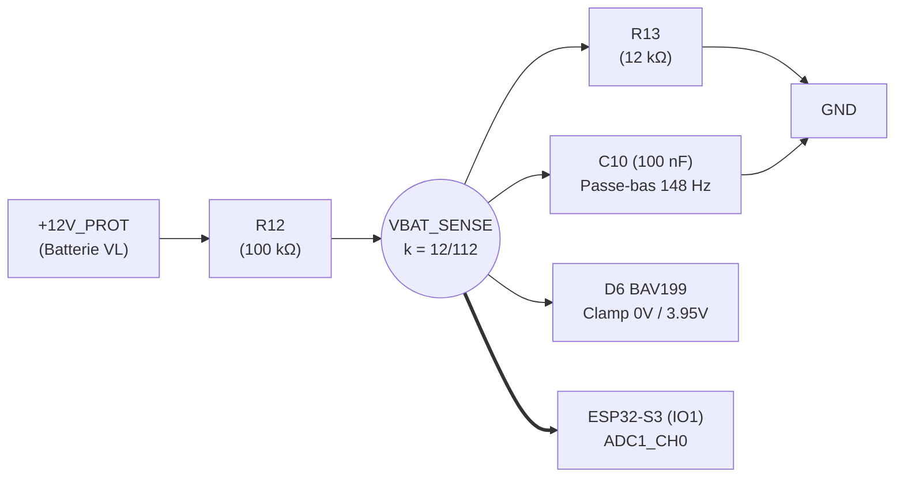

# Spécifications Logicielles & Document d'Amorçage Firmware (Software Handover)

Ce document constitue le **cahier des charges fonctionnel, technique et matériel** destiné à l'initialisation du **dépôt dédié au firmware embarqué** du Scanner OBD-II ESP32. Il réunit l'ensemble des données d'interface matérielle (pinout, timings, caractéristiques électriques, protocoles et formules) indispensables pour développer, qualifier et déployer la stack logicielle sur la carte électronique.

---

## 1. Vision & Rôles du Firmware

Le matériel est une **carte universelle** capable d'assumer deux rôles selon sa configuration logicielle et matérielle :

```
                        ┌──────────────────────────────────────────────┐
                        │           CARTE UNIVERSELLE OBD2             │
                        │           (ESP32-S3-WROOM-1)                 │
                        └───────┬──────────────────────────────┬───────┘
                                │                              │
                Firmware Client │              Firmware Serveur│
                                ▼                              ▼
                 ┌─────────────────────────────┐┌─────────────────────────────┐
                 │       SCANNER OBD-II        ││      SIMULATEUR D'ECU       │
                 │   (Outil de diagnostic)     ││   (Banc d'essais labo)      │
                 ├─────────────────────────────┤├─────────────────────────────┤
                 │ • Maître de communication   ││ • Esclave répondeur         │
                 │ • Envoi requêtes OBD-II     ││ • Émission trames cycliques │
                 │ • Décodage PIDs & DTCs      ││ • Réponse PIDs / Freeze     │
                 │ • Stream BLE / Wi-Fi / USB  ││ • Injection dynamique DTCs  │
                 │ • Cavalier JP1 : OUVERT     ││ • Cavalier JP1 : FERMÉ      │
                 │ • Cavalier JP2 : FERMÉ      ││ • Cavalier JP2 : OUVERT     │
                 └─────────────────────────────┘└─────────────────────────────┘
```

1. **Rôle 1 : Scanner OBD-II (Mode Nominal Véhicule) :**
   - Connecté sur la prise diagnostic SAE J1962 d'une voiture 12V.
   - Initialise et interroge les calculateurs via TWAI/CAN (ISO 15765-4) et K-Line (ISO 9141-2 / ISO 14230 KWP2000).
   - Mesure en continu la tension batterie (`VBAT_SENSE`), gère la veille basse consommation (plancher matériel réaliste ~8 à 15 mA).
   - Diffuse les données télémétriques vers un smartphone / tablette via BLE 5.0 ou Wi-Fi, ou vers un PC via USB-C.
2. **Rôle 2 : Simulateur d'ECU Automobile (Mode Qualification sur Table / Banc Miroir) :**
   - Flashé sur une seconde carte identique interconnectée via son connecteur JST-XH 5 broches `J1` (et embase labo `H3`) à la carte Scanner.
   - Simule un calculateur moteur (ECM) et ses périphériques (TCM, ABS).
   - Émet des trames périodiques TWAI/CAN (régime moteur RPM, vitesse véhicule, température d'eau).
   - Répond aux requêtes OBD-II (Modes 01, 02, 03, 04, 07, 09) et aux initialisations K-Line 5-baud / Fast-Init.
   - Fournit une console interactive CLI (via USB-C ou BLE) pour faire varier dynamiquement les capteurs et injecter des pannes (`P0300`, `P0420`).

---

## 2. Interface Matérielle & Table d'Assignation des GPIOs

### 2.1 Cœur de Traitement : ESP32-S3-WROOM-1-N16R2
- **SoC :** ESP32-S3 (Xtensa Dual-Core 32 bits LX7 cadencé jusqu'à 240 MHz).
- **Mémoires :** 16 Mo Flash Quad SPI (NVS, partitions firmware), 2 Mo PSRAM Octal SPI.
- **Plage thermique :** –40 °C à +85 °C (conforme habitacle automobile).
- **Alimentation logique :** 3.3V régulé par LDO LDL1117S33R et purifié par perle de ferrite `FB1`.
- **Règle absolue :** Les broches d'E/S de l'ESP32-S3 **ne sont pas tolérantes 5V** ($V_{max} = 3.6\,\text{V}$). Tous les étages périphériques sont adaptés en 3.3V.

### 2.2 Table Complète de Mappage des Broches

| GPIO | Direction | Net Schéma | Périphérique / Fonction | Caractéristiques Électriques & Remarques |
| :--- | :---: | :--- | :--- | :--- |
| **`IO1`** | Entrée Analogique | `VBAT_SENSE` | **ADC1_CH0** (Mesure tension batterie) | Pont diviseur $k \approx 1/9.33$, filtre 148 Hz, clamp rail-to-rail `D6` (BAV199). Compatible Wi-Fi actif. |
| **`IO2`** | Sortie Numérique | `LED_STATUS` | **LED d'état rouge `LED1`** | Active à l'état HAUT (3.3V). Courant limité à 13.0 mA par `R6` (100 Ω). Compatible PWM LEDC. |
| **`IO4`** | Entrée Numérique | `KLINE_RX` | **UART RX (K-Line)** | Liaison série depuis transceiver L9637D (broche 1) via `R1` (10 Ω). Pull-up interne active 10 kΩ dans le L9637D reliée à 3.3V. |
| **`IO5`** | Sortie Numérique | `KLINE_TX` | **UART TX (K-Line)** | Émission série vers transceiver L9637D (broche 4) via `R2` (10 Ω). 12V récessif = 3.3V repos, dominant = 0V. |
| **`IO15`** | Sortie Numérique | `TWAI_TX` | **TWAI TX (CAN)** | Émetteur CAN vers transceiver TJA1051T (broche 1). Niveau logique 3.3V. |
| **`IO16`** | Entrée Numérique | `TWAI_RX` | **TWAI RX (CAN)** | Récepteur CAN depuis transceiver TJA1051T (broche 4). Niveau logique 3.3V via broche `VIO`. |
| **`IO19`** | E/S Différentielle | `USB_D-` | **USB OTG D- (Natif)** | Ligne différentielle USB négative avec résistance série `R22` (22 Ω) et TVS ESD `U7`. Flash ROM & CDC série. |
| **`IO20`** | E/S Différentielle | `USB_D+` | **USB OTG D+ (Natif)** | Ligne différentielle USB positive avec résistance série `R23` (22 Ω) et TVS ESD `U6`. Flash ROM & CDC série. |
| **`IO0`** | Entrée (Strapping) | `IO0` | **Bootloader ROM** | Pull-up externe 10 kΩ (`R21`) vers 3.3V. Point de test `TP10` pour mise à la masse au reset en cas de recovery. |
| **`EN`** | Entrée Reset | `ESP_EN` | **Reset Matériel / CHIP_PU** | Temporisation RC 10 ms (`R15` 10 kΩ + `C12` 1 µF) + Bouton tactile `SW1` (trou d'épingle) + Point de test `TP11`. |

---

## 3. Monitoring de Tension Batterie & Télémétrie Énergétique

### 3.1 Étage de Mesure ADC (`IO1` / ADC1_CH0)
Le rail batterie protégé `+12V_PROT` est atténué par le pont diviseur de précision $R_{12} = 100\,\text{k}\Omega$ et $R_{13} = 12\,\text{k}\Omega$, filtré par `C10` (100 nF, $f_c \approx 148\,\text{Hz}$) et protégé par la diode double silicium à ultra-faible fuite `D6` (BAV199, fuite $< 100\,\text{pA}$ à 85 °C).



### 3.2 Formule de Conversion & Étalonnage
Le ratio d'atténuation théorique est :
$$k = \frac{R_{13}}{R_{12} + R_{13}} = \frac{12\,\text{k}\Omega}{100\,\text{k}\Omega + 12\,\text{k}\Omega} = \frac{12}{112} \approx 0.1071428$$

La tension batterie réelle $V_{BAT}$ se déduit de la tension mesurée par l'ADC $V_{ADC}$ :
$$V_{BAT} = \frac{V_{ADC}}{k} = V_{ADC} \times 9.3333$$

**Tableau de correspondance des tensions :**

| État Véhicule / Condition | Tension Batterie $V_{BAT}$ | Tension sur Broche ADC $V_{ADC}$ | Comportement Firmware Attendu |
| :--- | :---: | :---: | :--- |
| **Alimentation USB seule (sur PC)** | **0.0 V (< 2.8 V)** | **< 0.300 V (≈ 0 V)** | Signature détectée : mode debug banc / déconnexion prise OBD (+12V_PROT à 0V isolé par Q1). Inhiber les alertes batterie basse. |
| **Coupure UVLO matérielle Buck** | **<= 8.01 V** | **<= 0.858 V** | Le régulateur Buck U4 se coupe matériellement. Flash NVS protégée. |
| **Batterie déchargée critique** | **< 11.8 V** | **< 1.264 V** | Alerte utilisateur, refuser les opérations d'écriture lourdes. |
| **Batterie nominale au repos** | **12.4 V à 12.8 V** | **1.328 V à 1.371 V** | Fonctionnement nominal moteur coupé. Armer le timer de veille auto (10 min). |
| **Alternateur en charge (moteur tournant)** | **13.8 V à 14.6 V** | **1.478 V à 1.564 V** | Détection automatique « Contact mis / Moteur tournant ». Maintien actif permanent. |
| **Surtension alternateur / Régulateur HS** | **> 15.5 V** | **> 1.660 V** | Alerte surtension, notification MIL rouge. |
| **Plafond transitoire (écrêtage TVS D1)** | **26.0 V** | **2.785 V** | Pleine échelle couverte sans saturation de l'ADC ($< 3.1\,\text{V}$). |

### 3.3 Recommandations d'Implémentation ADC & Bilan Énergétique
- Utiliser l'API de calibration ESP-IDF (`esp_adc_cal` / `adc_oneshot`).
- Atténuation ADC recommandée : `ADC_ATTEN_DB_12` (plage pleine échelle ~0 mV à 3100 mV).
- Moyennage glissant sur 32 ou 64 échantillons pour éliminer le bruit résiduel d'allumage.
- **Veille automatique (*Deep Sleep* / *Light Sleep*) & Plancher de Consommation :**
  - Si $V_{BAT} \le 12.8\,\text{V}$ pendant plus de 10 minutes consécutives et absence de trame sur les bus $\rightarrow$ passage en veille basse consommation ($I_{tot} \approx 8 \text{ à } 15\,\text{mA}$).
  - *Analyse matérielle du plancher de veille :* Les transceivers physiques `U2` (TJA1051T/3) et `U3` (L9637D), ainsi que le régulateur LDO `U5` (LDL1117) et le Buck `U4` (TPS54331), restent sous tension tant que le 12V batterie est présent. En veille profonde de l'ESP32-S3 ($I_{ESP} < 20\,\mu\text{A}$), le courant quiescent résiduel global de la carte se situe entre 8 et 15 mA.
  - *Impact sur la batterie :* Une consommation de 10 mA représente $0.24\,\text{Ah/jour}$, soit environ $7.2\,\text{Ah/mois}$ (décharge < 15% sur batterie 60 Ah après 30 jours), ce qui est parfaitement sécuritaire pour un outil de diagnostic occasionnel ou d'atelier.
  - *Évolution matérielle future :* Si une veille stricte $< 1\,\text{mA}$ était exigée pour un équipement télématique permanent (tracker 24h/24), prévoir un interrupteur High-Side commandé par GPIO sur le rail 5V coupant `U2` et `U3`.
  - Réveil configuré sur front GPIO (`ext0` / `ext1`) lors de l'activité CAN/K-Line ou via seuil comparateur ULP sur montée de tension (> 13.2V au démarrage moteur).

---

## 4. Pile Protocolaire Bus CAN (ISO 15765-4 & TWAI)

### 4.1 Spécifications Physiques & Matérielles
- **Transceiver :** NXP TJA1051T/3/1J (broche 1 TXD $\leftarrow$ `IO15`, broche 4 RXD $\rightarrow$ `IO16`, broche 5 VIO $\leftarrow$ 3.3V).
- **Terminaison :** Résistance `R8` (120 Ω) commutable par cavalier `JP1`.
  - **Sur véhicule :** Cavalier `JP1` **OUVERT** (les 2 terminaisons 120 Ω existent déjà dans le faisceau).
  - **Sur banc bi-cartes :** Cavalier `JP1` **FERMÉ** sur les deux cartes (forme les 60 Ω équivalents de la norme ISO 11898-2).
- **Points de test & capture :** Header diagnostic `H2` (`Pin 1: TWAI_RX`, `Pin 2: TWAI_TX`, `Pin 3: GND`) pour analyseur logique.

### 4.2 Configuration du Périphérique TWAI (ESP32-S3)
Le contrôleur TWAI (*Two-Wire Automotive Interface*) d'Espressif est 100% compatible CAN 2.0B.

**Débits et formats normalisés ISO 15765-4 :**
1. **ISO 15765-4 CAN 500 kbps, 11-bit ID** (Standard, 500k/11b) — Cas le plus fréquent sur VL modernes.
2. **ISO 15765-4 CAN 500 kbps, 29-bit ID** (Étendu, 500k/29b).
3. **ISO 15765-4 CAN 250 kbps, 11-bit ID** (Standard, 250k/11b).
4. **ISO 15765-4 CAN 250 kbps, 29-bit ID** (Étendu, 250k/29b).

**Identifiants d'arbitrage normalisés (11-bit) :**
- Requête fonctionnelle (tous calculateurs) : `0x7DF`.
- Requête physique ECM (Moteur) : `0x7E0` (Réponse : `0x7E8`).
- Requête physique TCM (Boîte auto) : `0x7E1` (Réponse : `0x7E9`).

**Identifiants d'arbitrage normalisés (29-bit) :**
- Requête fonctionnelle : `0x18DB33F1`.
- Requête physique ECM : `0x18DA10F1` (Réponse : `0x18DAF110`).

### 4.3 Couche Transport ISO-TP (ISO 15765-2)
Le driver doit implémenter la segmentation et le réassemblage des trames ISO-TP :
- **Single Frame (SF) :** Octet 0 = `0x00` à `0x07` (longueur 1 à 7 octets). Utilisé pour la majorité des requêtes Mode 01.
- **First Frame (FF) :** Octets 0-1 = `0x10` + longueur totale sur 12 bits (> 7 octets).
- **Flow Control (FC) :** Octet 0 = `0x30` (*Continue To Send*), Block Size (BS), Separation Time (STmin).
- **Consecutive Frame (CF) :** Octet 0 = `0x20` à `0x2F` (numéro de séquence 0 à 15 modulo 16).

---

## 5. Pile Protocolaire K-Line (ISO 9141-2 / ISO 14230 KWP2000)

### 5.1 Spécifications Physiques & Matérielles
- **Transceiver :** STMicroelectronics L9637D013TR (broche 4 TX $\leftarrow$ `IO5`, broche 1 RX $\rightarrow$ `IO4`, broche 3 VCC $\leftarrow$ 3.3V, broche 7 VS $\leftarrow$ `+12V_PROT`).
- **Niveau logique :** Liaison *half-duplex* bidirectionnelle. Les octets émis sur TX sont immédiatement renvoyés en écho local sur RX (le firmware doit filtrer ou vérifier son propre écho pour détecter d'éventuelles collisions).
- **Pull-up 500 Ω normalisée ISO 9141-2 (`R16` // `R18`) :**
  - **Sur véhicule (Mode Scanner / Tester) :** Cavalier `JP2` **FERMÉ (avec shunt)**. La norme exige que le testeur fournisse le pull-up vers le 12V.
  - **Sur banc bi-cartes (Mode Simulateur d'ECU) :** Cavalier `JP2` **OUVERT (sans shunt)** pour émuler la haute impédance passive ($R_{in} \ge 100\,\text{k}\Omega$) d'un ECU.
- **Points de test & capture :** Header diagnostic `H1` (`Pin 1: KLINE_RX`, `Pin 2: KLINE_TX`, `Pin 3: GND`).

### 5.2 Procédures d'Initialisation
Le driver K-Line doit supporter les deux méthodes d'établissement de liaison :

#### A. Initialisation Lente 5-baud (ISO 9141-2 §5.1 / ISO 14230-2)
1. Ligne au repos récessif (12V) pendant au moins $T_{idle} \ge 2600\,\text{ms}$.
2. Émission de l'adresse cible (ex. `0x33` pour OBD-II générique, ou `0x11` pour GM/Daewoo ECM) à la vitesse stricte de **5 bauds** (1 bit = 200 ms, durée totale du mot = 2.0 s) via bit-banging sur `IO5`.
3. Réception du mot de synchronisation `0x55` de l'ECU à 10400 bauds.
4. Réception des deux mots-clés de protocole ($KB_1, KB_2$, ex. `0x08, 0x08` ou `0x94, 0x94`).
5. Émission de l'inversion du second mot-clé ($\sim KB_2$) par le testeur pour verrouiller la communication.

#### B. Initialisation Rapide (Fast-Init 25 ms, ISO 14230-2)
1. Ligne au repos récessif pendant $T_{idle} \ge 300\,\text{ms}$.
2. Forçage de la ligne à l'état bas dominant (0V) pendant $T_{inil} = 25 \pm 1\,\text{ms}$.
3. Remontée à l'état haut récessif (12V) pendant $T_{wup} = 25 \pm 1\,\text{ms}$.
4. Émission immédiate à 10400 bauds du message `StartCommunicationRequest` :
   `0x81 0x10 0xF1 0x81 0x03` (Format, Target ECM 0x10, Source Tester 0xF1, Service 0x81, Checksum).
5. Réception de la réponse positive `StartCommunicationPositiveResponse` (`0xC1 0xEA 0x8F ...`).

### 5.3 Extension Constructeur GM-Daewoo Kalos (KWP2000 Propriétaire)
Pour supporter le diagnostic approfondi du véhicule cible (Daewoo Kalos T200 1.4L / Chevrolet Aveo) :
- **Adressage multi-calculateurs sur la broche 7 unique (`K_LINE`) :**
  - Calculateur Moteur (ECM Delphi/Daewoo MR-140 / HV-240) : Adresse physique `0x10` ou `0x11`.
  - Calculateur Boîte Automatique (TCM Aisin 81-40LE) : Adresse physique `0x28`.
  - Calculateur Freinage Antiblocage (ABS Teves MK20 / MK70) : Adresse physique `0x58`.
  - Module Airbag (SDM Daewoo) : Adresse physique `0x50` ou `0x51`.
- **Services KWP2000 spécifiques :**
  - Service `0x21` / `0x22` (*ReadDataByLocalIdentifier*) pour lire les flux capteurs constructeurs non exposés en OBD-II générique (pressions, états d'actionneurs, signaux de climatisation).
  - Service `0x30` (*InputOutputControlByLocalIdentifier*) pour le pilotage forcé des actionneurs (relais pompe à essence, ventilateur radiateur, coupure injecteur).
  - Service `0x18` / `0x14` pour lecture et effacement des DTCs spécifiques constructeur (`P1xxx`, `Bxxxx`, `Cxxxx`).

---

## 6. Simulateur d'ECU Embarqué (Banc d'Essais sur Table)

Pour qualifier le système sans véhicule, le firmware peut être compilé ou configuré en **mode Serveur ECU** :

```c
// Configuration de compilation
#define MODE_ECU_SIMULATOR 1
```

> [!CAUTION]
> **Règle absolue d'ordonnancement de câblage sur banc (Anti-rétroalimentation) :**
> Lors des tests sur table avec le simulateur d'ECU ou une alimentation externe :
> 1. **Toujours relier et alimenter les broches d'alimentation (+12V et GND via `H3` ou les broches 1 (+12V) et 5 (GND) de `J1`) AVANT de relier les lignes de signaux/bus (`CANH`, `CANL`, `K_LINE`).**
> 2. *Interdiction formelle du câblage partiel sans masse ou sans 12V :* Si la ligne `K_LINE` est raccordée à une source active 12V alors que le `+12V` ou la masse `GND` de la carte n'est pas connectée, un courant parasite transite par les résistances de pull-up (`R16` // `R18`) et les diodes de clamp internes du transceiver `U3` (L9637D), ce qui rétro-alimente le rail `+12V_PROT` et le système de manière anormale, risquant d'endommager `U3` ou de fausser la surveillance de tension `VBAT_SENSE`.

### 6.1 Services Émulés par le Simulateur
1. **Émulation TWAI CAN :**
   - Tâche périodique émettant des trames cycliques moteur (ex. trames constructeur 10 ms / 50 ms).
   - Tâche répondeuse ISO-TP recevant sur `0x7DF` / `0x7E0` et répondant sur `0x7E8` :
     - **Mode 01 :** Traitement des PIDs PID 00 (Bitmap supporté), PID 04 (Charge moteur), PID 05 (T° liquide), PID 0C (Régime RPM), PID 0D (Vitesse), PID 0F (T° admission).
     - **Mode 02 :** Renvoi d'un Freeze Frame simulé lors de l'apparition d'un défaut.
     - **Mode 03 :** Renvoi des DTCs actifs configurés (ex. `P0300` - Ratés d'allumage aléatoires, `P0420` - Rendement catalyseur).
     - **Mode 04 :** Acquittement d'effacement et réinitialisation des variables de défaut.
2. **Émulation K-Line :**
   - Écoute des séquences 5-baud et Fast-Init.
   - Envoi des mots-clés et acquittement de session KWP2000.
3. **Console Interactive CLI (Série USB-C CDC / Web BLE) :**
   - `set rpm <valeur>` : modifie dynamiquement le régime moteur (ex. `set rpm 3500`).
   - `set speed <valeur>` : modifie la vitesse véhicule (ex. `set speed 90`).
   - `set coolant <temp>` : modifie la température d'eau (ex. `set coolant 98`).
   - `fault inject <code_dtc>` : déclenche l'allumage du témoin MIL et stocke le DTC (ex. `fault inject P0300`).
   - `fault clear` : purge les défauts simulés.

---

## 7. Interfaces Utilisateur, Connectivité & Feedback Visuel

### 7.1 Machine d'État de la LED Témoin `LED1` (`IO2`)
La LED rouge `LED1` procure un diagnostic visuel instantané sans écran ni smartphone :

| Séquence Lumineuse | Fréquence / Rapport Cyclique | Signification / État Système |
| :--- | :--- | :--- |
| **Éteinte** | 0% | Système éteint ou en veille profonde (*Deep Sleep*). |
| **Pulsation lente (Breathing)** | 0.5 Hz (PWM progressif) | En attente de connexion (Scanner prêt, aucun bus actif). |
| **Clignotement lent régulier** | 1 Hz (500 ms ON / 500 ms OFF) | Recherche de protocole / Négociation de vitesse en cours. |
| **Allumée fixe** | 100% | Liaison véhicule établie et communication active. |
| **Flashs rapides brefs** | 10 Hz (salves de 50 ms) | Transfert de trames en cours (lecture PID / streaming). |
| **Clignotement SOS (3 courts, 3 longs, 3 courts)** | Séquence morse | Erreur critique : surtension détectée (> 16V) ou bus bloqué (*Bus-Off*). |

### 7.2 Connectivité Sans Fil
- **Bluetooth Low Energy (BLE 5.0) :**
  - Service GATT primaire avec caractéristiques :
    - `CHAR_VEHICLE_DATA` (Notification) : flux binaire compact des PIDs temps réel (RPM, vitesse, tensions, températures).
    - `CHAR_COMMAND_IN` (Write Without Response) : envoi de requêtes OBD-II brutes depuis l'application mobile.
    - `CHAR_BATTERY_VOLTAGE` (Read / Notify) : tension batterie précise en millivolts.
- **Wi-Fi (802.11 b/g/n) :**
  - Mode SoftAP (SSID : `OBD2-Scanner-XXXX`, IP : `192.168.4.1`) ou Station.
  - Serveur WebSocket embarqué pour affichage d'un tableau de bord HTML5 réactif dans n'importe quel navigateur sans installer d'application native.

---

## 8. Stack Logicielle Recommandée & Organisation du Futur Dépôt

### 8.1 Cadre de Développement
- **Framework recommandé :** **ESP-IDF v5.2+** (C/C++ natif) avec FreeRTOS préemptif pour une maîtrise rigoureuse des timings temps réel, des interruptions et des consommations d'énergie.
- **Outil de compilation :** `idf.py` sous environnement standard CMake / Ninja.

### 8.2 Tâches FreeRTOS Découplées Recommandées

```
┌────────────────────────────────────────────────────────────────────────┐
│                          ESP-IDF / FreeRTOS                            │
├────────────────────────────────────────────────────────────────────────┤
│  • Task 'twai_rx_tx'      [Prio 10] : Gestion réactive trames CAN/TWAI │
│  • Task 'kline_engine'    [Prio 10] : Timings stricts UART / 5-baud    │
│  • Task 'power_telemetry' [Prio  3] : Échantillonnage ADC1 & Veille    │
│  • Task 'comm_host'       [Prio  5] : Pile BLE GATT / Web / USB CDC    │
│  • Task 'ui_led'          [Prio  2] : Machine d'état LED1 PWM         │
│  • Task 'ecu_sim'         [Prio  4] : Moteur simulateur (si actif)     │
└────────────────────────────────────────────────────────────────────────┘
```

### 8.3 Arborescence Recommandée pour le Futur Dépôt Firmware

```text
obd2-esp32-firmware/
├── CMakeLists.txt
├── sdkconfig.defaults
├── README.md               # Présentation du firmware (dérivé de software.md)
├── docs/
│   └── software.md         # Copie du présent cahier des charges
├── components/
│   ├── bsp/                # Board Support Package (GPIOs, pinout, LED, ADC)
│   ├── twai_driver/        # Driver TWAI bas niveau & filtre matériel
│   ├── isotp/              # Pile transport ISO-TP (ISO 15765-2)
│   ├── kline_driver/       # Driver UART K-Line & bit-banging 5-baud
│   ├── obd2_stack/         # Services OBD-II SAE J1979 (Modes 01-09)
│   ├── kwp2000/            # Pile constructeur GM-Daewoo KWP2000
│   ├── power_mgmt/         # Surveillance VBAT_SENSE, calibration & sleep
│   ├── comm_ble/           # Serveur BLE GATT & profils télémétrie
│   ├── comm_wifi/          # Serveur Web & WebSocket
│   └── ecu_simulator/      # Moteur d'émulation ECU & CLI banc de test
└── main/
    ├── CMakeLists.txt
    ├── app_main.c          # Initialisation, arbitrage rôle & dispatch tâches
    └── cli_commands.c      # Console interactive USB-C
```

---

## 9. Checklist d'Initialisation du Dépôt Dédié

- [ ] Initialiser le dépôt Git dédié (`obd2-esp32-firmware`).
- [ ] Cloner ce document [`documents/software.md`](software.md) comme socle contractuel d'architecture logicielle.
- [ ] Configurer `sdkconfig.defaults` : active TWAI, active USB CDC sur `IO19`/`IO20`, active Bluetooth BLE 5.0, fréquence CPU 240 MHz, Flash 16 Mo, PSRAM 2 Mo.
- [ ] Valider le premier binaire "Hello World" : clignotement de `LED1` (`IO2`) et mesure brute de `VBAT_SENSE` (`IO1`).
- [ ] Connecter sur banc bi-cartes miroir (Cas 3) et valider la première trame d'écho TWAI CAN 500 kbps entre les deux cartes.
