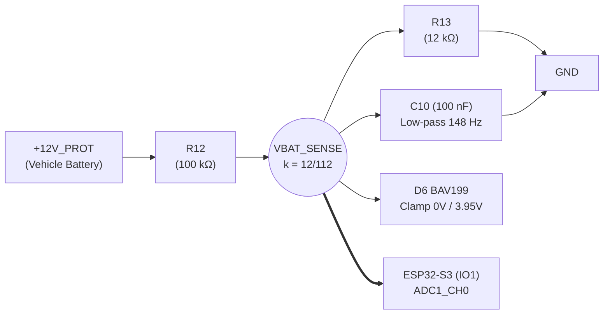

# Software Specifications & Firmware Handover Document

This document constitutes the **functional, technical, and hardware requirements specification** for initializing the **dedicated embedded firmware repository** for the ESP32 OBD-II Scanner. It compiles all hardware interface definitions (pinouts, timings, electrical ratings, communication protocols, and conversion formulas) necessary to develop, validate, and deploy the software stack on the physical board.

---

## 1. Vision & Firmware Operating Roles

The physical board is a **universal hardware platform** capable of assuming two distinct roles depending on its hardware jumper configuration and flashed firmware image:

```
                        ┌──────────────────────────────────────────────┐
                        │          UNIVERSAL OBD2 HARDWARE             │
                        │           (ESP32-S3-WROOM-1)                 │
                        └───────┬──────────────────────────────┬───────┘
                                │                              │
                 Client Firmware│               Server Firmware│
                                ▼                              ▼
                 ┌─────────────────────────────┐┌─────────────────────────────┐
                 │       OBD-II SCANNER        ││        ECU SIMULATOR        │
                 │     (Diagnostic Tool)       ││      (Lab Test Bench)       │
                 ├─────────────────────────────┤├─────────────────────────────┤
                 │ • Communication Master      ││ • Responding Slave          │
                 │ • OBD-II Query Dispatcher   ││ • Cyclic Frame Broadcaster  │
                 │ • PIDs & DTCs Decoder       ││ • PIDs / Freeze Responder   │
                 │ • BLE / Wi-Fi / USB Stream  ││ • Dynamic Fault Injection   │
                 │ • Jumper JP1: OPEN          ││ • Jumper JP1: CLOSED        │
                 │ • Jumper JP2: CLOSED        ││ • Jumper JP2: OPEN          │
                 └─────────────────────────────┘└─────────────────────────────┘
```

1. **Role 1: OBD-II Scanner (Nominal In-Vehicle Mode):**
   - Connected directly to the SAE J1962 diagnostic port of a 12V vehicle.
   - Initializes and queries ECUs via TWAI/CAN (ISO 15765-4) and K-Line (ISO 9141-2 / ISO 14230 KWP2000).
   - Continuously monitors battery voltage (`VBAT_SENSE`), manages low-power sleep (realistic hardware baseline ~8 to 15 mA).
   - Streams live telemetry to a smartphone/tablet via BLE 5.0 or Wi-Fi, or to a PC via USB-C.
2. **Role 2: Automotive ECU Simulator (Bench Qualification / Mirror Board Mode):**
   - Flashed onto an identical second board interconnected via its JST-XH 5-pin connector `J1` (and lab header `H3`) to the Scanner board.
   - Emulates an Engine Control Module (ECM) and companion controllers (TCM, ABS).
   - Broadcasts periodic TWAI/CAN frames (engine RPM, vehicle speed, coolant temperature).
   - Responds to standard OBD-II queries (Modes 01, 02, 03, 04, 07, 09) and K-Line 5-baud / Fast-Init wake-up sequences.
   - Provides an interactive CLI console (via USB-C or BLE) to dynamically modulate sensor values and inject diagnostic fault codes (`P0300`, `P0420`).

---

## 2. Hardware Interface & GPIO Pinout Mapping

### 2.1 Processing Core: ESP32-S3-WROOM-1-N16R2
- **SoC:** ESP32-S3 (Xtensa Dual-Core 32-bit LX7 clocked up to 240 MHz).
- **Memory:** 16 MB Quad SPI Flash (NVS storage, firmware partitions), 2 MB Octal SPI PSRAM.
- **Operating Temperature:** –40 °C to +85 °C (automotive cabin rated).
- **Logic Supply:** 3.3V regulated by low-noise LDO LDL1117S33R and filtered by ferrite bead `FB1`.
- **Absolute Rule:** ESP32-S3 I/O pins are **not 5V tolerant** (`Vmax = 3.6 V`). All peripheral interface stages are natively level-shifted or clamped to 3.3V.

### 2.2 Complete Pinout Mapping Table

| GPIO | Direction | Schematic Net | Peripheral / Function | Electrical Characteristics & Notes |
| :--- | :---: | :--- | :--- | :--- |
| **`IO1`** | Analog Input | `VBAT_SENSE` | **ADC1_CH0** (Battery Voltage Sensing) | Precision divider `k ≈ 1/9.33`, 148 Hz filter, rail-to-rail clamp `D6` (BAV199). Compatible with active Wi-Fi. |
| **`IO2`** | Digital Output | `LED_STATUS` | **Status LED Red `LED1`** | Active HIGH (3.3V). Current limited to 13.0 mA by `R6` (100 Ω). Compatible with PWM LEDC. |
| **`IO4`** | Digital Input | `KLINE_RX` | **UART RX (K-Line)** | Serial input from L9637D transceiver (pin 1) via `R1` (10 Ω). Active internal 10 kΩ pull-up in L9637D tied to 3.3V. |
| **`IO5`** | Digital Output | `KLINE_TX` | **UART TX (K-Line)** | Serial output to L9637D transceiver (pin 4) via `R2` (10 Ω). 12V recessive = 3.3V idle, dominant = 0V. |
| **`IO15`** | Digital Output | `TWAI_TX` | **TWAI TX (CAN)** | CAN transmitter output to TJA1051T (pin 1). 3.3V logic level. |
| **`IO16`** | Digital Input | `TWAI_RX` | **TWAI RX (CAN)** | CAN receiver input from TJA1051T (pin 4). 3.3V logic level via dedicated `VIO` pin. |
| **`IO19`** | Differential I/O | `USB_D-` | **USB OTG D- (Native)** | Negative USB differential line with series resistor `R22` (22 Ω) and TVS ESD `U7`. ROM flash & CDC serial. |
| **`IO20`** | Differential I/O | `USB_D+` | **USB OTG D+ (Native)** | Positive USB differential line with series resistor `R23` (22 Ω) and TVS ESD `U6`. ROM flash & CDC serial. |
| **`IO0`** | Input (Strapping) | `IO0` | **ROM Bootloader** | External 10 kΩ pull-up (`R21`) to 3.3V. Test point `TP10` for grounding at reset during emergency recovery. |
| **`EN`** | Reset Input | `ESP_EN` | **Hardware Reset / CHIP_PU** | RC timing 10 ms (`R15` 10 kΩ + `C12` 1 µF) + Pinhole pushbutton `SW1` + Test point `TP11`. |

---

## 3. Battery Voltage Monitoring & Power Telemetry

### 3.1 ADC Measurement Stage (`IO1` / ADC1_CH0)
The protected battery rail `+12V_PROT` is attenuated by a precision divider `R12 = 100 kΩ` and `R13 = 12 kΩ`, filtered by `C10` (100 nF, `fc ≈ 148 Hz`), and clamped by ultra-low-leakage dual diode `D6` (BAV199, leakage `< 100 pA` at 85 °C).



### 3.2 Conversion Formula & Calibration
The theoretical attenuation ratio is:
$$k = \frac{R_{13}}{R_{12} + R_{13}} = \frac{12\,\text{k}\Omega}{100\,\text{k}\Omega + 12\,\text{k}\Omega} = \frac{12}{112} \approx 0.1071428$$

The actual battery voltage $V_{BAT}$ is computed from the measured ADC voltage $V_{ADC}$:
$$V_{BAT} = \frac{V_{ADC}}{k} = V_{ADC} \times 9.3333$$

**Voltage Mapping Table:**

| Vehicle State / Condition | Battery Voltage $V_{BAT}$ | ADC Pin Voltage $V_{ADC}$ | Expected Firmware Behavior |
| :--- | :---: | :---: | :--- |
| **USB Power Only (Bench Debug)** | **0.0 V (< 2.8 V)** | **< 0.300 V (≈ 0 V)** | Signature detected: bench debug mode (+12V_PROT isolated at 0V by Q1). Inhibit low battery alerts. |
| **Hardware Buck UVLO Cutoff** | **<= 8.01 V** | **<= 0.858 V** | Buck regulator U4 shuts down in hardware. NVS Flash protected. |
| **Critically Discharged Battery** | **< 11.8 V** | **< 1.264 V** | User alert; reject high-power flash or heavy operations. |
| **Nominal Resting Battery** | **12.4 V to 12.8 V** | **1.328 V to 1.371 V** | Normal engine-off operation. Arm auto-sleep timer (10 min). |
| **Alternator Charging (Engine Running)** | **13.8 V to 14.6 V** | **1.478 V to 1.564 V** | Automatic detection: "Ignition ON / Engine Running". Maintain continuous active mode. |
| **Alternator Overvoltage / Faulty Regulator** | **> 15.5 V** | **> 1.660 V** | Overvoltage alert, trigger red MIL status. |
| **Transient Peak (TVS D1 Clamping)** | **26.0 V** | **2.785 V** | Full transient scale covered without ADC saturation (`< 3.1 V`). |

### 3.3 ADC Implementation Guidelines & Power Budget
- Use the ESP-IDF calibration API (`esp_adc_cal` / `adc_oneshot`).
- Recommended ADC attenuation: `ADC_ATTEN_DB_12` (full-scale range ~0 mV to 3100 mV).
- Moving average filter over 32 or 64 samples to eliminate residual ignition noise.
- **Automatic Sleep (*Deep Sleep* / *Light Sleep*) & Quiescent Floor:**
  - If $V_{BAT} \le 12.8\,\text{V}$ for more than 10 consecutive minutes and no bus traffic $\rightarrow$ transition to low-power sleep ($I_{tot} \approx 8 \text{ to } 15\,\text{mA}$).
  - *Hardware Sleep Floor Analysis:* Physical transceivers `U2` (TJA1051T/3) and `U3` (L9637D), alongside linear LDO `U5` (LDL1117) and Buck `U4` (TPS54331), remain powered while 12V battery is present. In ESP32-S3 deep sleep ($I_{ESP} < 20\,\mu\text{A}$), residual quiescent current sits between 8 mA and 15 mA.
  - *Battery Impact:* A 10 mA draw represents $0.24\,\text{Ah/day}$, or ~ $7.2\,\text{Ah/month}$ (< 15% discharge on a 60 Ah battery after 30 days), perfectly safe for workshop or occasional diagnostic use.
  - *Future Hardware Evolution:* If sub-1 mA sleep were required for permanent telematics tracking (24/7 in-vehicle plug), add a GPIO-controlled High-Side switch on the 5V rail to cut `U2` and `U3`.
  - Wake-up source: configure GPIO edge wake-up (`ext0` / `ext1`) on CAN/K-Line activity or ULP comparator threshold on battery voltage rise (> 13.2V at engine crank).

---

## 4. CAN Bus Protocol Stack (ISO 15765-4 & TWAI)

### 4.1 Physical & Hardware Specifications
- **Transceiver:** NXP TJA1051T/3/1J (pin 1 TXD $\leftarrow$ `IO15`, pin 4 RXD $\rightarrow$ `IO16`, pin 5 VIO $\leftarrow$ 3.3V).
- **Termination:** 120 Ω resistor `R8` switchable via hardware jumper `JP1`.
  - **In-Vehicle:** Jumper `JP1` **OPEN** (120 Ω terminations already exist on the vehicle harness).
  - **Bench Dual-Board Mirror:** Jumper `JP1` **CLOSED** on both boards (forms the 60 Ω equivalent required by ISO 11898-2).
- **Diagnostic Capture Points:** Header `H2` (`Pin 1: TWAI_RX`, `Pin 2: TWAI_TX`, `Pin 3: GND`) for USB logic analyzer.

### 4.2 TWAI Controller Configuration (ESP32-S3)
Espressif's TWAI (*Two-Wire Automotive Interface*) controller is 100% CAN 2.0B compliant.

**Standard ISO 15765-4 Baud Rates and Formats:**
1. **ISO 15765-4 CAN 500 kbps, 11-bit ID** (Standard, 500k/11b) — Dominant format on modern passenger cars.
2. **ISO 15765-4 CAN 500 kbps, 29-bit ID** (Extended, 500k/29b).
3. **ISO 15765-4 CAN 250 kbps, 11-bit ID** (Standard, 250k/11b).
4. **ISO 15765-4 CAN 250 kbps, 29-bit ID** (Extended, 250k/29b).

**Standard Arbitration IDs (11-bit):**
- Functional broadcast query (all ECUs): `0x7DF`.
- Physical query ECM (Engine): `0x7E0` (Response: `0x7E8`).
- Physical query TCM (Transmission): `0x7E1` (Response: `0x7E9`).

**Standard Arbitration IDs (29-bit):**
- Functional broadcast query: `0x18DB33F1`.
- Physical query ECM: `0x18DA10F1` (Response: `0x18DAF110`).

### 4.3 ISO-TP Transport Layer (ISO 15765-2)
The driver must implement frame segmentation and reassembly per ISO-TP:
- **Single Frame (SF):** Byte 0 = `0x00` to `0x07` (length 1 to 7 bytes). Used for most Mode 01 requests.
- **First Frame (FF):** Bytes 0-1 = `0x10` + total length across 12 bits (> 7 bytes).
- **Flow Control (FC):** Byte 0 = `0x30` (*Continue To Send*), Block Size (BS), Separation Time (STmin).
- **Consecutive Frame (CF):** Byte 0 = `0x20` to `0x2F` (sequence number 0 to 15 modulo 16).

---

## 5. K-Line Protocol Stack (ISO 9141-2 / ISO 14230 KWP2000)

### 5.1 Physical & Hardware Specifications
- **Transceiver:** STMicroelectronics L9637D013TR (pin 4 TX $\leftarrow$ `IO5`, pin 1 RX $\rightarrow$ `IO4`, pin 3 VCC $\leftarrow$ 3.3V, pin 7 VS $\leftarrow$ `+12V_PROT`).
- **Logic Level:** Bi-directional *half-duplex* bus. Bytes transmitted on TX are immediately looped back locally on RX (firmware must filter or verify its own local echo to detect bus collisions).
- **ISO 9141-2 Standard 500 Ω Pull-Up (`R16` // `R18`):**
  - **In-Vehicle (Scanner / Tester Mode):** Jumper `JP2` **CLOSED (with shunt)**. The standard mandates that the diagnostic tester supplies the 500 Ω pull-up to +12V.
  - **Bench Dual-Board Mirror (ECU Simulator Mode):** Jumper `JP2` **OPEN (no shunt)** to emulate the passive high impedance ($R_{in} \ge 100\,\text{k}\Omega$) of an ECU.
- **Diagnostic Capture Points:** Header `H1` (`Pin 1: KLINE_RX`, `Pin 2: KLINE_TX`, `Pin 3: GND`).

### 5.2 Bus Initialization Procedures
The K-Line driver must support both standard connection establishment methods:

#### A. 5-Baud Slow Initialization (ISO 9141-2 §5.1 / ISO 14230-2)
1. Bus idle recessive (12V) for at least $T_{idle} \ge 2600\,\text{ms}$.
2. Transmit target address (e.g. `0x33` for generic OBD-II, or `0x11` for GM/Daewoo ECM) at strictly **5 baud** (1 bit = 200 ms, total word duration = 2.0 s) via bit-banging on `IO5`.
3. Receive synchronization pattern `0x55` from ECU at 10,400 baud.
4. Receive protocol key bytes ($KB_1, KB_2$, e.g. `0x08, 0x08` or `0x94, 0x94`).
5. Transmit inverted second key byte ($\sim KB_2$) from tester to lock communication.

#### B. Fast Initialization (Fast-Init 25 ms, ISO 14230-2)
1. Bus idle recessive for $T_{idle} \ge 300\,\text{ms}$.
2. Force bus low dominant (0V) for $T_{inil} = 25 \pm 1\,\text{ms}$.
3. Release bus high recessive (12V) for $T_{wup} = 25 \pm 1\,\text{ms}$.
4. Immediately transmit `StartCommunicationRequest` at 10,400 baud:
   `0x81 0x10 0xF1 0x81 0x03` (Format, Target ECM 0x10, Source Tester 0xF1, Service 0x81, Checksum).
5. Receive `StartCommunicationPositiveResponse` (`0xC1 0xEA 0x8F ...`).

### 5.3 GM-Daewoo Kalos Proprietary KWP2000 Extension
For comprehensive in-depth diagnostics on the target platform (Daewoo Kalos T200 1.4L / Chevrolet Aveo):
- **Multi-Module Addressing over Single Pin 7 (`K_LINE`):**
  - Engine ECM (Delphi/Daewoo MR-140 / HV-240): Physical address `0x10` or `0x11`.
  - Automatic Transmission TCM (Aisin 81-40LE): Physical address `0x28`.
  - Anti-lock Braking ABS (Teves MK20 / MK70): Physical address `0x58`.
  - Airbag SDM (Daewoo): Physical address `0x50` or `0x51`.
- **Specific KWP2000 Diagnostic Services:**
  - Service `0x21` / `0x22` (*ReadDataByLocalIdentifier*) to poll OEM sensor streams not published on generic OBD-II (A/C pressure, actuator states, HVAC status).
  - Service `0x30` (*InputOutputControlByLocalIdentifier*) for bidirectional actuator actuation (fuel pump relay, radiator cooling fan, injector cutoff).
  - Service `0x18` / `0x14` for reading and clearing manufacturer-specific DTCs (`P1xxx`, `Bxxxx`, `Cxxxx`).

---

## 6. On-Board ECU Simulator (Bench Lab Testing)

To validate the scanner without a physical car, the firmware can be compiled or configured in **ECU Server Mode**:

```c
// Build configuration
#define MODE_ECU_SIMULATOR 1
```

> [!CAUTION]
> **Strict Bench Wiring Order Rule (Anti-Backfeeding):**
> When testing on the bench with the ECU simulator or an external power supply:
> 1. **Always connect GND and power the 12V supply (via `H3` or pins 1 (+12V) and 5 (GND) of `J1`) BEFORE connecting bus signal lines (`CANH`, `CANL`, `K_LINE`).**
> 2. *Strictly prohibit partial wiring without ground or 12V:* If `K_LINE` is connected to an active 12V source while board `GND` or `+12V` is unpowered, current will backfeed through pull-up resistors (`R16` // `R18`) and internal clamp diodes of `U3` (L9637D), abnormally backfeeding `+12V_PROT`, risking transceiver damage and distorting `VBAT_SENSE`.

### 6.1 Services Emulated by the Simulator
1. **TWAI CAN Emulation:**
   - Periodic FreeRTOS task broadcasting cyclic engine frames (e.g. 10 ms / 50 ms broadcast).
   - ISO-TP responder task listening on `0x7DF` / `0x7E0` and replying on `0x7E8`:
     - **Mode 01:** Handles PID 00 (Supported PIDs bitmap), PID 04 (Calculated engine load), PID 05 (Coolant temp), PID 0C (Engine RPM), PID 0D (Vehicle speed), PID 0F (Intake air temp).
     - **Mode 02:** Returns simulated Freeze Frame data on active DTC.
     - **Mode 03:** Returns active stored DTCs (e.g. `P0300` - Random/Multiple cylinder misfire, `P0420` - Catalyst efficiency below threshold).
     - **Mode 04:** Clears DTCs and resets trouble status variables.
2. **K-Line Emulation:**
   - Listens for 5-baud and Fast-Init wake-up patterns.
   - Responds with sync bytes and accepts KWP2000 diagnostic sessions.
3. **Interactive CLI Console (USB-C CDC Serial / Web BLE):**
   - `set rpm <value>`: Dynamically modulates engine RPM (e.g. `set rpm 3500`).
   - `set speed <value>`: Modulates vehicle speed (e.g. `set speed 90`).
   - `set coolant <temp>`: Modulates coolant temperature (e.g. `set coolant 98`).
   - `fault inject <dtc_code>`: Illuminates MIL lamp and stores fault code (e.g. `fault inject P0300`).
   - `fault clear`: Purges active simulated faults.

---

## 7. User Interfaces, Connectivity & Visual Feedback

### 7.1 Status LED `LED1` State Machine (`IO2`)
The red LED `LED1` provides immediate visual diagnostics without requiring a connected smartphone:

| Lighting Pattern | Frequency / Duty Cycle | Meaning / System State |
| :--- | :--- | :--- |
| **Off** | 0% | System unpowered or in Deep Sleep. |
| **Slow Breathing** | 0.5 Hz (Smooth PWM ramp) | Ready and awaiting connection (Scanner initialized, bus idle). |
| **Slow Regular Blink** | 1 Hz (500 ms ON / 500 ms OFF) | Protocol scanning / Baud rate negotiation in progress. |
| **Solid On** | 100% | Vehicle bus connection established and active. |
| **Rapid Bursts** | 10 Hz (50 ms bursts) | Frame transmission in progress (streaming PIDs). |
| **SOS Pattern (3 short, 3 long, 3 short)** | Morse sequence | Critical fault: overvoltage detected (> 16V) or bus locked (*Bus-Off*). |

### 7.2 Wireless Connectivity
- **Bluetooth Low Energy (BLE 5.0):**
  - Primary GATT service providing:
    - `CHAR_VEHICLE_DATA` (Notify): Compact binary packet stream of real-time PIDs (RPM, speed, voltages, temperatures).
    - `CHAR_COMMAND_IN` (Write Without Response): Raw OBD-II query submission from companion mobile app.
    - `CHAR_BATTERY_VOLTAGE` (Read / Notify): Calibrated battery voltage in millivolts.
- **Wi-Fi (802.11 b/g/n):**
  - SoftAP Mode (SSID: `OBD2-Scanner-XXXX`, IP: `192.168.4.1`) or Station mode.
  - Embedded WebSocket server serving a responsive HTML5 dashboard to any browser without native app installation.

---

## 8. Recommended Software Stack & Repository Architecture

### 8.1 Development Framework
- **Recommended Framework:** **ESP-IDF v5.2+** (Native C/C++) with preemptive FreeRTOS for microsecond timing accuracy, hardware interrupts, and low-power management.
- **Build System:** `idf.py` with standard CMake / Ninja toolchain.

### 8.2 Decoupled FreeRTOS Tasks Architecture

```
┌────────────────────────────────────────────────────────────────────────┐
│                          ESP-IDF / FreeRTOS                            │
├────────────────────────────────────────────────────────────────────────┤
│  • Task 'twai_rx_tx'      [Prio 10] : Reactive CAN/TWAI packet handling│
│  • Task 'kline_engine'    [Prio 10] : Strict UART / 5-baud timings     │
│  • Task 'power_telemetry' [Prio  3] : ADC1 sampling & sleep governance │
│  • Task 'comm_host'       [Prio  5] : BLE GATT / Web / USB CDC stack   │
│  • Task 'ui_led'          [Prio  2] : LED1 PWM state machine           │
│  • Task 'ecu_sim'         [Prio  4] : Simulator engine (when active)   │
└────────────────────────────────────────────────────────────────────────┘
```

### 8.3 Recommended Repository Tree for Dedicated Firmware Repo

```text
obd2-esp32-firmware/
├── CMakeLists.txt
├── sdkconfig.defaults
├── README.md               # Firmware overview (derived from software.md)
├── docs/
│   └── software.md         # Master software handover specifications
├── components/
│   ├── bsp/                # Board Support Package (GPIOs, pinout, LED, ADC)
│   ├── twai_driver/        # Low-level TWAI driver & hardware filters
│   ├── isotp/              # ISO-TP transport stack (ISO 15765-2)
│   ├── kline_driver/       # UART K-Line driver & 5-baud bit-banging
│   ├── obd2_stack/         # SAE J1979 OBD-II services (Modes 01-09)
│   ├── kwp2000/            # GM-Daewoo KWP2000 OEM protocol stack
│   ├── power_mgmt/         # VBAT_SENSE monitoring, calibration & sleep
│   ├── comm_ble/           # BLE GATT server & telemetry profiles
│   ├── comm_wifi/          # Web & WebSocket telemetry server
│   └── ecu_simulator/      # ECU emulation engine & bench CLI
└── main/
    ├── CMakeLists.txt
    ├── app_main.c          # Boot, role arbitration & task dispatcher
    └── cli_commands.c      # Interactive USB-C CLI console
```

---

## 9. Dedicated Repository Initialization Checklist

- [ ] Initialize dedicated Git repository (`obd2-esp32-firmware`).
- [ ] Clone this document [`documents/software.md`](software.md) as the contractual software architecture foundation.
- [ ] Configure `sdkconfig.defaults`: enable TWAI, enable USB CDC on `IO19`/`IO20`, enable Bluetooth BLE 5.0, 240 MHz CPU frequency, 16 MB Flash, 2 MB PSRAM.
- [ ] Validate first "Hello World" build: `LED1` blinky (`IO2`) and raw `VBAT_SENSE` reading (`IO1`).
- [ ] Connect on dual-board mirror bench (Case 3) and validate first 500 kbps TWAI CAN echo frame between both boards.
