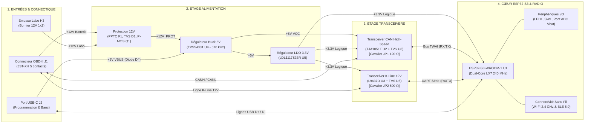
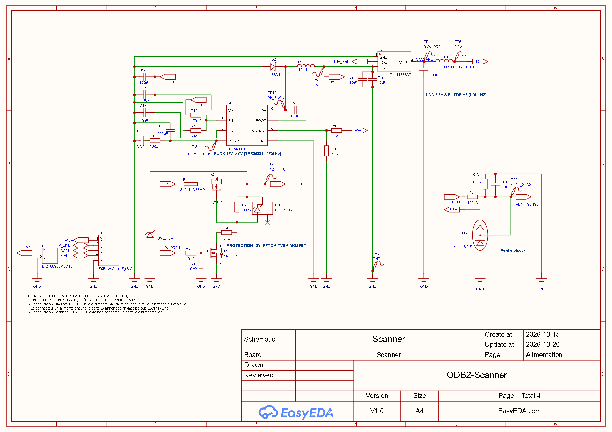
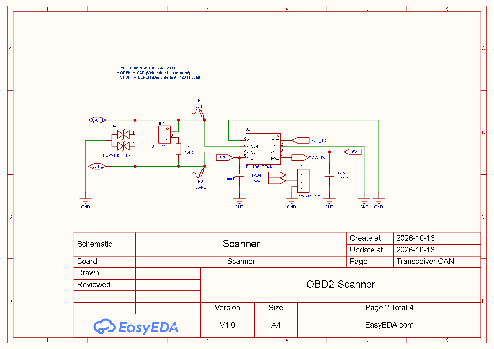
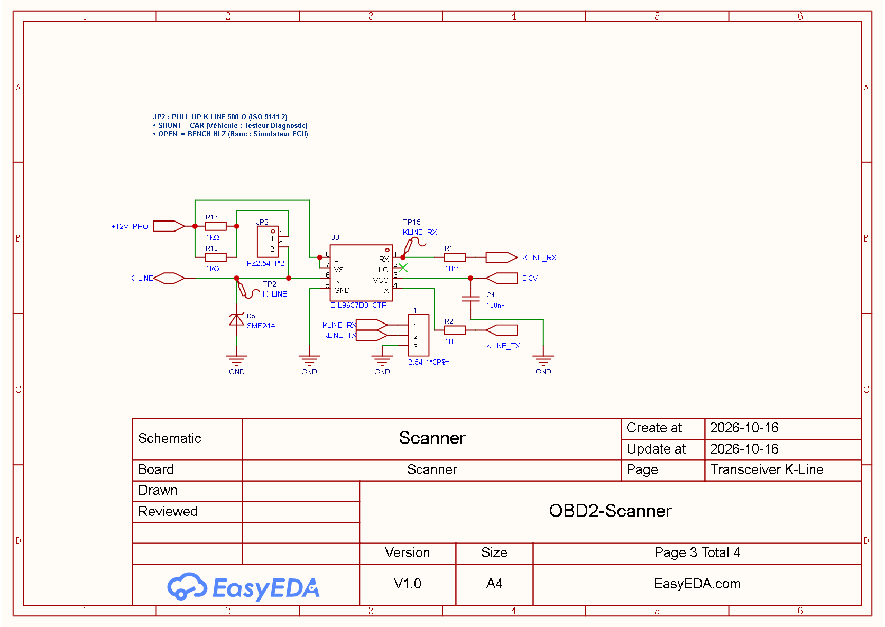
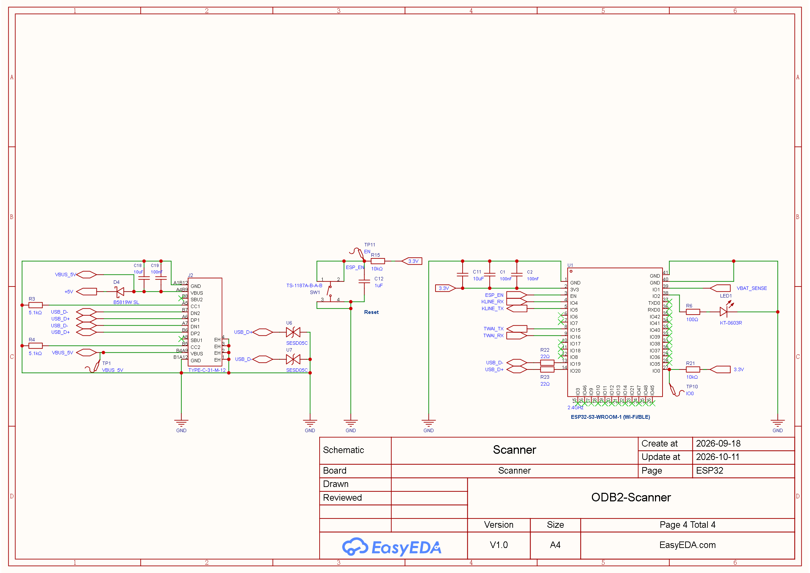
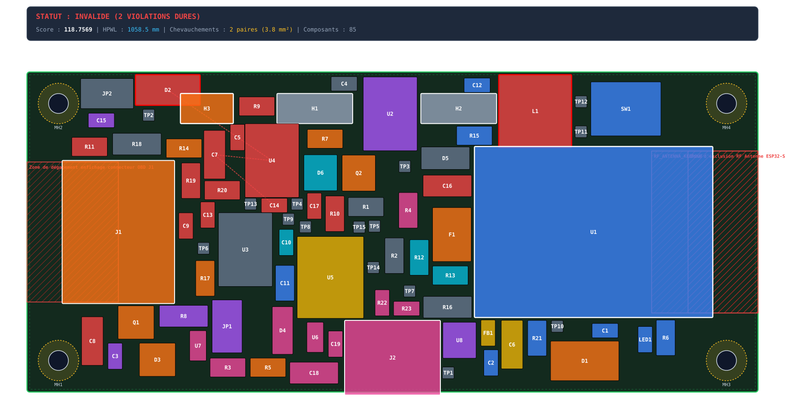
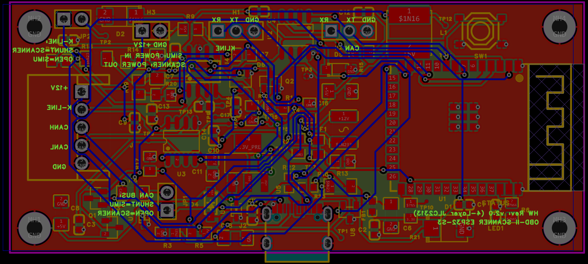
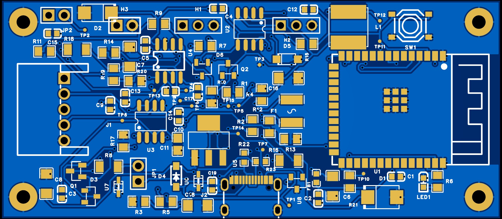
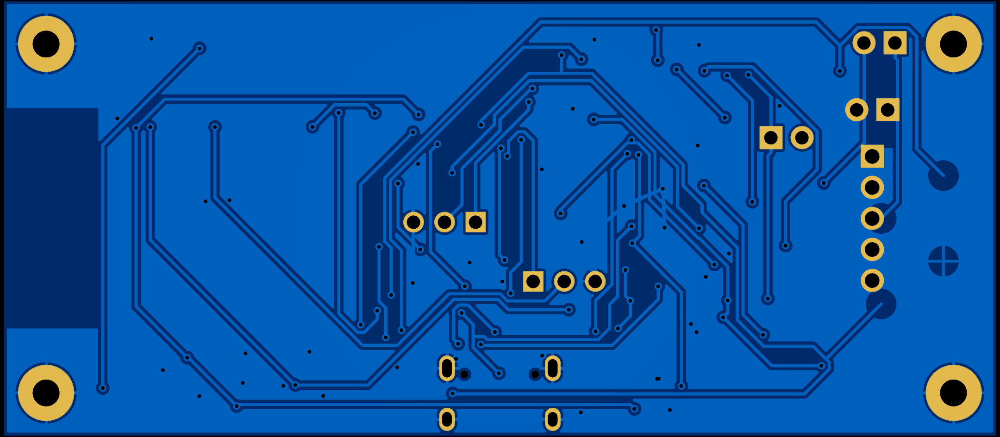

# Scanner OBD-II ESP32 — Conception Matérielle (Hardware)

Projet de conception matérielle (schéma électrique, dimensionnement des composants, routage PCB 4 couches et fabricabilité) d'un scanner de diagnostic automobile OBD-II universel, communicant et sécurisé basé sur le SoC ESP32-S3.

> [!NOTE]
> **Séparation des Dépôts Matériel vs Logiciel :**
> Ce dépôt `OBD2` est **dédié à la conception matérielle** (CAO EasyEDA Pro, dimensionnement physique, simulations thermiques/CEM, validation DRC/ERC et dossiers de fabrication JLCPCB). Le développement du firmware embarqué (ESP-IDF / FreeRTOS) fera l'objet d'un **dépôt logiciel dédié séparé**.
> Le document de cadrage technique et de liaison entre les deux projets est consultable dans [`documents/software.md`](documents/software.md) (*Software Handover & Specifications*).

---

## 1. Objectifs & Périmètre du Projet

> [!IMPORTANT]
> **Périmètre d'application exclusif : Voitures particulières (Réseau 12V)**
> L'ensemble du matériel est conçu et dimensionné exclusivement pour les véhicules légers équipés d'un **réseau de bord 12V** (batterie 12V nominale, prise standard SAE J1962 Type A). Il **ne doit en aucun cas** être raccordé à des réseaux **24V** (poids lourds, engins de chantier, bus ou prises Type B), ni soumis à des boosters 24V.

> [!NOTE]
> **Conformité & Périmètre Normatif ISO 16750-2 / Load-Dump :**
> La tenue aux surtensions du circuit repose sur la présence d'un alternateur automobile moderne doté d'un écrêtage centralisé standard (*Centralized Load Dump Clamp* conforme ISO 16750-2 Test B, VL <= 35V). La diode TVS `D1` (SMBJ16A, Vcl = 26.0V max) et le régulateur Buck `U4` (TPS54331, Vin max 30.0V) procurent une marge de sécurité robuste de 4.0V. Les agressions hors spécification (démarrage forcé sur booster 24V et impulsion d'énergie brute non centralisée de 200J ISO 7637-2 / ISO 16750-2 Test A sans écrêtage alternateur) sont formellement exclues du périmètre contractuel.

Le projet est conçu pour opérer et se qualifier selon **trois cas d'usage et de test opérationnels** :
1. **Cas 1 : Nominal Véhicule (Usage Conducteur / Atelier) :** Diagnostic autonome enfiché sur la prise OBD-II SAE J1962 (12V) du véhicule via connecteur verrouillable JST-XH 5 broches `J1`, communication 100% sans fil (BLE 5.0 / Wi-Fi), alimentation directe par la batterie du véhicule avec coupure de sécurité UVLO à 8.01 V, cavalier CAN `JP1` ouvert et cavalier K-Line `JP2` impérativement fermé (avec shunt) conformément au rôle de testeur ISO 9141-2.
2. **Cas 2 : Nominal + Debug In Situ (Roulage d'Essai & Traces Brutes) :** Raccordé au véhicule via `J1` avec câble USB-C vers PC portable de diagnostic sur batterie interne pour capture des traces en roulage, arbitrage d'alimentation prioritaire 12V via diode anti-retour `D4`, règle d'isolation de masse stricte (anti-boucle de terre), cavalier CAN `JP1` ouvert et cavalier K-Line `JP2` fermé (avec shunt).
3. **Cas 3 : Banc d'Essais Bi-Cartes Miroir (Qualification Labo & Simulation ECU) :** Deux cartes face à face interconnectées via leurs connecteurs JST-XH 5 contacts `J1` (Carte Scanner face à Carte Simulateur d'ECU), l'alimentation de laboratoire 12V DC étant connectée sur l'embase dédiée `H3` du banc simulateur, avec double liaison USB-C, terminaison CAN `JP1` fermée à 120 Ω sur les deux cartes (60 Ω équivalents) et pull-up K-Line 500 Ω activée sur le scanner via `JP2` (cavalier `JP2` ouvert sur le simulateur).

---

### 1.1 Capacités Matérielles en Mode Scanner OBD-II (Client)

Module autonome compact venant s'enficher directement sur la prise diagnostic du véhicule :

* **Diagnostic moteur multi-protocoles :**
  * **Bus CAN (ISO 11898-2 / ISO 15765-4) :** Couche physique différentielle haute vitesse (jusqu'à 1 Mbps), via transceiver certifié `U2` (TJA1051T) avec adaptation logique `VIO` 3.3V, contrôleur matériel TWAI de l'ESP32-S3 et protection ESD dédiée `U8` (NUP2105L).
  * **Ligne K-Line (ISO 9141-2 / ISO 14230 KWP2000) :** Liaison mono-fil bidirectionnelle 12V calibrée, via transceiver `U3` (L9637D), pull-up normalisée 500 Ω (`R16` // `R18` 1206) commutable par cavalier `JP2`, et protection TVS unidirectionnelle `D5` (SMF24A).
* **Cœur de traitement & Connectivité sans fil :** SoC **ESP32-S3-WROOM-1** (Xtensa LX7 Dual-Core 240 MHz, 16 Mo Flash, 2 Mo PSRAM, –40 °C à +85 °C) assurant les liaisons Bluetooth Low Energy (BLE 5.0) et Wi-Fi 2.4 GHz avec antenne méandre PCB intégrée.
* **Architecture d'alimentation hybride sécurisée :**
  * Étage primaire robuste face aux transitoires automobiles : fusible réarmable PPTC `F1` (1.1A / 33V), diode TVS `D1` (SMBJ16A, serrage 26.0V max), protection anti-inversion active sans chute de tension par P-MOSFET `Q1` (60V) et N-MOSFET `Q2`.
  * Double étage de régulation : convertisseur Buck haute fréquence 570 kHz (`U4` TPS54331) 12V → 5V (rendement > 85%, coupure UVLO franche à 8.01 V), suivi d'un LDO ultra-faible bruit 3.3V (`U5` LDL1117S33R) filtré par perle de ferrite `FB1`.
  * Alimentation autonome sur port USB-C protégée contre les retours véhicule par diode Schottky de puissance 1A `D4`.
* **Spécifications logicielles associées :** Voir [`documents/software.md §4 & §5`](documents/software.md) pour les machines d'état protocolaires, l'initialisation 5-baud / Fast-Init et les services OBD-II (Modes 01 à 09).

#### Profils & Cas d'Utilisation Cibles du Scanner

Pour le détail exhaustif des schémas de câblage, des règles de sécurité électrique et des diagrammes d'interconnexion, consulter le **[Guide d'Architecture des Cas d'Usage (documents/hardware.md §8)](documents/hardware.md#8-architecture-des-cas-dusage-cibles--câblage-opérationnel)** :

| Cas d'Usage Cible | Connecteur 5P (`J1`) & Embase Labo (`H3`) | Port USB-C (`J2`) | Cavalier CAN (`JP1` 120 Ω) | Cavalier K-Line (`JP2` 500 Ω) | Canaux de Communication | Source d'Alimentation |
| :--- | :---: | :---: | :---: | :---: | :--- | :--- |
| **Cas 1 : Nominal Véhicule** | Faisceau pigtail JST-XH vers prise SAE J1962 (`H3` libre) | **DÉCONNECTÉ** | **OUVERT** *(Sans shunt)* | **FERMÉ** *(Shunt 500 Ω Tester)* | BLE 5.0 (App smartphone) / Wi-Fi | 100% Batterie véhicule 12V |
| **Cas 2 : Nominal + Debug In Situ** | Faisceau pigtail JST-XH vers prise SAE J1962 (`H3` libre) | Relié au **PC sur batterie** | **OUVERT** *(Sans shunt)* | **FERMÉ** *(Shunt 500 Ω Tester)* | USB Série (Logs PC) + BLE 5.0 (App) | 12V véhicule prioritaire (anti-retour `D4`) |
| **Cas 3 : Banc d'Essais Bi-Cartes Miroir** | Faisceau `J1` inter-cartes + Alim Labo 12V sur `H3` | Relié au PC dev | **FERMÉ** *(Shunt 120 Ω)* | **FERMÉ** *(Scanner)* / **OUVERT** *(ECU)* | USB Série natif / JTAG + Headers `H1`/`H2` | Alim Labo 12V sur `H3` (relais USB-C via `D4`) |

> [!CAUTION]
> **Règle vitale d'isolation de masse (Cas 2) :** Lors d'une session de débogage in situ sur véhicule, le PC portable relié au port USB-C `J2` doit fonctionner **exclusivement sur sa batterie interne**. Le branchement sur secteur 230V avec terre est strictement interdit (danger de destruction immédiate par boucle de terre entre la prise murale et la carrosserie du véhicule).

---

### 1.2 Capacités Matérielles en Mode Simulateur d'ECU (Serveur Banc d'Essais)

> [!IMPORTANT]
> **Une seule et même carte matérielle universelle :**
> Le projet ne nécessite aucune conception matérielle séparée. La même carte électronique, produite à l'identique, incarne soit le rôle de **Scanner de diagnostic (Client)**, soit le rôle de **Simulateur d'ECU automobile (Serveur)** selon la configuration de ses cavaliers matériels (`JP1`, `JP2`) et le firmware téléversé dans son microcontrôleur ESP32-S3.

Dans le **Cas 3 (Banc d'Essais Bi-Cartes Miroir)**, une seconde carte configurée en simulateur reproduit fidèlement le comportement d'un calculateur moteur (ECU) et de son réseau de bord :

* **Configuration Matérielle Dédiée au Rôle Simulateur d'ECU :**
  * **Cavalier CAN `JP1` (Terminaison 120 Ω) : FERMÉ (avec shunt)** — Fournit la terminaison de ligne indispensable à l'extrémité du bus CAN simulé (la carte Scanner fournissant les autres 120 Ω, formant les 60 Ω équivalents de la norme ISO 11898-2).
  * **Cavalier K-Line `JP2` (Pull-Up 500 Ω) : OUVERT (sans shunt)** — Laisse la ligne en haute impédance passive (Rin >= 100 kΩ), rôle normalisé de l'ECU du véhicule (le scanner fournissant la polarisation active 500 Ω).
  * **Connecteur JST-XH 5 contacts `J1` & Embase Labo `H3` :** `J1` raccordé en direct au connecteur `J1` de la carte Scanner (lignes CANH, CANL, K_LINE, +12V, GND), le rail +12V pouvant être alimenté directement par l'alimentation de laboratoire via l'embase dédiée 1x2 broches `H3`.
  * **Port USB-C `J2` :** Relié au PC de développement pour le pilotage interactif (CLI / logs) et l'injection dynamique de scénarios de panne.
  * **Embases de Diagnostic (`H1` et `H2`) :** Permettent le branchement d'un analyseur logique USB pour espionner simultanément les trames CAN et UART au niveau logique 3.3V.
* **Spécifications logicielles associées :** Voir [`documents/software.md §6`](documents/software.md#6-simulateur-decu-embarqué-banc-dessais-sur-table) pour l'émulation des trames cycliques, le répondeur ISO-TP et les commandes CLI d'injection de pannes (`set rpm`, `fault inject P0300`).

---

### 1.3 Référentiel Normatif & Évaluation de la Conformité (Design Compliance)

Le matériel et le firmware sont développés en référence stricte aux standards internationaux de l'ingénierie automobile. Chaque domaine technique fait l'objet d'une analyse rigoureuse de **conformité par conception** (*Design Compliance*) :

---

#### 🔌 1. Connectique de Diagnostic & Banc — SAE J1962 / ISO 15031-3
* **Statut de conformité :** 🟢 **100% Conforme**
* **Périmètre :** Raccordement physique à la prise diagnostic du véhicule et interconnexion banc d'essais.
* **Justification matérielle & Choix de conception :**
  * Connecteur PCB JST-XH 5 contacts coudé à 90° au pas 2.50 mm (`S5B-XH-A-1(LF)(SN)`, LCSC `C163038`) pour raccordement direct au faisceau pigtail OBD-II ou banc miroir.
  * Brochage unifié de `J1` : broche 1 (`+12V`), 2 (`GND`), 3 (`CANH`), 4 (`CANL`), 5 (`K_LINE`).
  * Embase mâle 1x2 broches au pas 2.54 mm `H3` (LCSC `C124375`) dédiée à l'injection 12V laboratoire en mode simulateur ECU.
* **Conditions & Limites d'usage :** Raccordement sécurisé par connecteur verrouillable ou embase de banc.

---

#### 🚗 2. Couche Physique Bus CAN — ISO 11898-2
* **Statut de conformité :** 🟢 **100% Conforme**
* **Périmètre :** Bus de communication différentiel haute vitesse (CAN High-Speed jusqu'à 1 Mbps).
* **Justification matérielle & Choix de conception :**
  * Transceiver certifié NXP **TJA1051T/3/1J** avec broche logique dédiée `VIO` raccordée au 3.3V (parfaite intégrité logique avec l'ESP32-S3 sans adaptateur de niveau).
  * Routage en paires différentielles symétriques avec impédance contrôlée 120 Ω.
  * Terminaison 120 Ω (`R8`) commutable par cavalier matériel `JP1`.
* **Conditions & Limites d'usage :** Cavalier `JP1` impérativement **ouvert** lors d'un raccordement sur véhicule (le bus automobile étant déjà terminé par ses deux résistances de 120 Ω aux extrémités).

---

#### ⚡ 3. Ligne de Diagnostic K-Line — ISO 9141-2 & ISO 14230 (KWP2000)
* **Statut de conformité :** 🟢 **100% Conforme**
* **Périmètre :** Ligne de diagnostic mono-fil bidirectionnelle 12V (véhicules essence post-2001 et diesel post-2004).
* **Justification matérielle & Choix de conception :**
  * Transceiver spécialisé STMicroelectronics **L9637D** certifié conforme ISO 9141.
  * Polarisation pull-up commutable à 500 Ω (`R16` en parallèle avec `R18`, boîtiers 1206 pour dissiper la puissance thermique sous 12V) garantissant un temps de montée tr < 2 µs sur charge capacitive de 2 nF.
  * Pleine compatibilité avec l'initialisation lente (*5-baud init*) et l'initialisation rapide (*Fast-Init* 25 ms).
* **Conditions & Limites d'usage :** Débit limité à 10.4 kbps conformément à la spécification ISO.

---

#### 🧠 4. Protocoles de Diagnostic & Transport — ISO 15765-4 & SAE J1979
* **Statut de conformité :** 🔵 **Prêt 100% (Matériel dimensionné / Validation Firmware)**
* **Périmètre :** Couche transport CAN (ISO-TP) et requêtes normalisées OBD-II (PIDs standardisés).
* **Justification matérielle & Choix de conception :**
  * Contrôleur TWAI matériel natif de l'ESP32-S3 prenant en charge les trames d'identifiants standard 11-bit et étendus 29-bit.
  * Étage matériel dimensionné pour les débits normalisés 500 kbps et 250 kbps (requêtes OBD-II Modes 01 à 0A).
* **Conditions & Limites d'usage :** La validation finale relève du firmware applicatif consigné dans le dépôt dédié (spécifié dans [`documents/software.md`](documents/software.md)).

---

#### 🛡️ 5. Protection contre les Transitoires Conduits 12V — ISO 7637-2
* **Statut de conformité :** 🟢 **95% Conforme (Niveau III / Classe A)**
* **Périmètre :** Surtensions et impulsions parasites conduites sur le faisceau électrique 12V de l'automobile.
* **Justification matérielle & Choix de conception :**
  * **Impulsion 1 (–100 V inductif) :** Écrêtée en conduction directe sous environ –1 V par la diode TVS `D1` (`SMBJ16A`) et bloquée en tension inverse par le P-MOSFET `Q1` (tenue Vds 60V, tension Vgs bornée à 12V par la diode Zener `D3` et le diviseur `R5`/`R17`).
  * **Impulsion 2a (+50 V) :** Écrêtée sous 26.0 V par la TVS d'entrée `D1` (`SMBJ16A`).
  * **Impulsions 3a/3b (–150 V / +100 V HF) :** Filtrées par le réseau d'entrée associant la TVS `D1` et les capacités céramiques haute tension `C14` et `C7`.
* **Conditions & Limites d'usage :** Étage dimensionné pour les impédances de source normalisées des réseaux de bord automobiles standard.

---

#### 🚙 6. Contraintes Électriques Véhicules Légers — ISO 16750-2
* **Statut de conformité :** 🟡 **90% Conforme (Ciblé Réseau 12V Véhicules Légers)**
* **Périmètre :** Variations de tension batterie, chutes au démarrage et délestage de charge (*Load-Dump*).
* **Justification matérielle & Choix de conception :**
  * **Inversion de polarité (§4.7, –14 V) :** Bloquée à 100% par le transistor P-MOSFET `Q1` (aucun courant de fuite destructif).
  * **Démarrage moteur / Cranking (§4.6.3) :** Coupure propre sous 8.01 V via le seuil UVLO précis (`R19`/`R20`) et démarrage temporisé à 4.0 ms (`C17`) pour prévenir toute corruption de la mémoire Flash NVS de l'ESP32-S3 lors des micro-coupures.
  * **Load-Dump centralisé (§4.6.4, 35 V) :** Tension écrêtée à 26.0 V par `D1`, restant strictement sous la limite absolue de 30.0 V du régulateur Buck TPS54331.
* **Conditions & Limites d'usage :** Interdiction formelle d'utilisation sur réseaux 24V (poids lourds) ou surtensions prolongées de démarrage d'urgence (*Jump-Start* 24V > quelques secondes).

---

#### ⚡ 7. Immunité aux Décharges Électrostatiques (ESD) — ISO 10605 / IEC 61000-4-2
* **Statut de conformité :** 🟢 **100% Conforme (Niveau 4 : ±8 kV contact / ±15 kV air)**
* **Périmètre :** Protection contre les arcs électrostatiques sur les connecteurs accessibles par l'utilisateur.
* **Justification matérielle & Choix de conception :**
  * **Lignes CAN :** Diode double TVS spécifique automobile `U8` (NUP2105L), certifiée IEC 61000-4-2 Niveau 4 (tenue jusqu'à ±30 kV au contact et dans l'air).
  * **Ligne K-Line :** Diode TVS unidirectionnelle `D5` (`SMF24A`, 24V, 200 W crête) avec retour de conduction sous –1.0 V face aux impulsions négatives.
  * **Port USB-C :** Réseau de diodes ESD ultra-rapides `U6` et `U7` (SESD05C, capacité parasite Cj < 1.0 pF préservant l'intégrité du bus USB High-Speed).
* **Conditions & Limites d'usage :** Raccordement optimal au plan de masse continu multicouche par vias de couture.

---

#### 📡 8. Connectivité Sans Fil Radiofréquence — IEEE 802.11 b/g/n & BLE 5.0
* **Statut de conformité :** 🟢 **100% Conforme (Module Pré-certifié)**
* **Périmètre :** Émission et réception sans fil Wi-Fi 2.4 GHz et Bluetooth Low Energy 5.0.
* **Justification matérielle & Choix de conception :**
  * Module ESP32-S3-WROOM-1 pré-certifié par le fabricant Espressif Systems (FCC, CE, SRRC).
  * Antenne méandre sur PCB accordée à 50 Ω.
* **Conditions & Limites d'usage :** Respect strict de la zone d'exclusion RF (*Keepout*) sur toutes les couches de cuivre du PCB (antenne dégagée en porte-à-faux sur le bord Est de la carte).

---

## 2. Architecture Fonctionnelle Globale

#### Légende Fonctionnelle des Flux :
* **1. Entrées & Raccordements :** Connecteur `J1` (faisceau véhicule ou banc miroir), embase `H3` (alimentation laboratoire 12V), port USB-C `J2` (alimentation autonome banc 5V via diode `D4` et flash série).
* **2. Étage d'Alimentation :** Filtrage et protection amont (`F1`, `D1`, `Q1`), régulateur à découpage Buck 5V (`U4` TPS54331 à 570 kHz), et régulateur LDO 3.3V à faible bruit (`U5` LDL1117S33R).
* **3. Transceivers Automobiles :** Contrôleur de ligne CAN High-Speed (`U2` TJA1051T, TVS `U8`, cavalier `JP1` 120 Ω) et étage K-Line mono-fil 12V (`U3` L9637D, TVS `D5`, cavalier `JP2` 500 Ω).
* **4. Cœur de Traitement :** ESP32-S3-WROOM-1 (`U1` Xtensa LX7 dual-core 240 MHz), interfaces physiques (`LED1`, `SW1`, diviseur de tension ADC `TP7`) et émetteur-récepteur Wi-Fi 2.4 GHz / BLE 5.0.

---

## 3. Visuels du Projet

### Schéma Électronique Modulaire (4 Blocs Fonctionnels)

#### 1. Étage d'Alimentation & Protections 12V

#### 2. Transceiver CAN (TJA1051T & Terminaison 120Ω)

#### 3. Transceiver K-Line (L9637D)

#### 4. Microcontrôleur ESP32-S3 & Périphériques

### Circuit Imprimé (PCB)

L'agencement des composants est résolu par le moteur d'auto-placement sous contraintes géométriques et CEM ([`pcb-placer`](.agents/skills/pcb-placer/)), s'appuyant sur un algorithme de recuit simulé multi-objectifs (*Simulated Annealing*).

| Métrique / Critère | Placement Initial (Baseline) | Placement Optimisé (Recuit Simulé) | Gain / Amélioration |
| :--- | :---: | :---: | :---: |
| **Statut de validité** | ❌ 85 violations dures | ✅ **VALIDE (0 violation dure)** | **100% conforme** |
| **Chevauchements physiques** | 76 paires (118.2 mm²) | **0 paire (0.0 mm²)** | **-100% de collisions** |
| **Pénalité proximité CEM** | Violations actives | **0.0000** (`C14` < 3 mm, découplages < 2 mm) | **Règles CEM & intégrité respectées** |
| **Compacité boucle Buck** | Non contrainte | **0.7449** (boucle SW-L1-D2 compacte) | **Boucle de commutation minimale** |
| **Zone RF Antenne ESP32** | Keepout statique désaligné | **Zone d'exclusion dérivée dynamiquement (Est)** | **Antenne 2.4 GHz 100% dégagée** |
| **Chevelu total (HPWL)** | 580.7 mm (non routable) | **679.4 mm** (corridors de routage libérés) | **Chevelu aéré et routable** |
| **Composants implantés** | 84 composants | **85 composants** (70 physiques + 15 mires TP) | **100% de la BOM couverte** |

#### 1. Placement des composants optimisé (Phase 2)
> **Statut :** ✅ Valide — 0 chevauchement (0.0 mm²), 0 violation dure, Score : 8.2732.

#### 2. Rendu final & Implantation PCB (EasyEDA Pro)
* **Vue d'implantation & pistes routées (EasyEDA Pro) :**

* **Rendus 2D photoréalistes :**
  * **Face supérieure (Top) :**
  
  * **Face inférieure (Bottom) :**
  

### Modélisation 3D

GitHub intègre nativement un visualiseur 3D WebGL : en cliquant sur les fichiers `.stl` ci-dessous, le modèle 3D interactif s'affiche directement dans votre navigateur avec manipulation à la souris (rotation, zoom, vue filaire/ombrée).

#### 1. Circuit Imprimé Assemblé (PCB)
* 🧊 **[Modèle 3D Interactif du PCB (`scanner.stl`)](./documents/pcb/scanner.stl)** *(visualisation 3D directe sous GitHub, 14.2 MB)*

#### 2. Boîtier Mécanique (Enclosure)
Boîtier bi-coquilles paramétrique à 4 bossages M2 avec berceau de câble et bride de décharge de traction :

* **Visualisation 3D Interactive (STL WebGL GitHub) :**
  * 🧊 **[Assemblage Boîtier Complet Fermé (`enclosure_assembly.stl`)](./documents/enclosure/enclosure_assembly.stl)** *(boîtier fermé intégrant la carte PCB et la bride)*
  * 🧊 **[Vue Éclatée de l'Ensemble (`enclosure_exploded.stl`)](./documents/enclosure/enclosure_exploded.stl)** *(couvercle et bride surélevés pour visualisation interne)*

* **Modèles CAO STEP Solides (Norme ISO 10303 AP214 avec noms de pièces et couleurs pour Autodesk Viewer) :**
  * 📐 **[Assemblage Fermé Complet (`enclosure_full_assembly.step`)](./documents/enclosure/enclosure_full_assembly.step)** *(solide d'assemblage complet multi-pièces)*
  * 📐 **[Assemblage en Vue Éclatée (`enclosure_exploded.step`)](./documents/enclosure/enclosure_exploded.step)** *(vue éclatée avec arborescence des composants nommés)*
  * 📦 **Fichiers unitaires d'usinage/impression 3D :**
    * [Coquille Inférieure (`enclosure_bottom.step`)](./documents/enclosure/enclosure_bottom.step)
    * [Coquille Supérieure (`enclosure_top.step`)](./documents/enclosure/enclosure_top.step)
    * [Bride Serre-câble OBD-II (`enclosure_clamp.step`)](./documents/enclosure/enclosure_clamp.step)

---

## 4. État d'Avancement & Prochaine Étape Immédiate

* **Phase 1 : Schématique & Nomenclature (Validée) :** Schéma complet modulaire en 4 pages fonctionnelles (Alimentation, Transceiver CAN, Transceiver K-Line, ESP32-S3), 85 composants validés (70 physiques + 15 mires TP), nomenclature 100% optimisée en Basic Parts JLCPCB ([`documents/schema/bom.json`](documents/schema/bom.json)), cavaliers de configuration bi-mode intégrés (`JP1` 120 Ω CAN, `JP2` 500 Ω K-Line), embase d'alimentation labo (`H3`), connecteurs de diagnostic USB (`H1`, `H2`), et contrôle strict **ERC = 0** sous EasyEDA Pro.
* **Phase 2 : Placement PCB & Sérigraphie (Validée) :** Moteur d'auto-placement par recuit simulé validé avec **0 chevauchement physique (0.0 mm²)**, courtyards et dégagements pastilles IPC-7351 respectés, sérigraphie optimisée par *Line-of-Sight* sans texte inversé ([`documents/pcb/placement.svg`](documents/pcb/placement.svg)).
* **Phase 3 : Auto-Routage & Plans de Masse (Validée) :** 100% des pistes actives routées (219/219 connexions), paires différentielles USB et CAN respectées, plans de masse continus multicouches, couture de masse (stitching) et certification **DRC EasyEDA Pro = 0 erreur, 0 avertissement**.
* **Phase 4 : Sérigraphie Fonctionnelle & Boîtier 3D (Validée) :** Sérigraphie fonctionnelle face arrière annotée (`documents/pcb/silkscreen.json`), skill CAO paramétrique `pcb-enclosure` implémenté avec modèles solides STEP et STL haute résolution générés pour JLCPCB 3D Printing.
* **Prochaine étape immédiate :** Dossier de fabrication SMT JLCPCB (Gerber, BOM SMT, CPL Pick & Place) et commande des prototypes.

---

## 5. Guide de Navigation du Dépôt

L'ensemble de la documentation technique et opérationnelle est structuré dans les documents dédiés suivants :

| Document | Description |
| :--- | :--- |
| 📖 **[readme.md](readme.md)** | **Présentation générale du projet matériel** : architecture, cas d'usage, référentiel normatif, visuels schémas et PCB, guide de navigation. |
| 📋 **[todo.md](todo.md)** | **Feuille de route active & checklist complète** : suivi détaillé des étapes de conception (mécanique, schéma, floorplanning, routage, plans de masse, contrôles, firmware et fabrication). |
| 📦 **[bom.json](documents/schema/bom.json)** | **Nomenclature PCBA structurée des 85 composants** : références fabricants (MPN), codes LCSC, boîtiers d'empreinte et sélection des pièces de base JLCPCB (*Basic Parts*). |
| 🧠 **[semantics.json](documents/schema/semantics.json)** | **Intention sémantique et électrique de schéma** : rôles précis, contraintes électriques (tensions minimales, tolérances, dissipation), blocs fonctionnels et politique de substitution. |
| 📑 **[datasheets.md](documents/datasheets/datasheets.md)** | **Référentiel constructeur & Audit de conformité des ICs** : synthèse des 6 datasheets officielles ([`documents/datasheets/references/`](documents/datasheets/references/)), caractéristiques électriques, limites absolues, règles d'implantation PCB et matrice de conformité. |
| 📐 **[constraints.json](documents/pcb/constraints.json)** | **Contraintes mécaniques de carte et de routage** : dimensions 100% mm, ancres mécaniques (`J1`, `J2`, `U1`), 4 trous M2 de fixation, keepouts et classes de routage FreeRouting. |
| 🧩 **[manifest.json](documents/pcb/manifest.json)** | **Manifeste physique et géométrique PCB** : boîtiers normalisés IPC-7351, règles de découplage, micro-clusters et contraintes CEM de placement. |
| 🔬 **[hardware.md](documents/hardware.md)** | **Architecture matérielle & anatomie détaillée** : guide pédagogique des 11 blocs, calculs théoriques (Buck, LDO, pont diviseur, Zener), table complète des nets, répertoire des points de test (`TP1` à `TP15`) et règles de layout. |
| 💻 **[software.md](documents/software.md)** | **Cahier des charges & Handover Firmware** : guide d'amorçage pour le dépôt logiciel dédié, mappage GPIOs, protocoles (TWAI CAN, K-Line KWP2000 Daewoo), formule ADC batterie, veille basse consommation (~8–15 mA) et simulateur d'ECU. |
| 📜 **[agents.md](agents.md)** | **Règles directrices des agents IA** : modularité agnostique, sécurité du pont EasyEDA, méthode séquentielle, post-validation et typographie. |
| 💡 **[learnings.md](learnings.md)** | **Capitalisation technique** : journal d'apprentissage, spécificités d'API EasyEDA Pro, formats d'unités et pièges évités. |
| 📥 **[review/](review/guidelines.md)** | **Sas d'entrée pour revues techniques** : répertoire réceptacle des fichiers de revue (`reviewXXX.md`), encadré par [`guidelines.md`](review/guidelines.md). Les revues y sont dépouillées, arbitrées puis supprimées après intégration dans `todo.md`. |
| 📁 **`documents/easyeda/OBD2.epro2`** | **Fichier projet natif EasyEDA Pro v2** : contient le schéma schématique `P1` et la carte de circuit imprimé `PCB1`. |

---

## 6. Outils & Skills Spécialisés d'Automatisation

Le projet intègre et exploite 8 compétences logicielles dédiées (*Skills*) sous `.agents/skills/` pour assister l'agent IA et fiabiliser les étapes critiques de modélisation théorique, d'audit, de CAO, d'agencement physique et d'optimisation des coûts d'assemblage :

| Skill | Emplacement | Rôle & Fonctionnalités |
| :--- | :--- | :--- |
| ⚡ **`buck-compensation`** | [`.agents/skills/buck-compensation/`](.agents/skills/buck-compensation/SKILL.md) | **Modélisation petit-signal & Stabilité Buck :** Outil de calcul mathématique et d'optimisation paramétrique du réseau de compensation Type II pour le régulateur TI TPS54331 (évaluation Bode, fréquence de coupure fco, marge de phase ≥ 45°, marge de gain ≥ 10 dB, et sélection optimale du triplet Rz, Cz, Cp sur le catalogue Basic Parts JLCPCB). |
| 🔌 **`easyeda-api`** | [`.agents/skills/easyeda-api/`](.agents/skills/easyeda-api/SKILL.md) | **Contrôle programmatique EasyEDA Pro :** Pont bidirectionnel local (WebSocket/HTTP sur port 49620) permettant d'interroger, d'auditer et d'automatiser le schéma et le PCB en temps réel sans manipulation manuelle à risque, avec accès aux 120+ classes de l'API officielle. |
| 🛣️ **`freerouting`** | [`.agents/skills/freerouting/`](.agents/skills/freerouting/SKILL.md) | **Auto-routage Headless Specctra DSN/SES :** Moteur d'auto-routage complet pilotant FreeRouting v2.4.1 sous OpenJDK 25 headless portable. Injecte les règles de classes de nets et isole les paires différentielles CAN/USB et les keepouts RF. |
| 📐 **`pcb-placer`** | [`.agents/skills/pcb-placer/`](.agents/skills/pcb-placer/SKILL.md) | **Moteur Agnostique d'Auto-Placement par Contraintes :** Algorithme stochastique par recuit simulé multi-objectifs pour l'agencement 2D des composants PCB sous EasyEDA Pro. Intègre les contraintes CEM (découplage < 2 mm), thermiques (boucle Buck), d'exclusion RF (antenne ESP32-S3) et génère nativement [`documents/pcb/placement.svg`](documents/pcb/placement.svg). |
| 🪡 **`pcb-stitcher`** | [`.agents/skills/pcb-stitcher/`](.agents/skills/pcb-stitcher/SKILL.md) | **Auto-stitching & Pontage Multi-Couches A* :** Solveur agnostique d'échappement par vias CMS, d'interconnexion 3D d'îlots de cuivre par algorithme A* avec évitement d'obstacles, et de renforcement des plans de masse GND. |
| 🔢 **`ratio-solver`** | [`.agents/skills/ratio-solver/`](.agents/skills/ratio-solver/SKILL.md) | **Solveur Mathématique de Ponts Diviseurs :** Calcul et optimisation automatique des couples de résistances sur les séries normalisées E24/E96 pour régulateurs, diviseurs ADC et références de tension. |
| 🔍 **`review`** | [`.agents/skills/review/`](.agents/skills/review/SKILL.md) | **Audit Matériel, Validation & Triage :** Moteur méthodologique et outillé pour la conduite de revues techniques matérielles (Axe 1 à 6, règle d'or Tabula Rasa / oubli de mémoire). Outil CLI agnostique (`review_tool.py`) validant la structure des rapports face aux standards et automatisant le dépouillement vers `todo.md`. |
| 💰 **`stingy-schematics`** | [`.agents/skills/stingy-schematics/`](.agents/skills/stingy-schematics/SKILL.md) | **Optimiseur SMT & Gardien Sémantique de Schéma :** Moteur d'audit et de réduction des coûts de fabrication JLCPCB PCBA. Analyse la nomenclature et `documents/schema/semantics.json` pour basculer des pièces Extended vers des Basic Parts sans compromis de qualité ni de sécurité, avec synchroniseur `sync_semantics.py`. |

---

## 7. Démarrage Rapide

1. **Ouvrir le projet :** Lancer EasyEDA Pro (version bureau ou web) et ouvrir le fichier `documents/easyeda/OBD2.epro2`.
2. **Contrôle d'intégrité :**
   - Schéma : Menu `Design` → `Check ERC` (doit retourner 0 erreur, 0 avertissement).
   - PCB : Menu `Design` → `Check DRC` (doit retourner 0 erreur).
3. **Pilotage IA :** Le pont local `easyeda-api` (port 49620) est automatiquement géré en tâche de fond par Antigravity via son hook de cycle de vie ([`.agents/hooks.json`](.agents/hooks.json)). Il suffit d'avoir importé l'extension `run-api-gateway.eext` dans EasyEDA Pro (voir [easyeda-api](.agents/skills/easyeda-api/SKILL.md)).