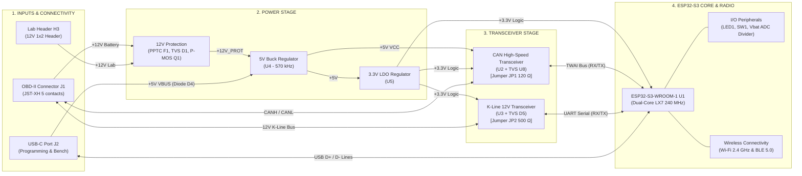
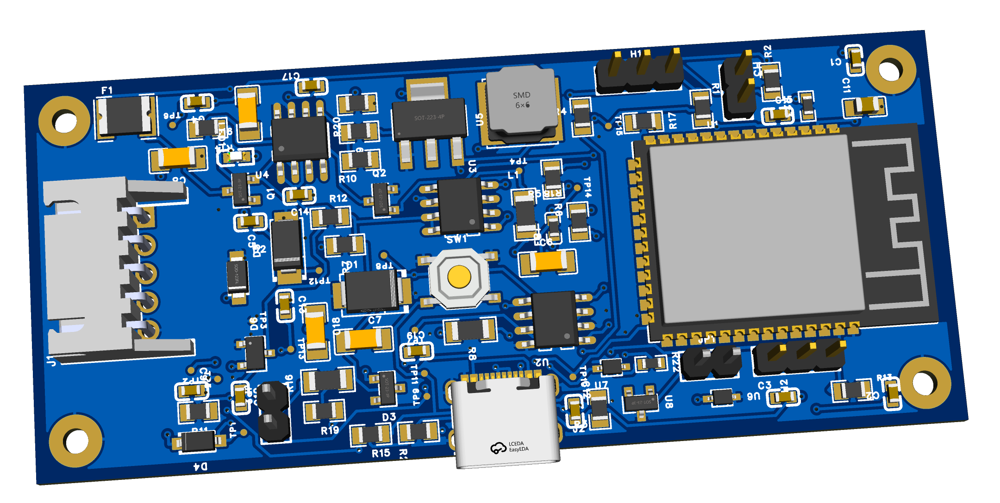

# ESP32 OBD-II Scanner — Hardware Design

Hardware engineering repository (schematic design, component dimensioning, 4-layer PCB layout, and design for manufacturing) for an automotive, connected, and secure universal OBD-II diagnostic scanner based on the ESP32-S3 SoC.

> [!NOTE]
> **Separation of Hardware vs Software Repositories:**
> This `OBD2` repository is **strictly dedicated to hardware engineering** (EasyEDA Pro CAD, physical dimensioning, thermal/EMC simulations, DRC/ERC validation, and JLCPCB fabrication deliverables). Embedded firmware development (ESP-IDF / FreeRTOS) is managed in a **separate dedicated software repository**.
> The technical interface and boundary document between both projects is available in [`documents/software.md`](documents/software.md) (*Software Handover & Specifications*).

---

## 1. Project Objectives & Scope

> [!IMPORTANT]
> **Exclusive Application Scope: Passenger Cars (12V Vehicle Board Net)**
> All hardware components are dimensioned and selected strictly for passenger cars and light commercial vehicles equipped with a **nominal 12V board net** (12V lead-acid battery, standard SAE J1962 Type A connector). Under **no circumstances** should this device be connected to **24V** commercial vehicles, heavy trucks, construction equipment, buses, or Type B sockets, nor should it be subjected to 24V jump starters.

> [!NOTE]
> **ISO 16750-2 Compliance & Load-Dump Boundary:**
> High-voltage transient immunity relies on the presence of a modern automotive alternator featuring standard centralized load dump suppression (*Centralized Load Dump Clamp* compliant with ISO 16750-2 Test B, VL <= 35V). TVS diode `D1` (16V, Vcl = 26.0V max) and Buck converter `U4` (Vin max 30.0V) provide a robust safety margin of 4.0V. Severe unsuppressed high-energy surges (24V booster jump-start or ISO 7637-2 / ISO 16750-2 Test A 200J unsuppressed load dump) are formally out of contractual design scope.

The hardware is designed, validated, and qualified across **three distinct operational use and test cases**:
1. **Case 1: Nominal In-Vehicle (Driver / Workshop Use):** Autonomous diagnostic dongle plugged into the vehicle SAE J1962 (12V) OBD-II port via right-angle 5-pin JST-XH connector `J1`, 100% wireless communication (BLE 5.0 / Wi-Fi), powered directly from the vehicle battery with sharp UVLO shutdown at 8.01 V, CAN jumper `JP1` open, and K-Line jumper `JP2` closed (shunted) in compliance with the ISO 9141-2 diagnostic tester role.
2. **Case 2: Nominal + In Situ Debug (Drive Cycles & Raw Trace Logging):** Connected to vehicle via `J1` with USB-C cable to a diagnostic laptop running on its internal battery for in-drive trace logging, 12V vehicle power priority via reverse-blocking diode `D4`, strict ground isolation rules (ground loop prevention), CAN jumper `JP1` open, and K-Line jumper `JP2` closed (shunted).
3. **Case 3: Dual-Board Mirror Testbench (Benchtop Qualification & ECU Simulation):** Two identical boards interconnected face-to-face via 5-pin JST-XH connectors `J1` (Scanner Board vs ECU Simulator Board), lab 12V DC power injected via dedicated 1x2 header `H3` on the simulator board, dual USB-C links, CAN termination `JP1` closed (120 Ω on both boards, yielding 60 Ω equivalent), and K-Line 500 Ω pull-up enabled on the scanner via `JP2` (`JP2` left open on the simulator).

---

### 1.1 Hardware Capabilities in OBD-II Scanner Mode (Client)

Compact autonomous dongle designed for direct connection to the vehicle diagnostic socket:

* **Multi-Protocol Engine Diagnostics:**
  * **CAN Bus (ISO 11898-2 / ISO 15765-4):** High-speed differential physical layer (up to 1 Mbps), driven by automotive transceiver `U2` with dedicated 3.3V `VIO` logic level adaptation, ESP32-S3 native hardware TWAI controller, and dedicated TVS diode `U8`.
  * **K-Line Interface (ISO 9141-2 / ISO 14230 KWP2000):** Calibrated 12V single-wire bidirectional bus, driven by transceiver `U3`, standardized 500 Ω pull-up (`R16` // `R18`) switchable via jumper `JP2`, and unidirectional TVS diode `D5`.
* **Processing Core & Wireless Connectivity:** **ESP32-S3-WROOM-1** SoC (Xtensa LX7 Dual-Core 240 MHz, 16 MB Flash, 2 MB PSRAM, –40 °C to +85 °C) handling Bluetooth Low Energy (BLE 5.0) and 2.4 GHz Wi-Fi with integrated PCB trace antenna.
* **Secured Hybrid Power Architecture:**
  * Robust primary stage for automotive transients: PPTC resettable fuse `F1` (1.1A / 33V), TVS diode `D1` (26.0V max clamping), and active low-loss reverse-polarity protection using P-MOSFET `Q1` and N-MOSFET `Q2`.
  * Dual regulation stages: 570 kHz Buck switching converter (`U4`) stepping down 12V to 5V (efficiency > 85%, clean UVLO cutoff at 8.01 V), followed by an ultra-low-noise 3.3V LDO (`U5`) filtered by ferrite bead `FB1`.
  * Autonomous benchtop power via USB-C protected against vehicle backfeeding by 1A Schottky power diode `D4`.
* **Associated Software Specifications:** Refer to [`documents/software.md §4 & §5`](documents/software.md) for protocol state machines, 5-baud / Fast-Init sequences, and OBD-II standard diagnostic services (Modes 01 to 09).

#### Target Scanner Profiles & Operating Cases

For full wiring schematics, electrical safety guidelines, and interconnection diagrams, refer to the **[Use Cases Architecture Guide (documents/hardware.md §8)](documents/hardware.md#8-target-use-case-architectures--operational-wiring)**:

| Target Use Case | 5P Connector (`J1`) & Lab Header (`H3`) | USB-C Port (`J2`) | CAN Jumper (`JP1` 120 Ω) | K-Line Jumper (`JP2` 500 Ω) | Communication Channels | Power Source |
| :--- | :---: | :---: | :---: | :---: | :--- | :--- |
| **Case 1: Nominal In-Vehicle** | JST-XH pigtail to SAE J1962 socket (`H3` unused) | **DISCONNECTED** | **OPEN** *(Unshunted)* | **CLOSED** *(500 Ω Tester Shunt)* | BLE 5.0 (Smartphone App) / Wi-Fi | 100% 12V Vehicle Battery |
| **Case 2: Nominal + In Situ Debug** | JST-XH pigtail to SAE J1962 socket (`H3` unused) | Connected to **laptop on battery** | **OPEN** *(Unshunted)* | **CLOSED** *(500 Ω Tester Shunt)* | USB Serial (PC logs) + BLE 5.0 (App) | 12V Vehicle priority (isolated by `D4`) |
| **Case 3: Dual-Board Mirror Testbench** | `J1` inter-board harness + Lab 12V on `H3` | Connected to Dev PC | **CLOSED** *(120 Ω Shunt)* | **CLOSED** *(Scanner)* / **OPEN** *(ECU)* | Native USB Serial / JTAG + Headers `H1`/`H2` | Lab 12V on `H3` (USB-C backup via `D4`) |

> [!CAUTION]
> **Vital Ground Isolation Rule (Case 2):** When performing in situ debugging on a live vehicle, the laptop connected to USB-C port `J2` must run **strictly on its internal battery**. Connection to mains 230V AC with protective earth is strictly prohibited (risk of hardware destruction due to ground loop currents circulating between mains earth and vehicle chassis).

---

### 1.2 Hardware Capabilities in ECU Simulator Mode (Testbench Server)

> [!IMPORTANT]
> **Single Universal Hardware Design:**
> This project requires no separate hardware design. The identical physical PCBA acts either as an **OBD-II Diagnostic Scanner (Client)** or as an **Automotive ECU Simulator (Server)** simply by selecting its hardware jumper positions (`JP1`, `JP2`) and flashing the appropriate firmware onto the ESP32-S3 microcontroller.

In **Case 3 (Dual-Board Mirror Testbench)**, a second board configured as an ECU simulator faithfully replicates an engine control module and its vehicle network:

* **Hardware Configuration for ECU Simulator Role:**
  * **CAN Jumper `JP1` (120 Ω Termination): CLOSED (shunted)** — Provides the necessary bus termination at the simulated ECU node (the Scanner board provides the other 120 Ω, forming the standard 60 Ω equivalent bus impedance per ISO 11898-2).
  * **K-Line Jumper `JP2` (500 Ω Pull-Up): OPEN (unshunted)** — Leaves the line in high-impedance passive listening mode (Rin >= 100 kΩ), matching the standardized automotive ECU role (the diagnostic scanner provides active 500 Ω pull-up).
  * **5-Pin JST-XH Connector `J1` & Lab Header `H3`:** `J1` connected pin-to-pin to `J1` on the Scanner board (CANH, CANL, K_LINE, +12V, GND), while the +12V rail can be directly energized from a benchtop DC supply via dedicated 1x2 header `H3`.
  * **USB-C Port `J2`:** Connected to the host PC for interactive CLI control and dynamic fault injection scenarios.
  * **Diagnostic Headers (`H1` and `H2`):** Allow direct connection of a USB logic analyzer to capture simultaneous CAN and UART traffic at 3.3V logic levels.
* **Associated Software Specifications:** Refer to [`documents/software.md §6`](documents/software.md#6-embedded-ecu-simulator-benchtop-testbench) for cyclic frame emulation, ISO-TP responder, and fault injection CLI commands (`set rpm`, `fault inject P0300`).

---

### 1.3 Standards Framework & Design Compliance Assessment

Hardware and firmware are engineered in strict accordance with international automotive engineering standards. Each technical discipline underwent a rigorous **Design Compliance Assessment**:

---

#### 🔌 1. Diagnostic & Testbench Connectors — SAE J1962 / ISO 15031-3
* **Compliance Status:** 🟢 **100% Compliant**
* **Scope:** Physical interface to vehicle diagnostic socket and testbench interconnection.
* **Hardware Justification & Design Choices:**
  * Right-angle 90° 5-pin 2.50 mm pitch JST-XH PCB header (`J1`) for direct mating with OBD-II pigtail harness or bench mirror cable.
  * Unified `J1` pinout: Pin 1 (`+12V`), 2 (`K_LINE`), 3 (`CANH`), 4 (`CANL`), 5 (`GND`).
  * 1x2 2.54 mm pitch male header `H3` dedicated to laboratory 12V DC power injection in ECU simulator mode.
* **Usage Limits & Boundaries:** Secure connection through keyed locking connector or testbench header.

---

#### 🚗 2. CAN Bus Physical Layer — ISO 11898-2
* **Compliance Status:** 🟢 **100% Compliant**
* **Scope:** High-speed differential communication bus (CAN High-Speed up to 1 Mbps).
* **Hardware Justification & Design Choices:**
  * Certified CAN transceiver `U2` featuring a dedicated `VIO` logic supply pin connected to 3.3V (ensuring clean logic-level matching with the ESP32-S3 without level shifters).
  * Symmetrical differential pair routing with controlled 120 Ω impedance.
  * 120 Ω bus termination resistor (`R8`) switchable via hardware jumper `JP1`.
* **Usage Limits & Boundaries:** Jumper `JP1` must be strictly **open** when connected to a vehicle (as the vehicle network already features its dual 120 Ω endpoint terminations).

---

#### ⚡ 3. K-Line Diagnostic Interface — ISO 9141-2 & ISO 14230 (KWP2000)
* **Compliance Status:** 🟢 **100% Compliant**
* **Scope:** Bidirectional 12V single-wire diagnostic bus (petrol post-2001 and diesel post-2004).
* **Hardware Justification & Design Choices:**
  * ISO 9141 diagnostic transceiver `U3`.
  * Switchable 500 Ω pull-up network (`R16` in parallel with `R18` to distribute power dissipation under 12V) ensuring rise time tr < 2 µs across a 2 nF capacitive bus load.
  * Fully compatible with both slow initialization (*5-baud init*) and fast initialization (*Fast-Init* 25 ms).
* **Usage Limits & Boundaries:** Baud rate capped at 10.4 kbps per ISO specification.

---

#### 🧠 4. Diagnostic & Transport Protocols — ISO 15765-4 & SAE J1979
* **Compliance Status:** 🔵 **100% Ready (Hardware dimensioned / Firmware validation pending)**
* **Scope:** CAN transport layer (ISO-TP) and standardized OBD-II query services (Standard PIDs).
* **Hardware Justification & Design Choices:**
  * ESP32-S3 native hardware TWAI controller supporting both 11-bit standard and 29-bit extended CAN identifier frames.
  * Hardware layer dimensioned for standardized bit rates of 500 kbps and 250 kbps (OBD-II Modes 01 to 0A).
* **Usage Limits & Boundaries:** Final validation rests on the application firmware hosted in the dedicated software repository (specified in [`documents/software.md`](documents/software.md)).

---

#### 🛡️ 5. Conducted 12V Transients Protection — ISO 7637-2
* **Compliance Status:** 🟢 **95% Compliant (Level III / Class A)**
* **Scope:** Voltage spikes and conducted transient pulses on the 12V automotive wiring harness.
* **Hardware Justification & Design Choices:**
  * **Pulse 1 (–100 V inductive):** Clamped in forward conduction below approx. –1 V by TVS diode `D1` and reverse-blocked by P-MOSFET `Q1` (Vgs gate voltage clamped to 12V by Zener `D3` and divider `R5`/`R17`).
  * **Pulse 2a (+50 V):** Clamped below 26.0 V by primary TVS `D1`.
  * **Pulses 3a/3b (–150 V / +100 V HF):** Filtered by the input network combining TVS `D1` and high-voltage ceramic capacitors `C14` and `C7`.
* **Usage Limits & Boundaries:** Front-end dimensioned for standard source impedances of typical automotive electrical systems.

---

#### 🚙 6. Light Vehicle Electrical Hazards — ISO 16750-2
* **Compliance Status:** 🟡 **90% Compliant (Targeted for 12V Passenger Vehicle Net)**
* **Scope:** Battery voltage variations, cranking voltage dips, and load dump transients.
* **Hardware Justification & Design Choices:**
  * **Reverse Polarity (§4.7, –14 V):** 100% blocked by P-MOSFET transistor `Q1` (zero destructive leakage current).
  * **Engine Cranking (§4.6.3):** Clean cutoff below 8.01 V via precision UVLO threshold divider (`R19`/`R20`) and 4.0 ms soft-start delay (`C17`) preventing ESP32-S3 NVS Flash corruption during brownouts.
  * **Centralized Load-Dump (§4.6.4, 35 V):** Voltage clamped to 26.0 V by `D1`, remaining strictly below the 30.0 V absolute maximum rating of Buck regulator `U4`.
* **Usage Limits & Boundaries:** Strictly prohibited on 24V commercial vehicle networks or prolonged jump-start high voltages (*Jump-Start* 24V > a few seconds).

---

#### ⚡ 7. Electrostatic Discharge (ESD) Immunity — ISO 10605 / IEC 61000-4-2
* **Compliance Status:** 🟢 **100% Compliant (Level 4: ±8 kV contact / ±15 kV air)**
* **Scope:** Protection against electrostatic discharge on user-accessible connectors.
* **Hardware Justification & Design Choices:**
  * **CAN Bus Lines:** Dual automotive-grade TVS diode array `U8`, certified to IEC 61000-4-2 Level 4 (rated up to ±30 kV contact and air discharge).
  * **K-Line Bus:** Unidirectional TVS diode `D5` (24V, 200 W peak pulse) with fast forward clamping below –1.0 V for negative transients.
  * **USB-C Port:** Ultra-fast ESD protection diode arrays `U6` and `U7` (parasitic capacitance Cj < 1.0 pF preserving USB High-Speed signal integrity).
* **Usage Limits & Boundaries:** Low-impedance stitching via connection to solid internal ground planes.

---

#### 📡 8. Radiofrequency Wireless Connectivity — IEEE 802.11 b/g/n & BLE 5.0
* **Compliance Status:** 🟢 **100% Compliant (Pre-Certified Module)**
* **Scope:** 2.4 GHz Wi-Fi and Bluetooth Low Energy 5.0 RF transmission and reception.
* **Hardware Justification & Design Choices:**
  * Pre-certified ESP32-S3-WROOM-1 module (FCC, CE, SRRC).
  * Integrated 50 Ω matched PCB meander antenna.
* **Usage Limits & Boundaries:** Strict compliance with copper keepout zones across all PCB layers (antenna overhangs clear off the eastern board edge).

---

## 2. Overall Functional Architecture

#### Functional Flow Legend:
* **1. Inputs & Interconnections:** Connector `J1` (vehicle harness or mirror testbench), header `H3` (lab 12V power supply), USB-C port `J2` (autonomous 5V bench power via diode `D4` and serial flashing).
* **2. Power Stage:** Upstream filtering and protection (`F1`, `D1`, `Q1`), 5V Buck switching converter (`U4` at 570 kHz), and low-noise 3.3V LDO regulator (`U5`).
* **3. Automotive Transceivers:** CAN High-Speed bus driver (`U2`, TVS `U8`, jumper `JP1` 120 Ω) and 12V single-wire K-Line stage (`U3`, TVS `D5`, jumper `JP2` 500 Ω).
* **4. Processing Core:** ESP32-S3-WROOM-1 (`U1` Xtensa LX7 dual-core 240 MHz), physical interfaces (`LED1`, `SW1`, ADC voltage divider `TP7`), and 2.4 GHz Wi-Fi / BLE 5.0 transceiver.

---

## 3. Project Visuals

### Modular Schematic (4 Functional Blocks)

#### 1. Power Supply & 12V Protections

#### 2. CAN Transceiver & 120Ω Termination

#### 3. K-Line Transceiver

#### 4. ESP32-S3 Microcontroller & Peripherals

### Printed Circuit Board (PCB)

Component placement is solved using the multi-objective simulated annealing engine ([`pcb-placer`](.agents/skills/pcb-placer/)), under strict geometric, EMC, and thermal constraints.

| Metric / Criterion | Baseline Placement | Optimized Placement (Simulated Annealing) | Gain / Improvement |
| :--- | :---: | :---: | :---: |
| **Validity Status** | ❌ 85 hard violations | ✅ **VALID (0 hard violations)** | **100% compliant** |
| **Physical Overlaps** | 76 pairs (118.2 mm²) | **0 pairs (0.0 mm²)** | **-100% collisions** |
| **EMC Proximity Penalty** | Active violations | **0.0000** (`C14` < 3 mm, decoupling < 2 mm) | **EMC & signal integrity rules satisfied** |
| **Buck Loop Compactness** | Unconstrained | **0.7449** (compact SW-L1-D2 loop) | **Minimized switching loop area** |
| **ESP32 Antenna RF Keepout** | Misaligned static keepout | **Dynamically derived Eastern keepout** | **2.4 GHz antenna 100% clear of copper** |
| **Total Wirelength (HPWL)** | 580.7 mm (unroutable) | **679.4 mm** (open routing channels) | **Spacious, routable netlist topology** |
| **Placed Components** | 84 components | **85 components** (70 physical + 15 TP testpoints) | **100% BOM coverage** |

#### 1. Optimized Component Placement (Phase 2)
> **Status:** ✅ Valid — 0 overlaps (0.0 mm²), 0 hard violations, Score: 8.2732.

#### 2. Final Layout & Board Views (EasyEDA Pro)
* **Routing & Component Placement View (EasyEDA Pro):**

* **Photorealistic 2D & 3D Renders:**
  * **Top Layer:**
  
  * **Bottom Layer:**
  
  * **Assembled 3D PCBA View:**
  

### 3D CAD Modeling

GitHub natively features a WebGL 3D viewer: clicking on the `.stl` files below opens an interactive 3D model directly in your browser with full mouse manipulation (rotate, zoom, wireframe/shaded views).

#### 1. Assembled Printed Circuit Board (PCB)
* 🧊 **[Interactive 3D PCB Model (`scanner.stl`)](./documents/pcb/scanner.stl)** *(direct WebGL 3D viewing on GitHub, 14.2 MB, generated and optimized via [`scripts/convert_step_to_stl.py`](scripts/convert_step_to_stl.py))*

#### 2. Mechanical Enclosure
Parametric two-piece clamshell enclosure with 4 M2 bosses, integrated cable cradle, and strain relief clamp:

* **Interactive 3D WebGL Views (GitHub STL Viewer):**
  * 🧊 **[Complete Closed Enclosure Assembly (`enclosure_assembly.stl`)](./documents/enclosure/enclosure_assembly.stl)** *(closed enclosure housing the PCB board and clamp)*
  * 🧊 **[Exploded View Assembly (`enclosure_exploded.stl`)](./documents/enclosure/enclosure_exploded.stl)** *(elevated top cover and clamp for internal inspection)*

* **Solid STEP CAD Models (ISO 10303 AP214 standard with part names and colors for Autodesk Viewer):**
  * 📐 **[Full Enclosure Solid Assembly (`enclosure_full_assembly.step`)](./documents/enclosure/enclosure_full_assembly.step)** *(complete multi-part solid assembly)*
  * 📐 **[Exploded View Solid Assembly (`enclosure_exploded.step`)](./documents/enclosure/enclosure_exploded.step)** *(exploded view with component tree)*
  * 📦 **Individual 3D Print / CNC Parts:**
    * [Bottom Shell (`enclosure_bottom.step`)](./documents/enclosure/enclosure_bottom.step)
    * [Top Shell (`enclosure_top.step`)](./documents/enclosure/enclosure_top.step)
    * [OBD-II Cable Strain Relief Clamp (`enclosure_clamp.step`)](./documents/enclosure/enclosure_clamp.step)

---

## 4. Project Progress & Immediate Next Step

* **Phase 1: Schematics & Bill of Materials (Validated):** Complete modular 4-page schematic (Power Supply, CAN Transceiver, K-Line Transceiver, ESP32-S3), 85 validated components (70 physical + 15 TP testpoints), 100% optimized BOM using JLCPCB Basic Parts ([`documents/schema/bom.json`](documents/schema/bom.json)), dual-mode jumpers integrated (`JP1` 120 Ω CAN, `JP2` 500 Ω K-Line), benchtop power header (`H3`), USB diagnostic taps (`H1`, `H2`), and strict **ERC = 0** compliance in EasyEDA Pro.
* **Phase 2: PCB Placement & Silkscreen (Validated):** Simulated annealing auto-placement engine validated with **0 physical overlaps (0.0 mm²)**, IPC-7351 courtyards and solder mask clearances respected, silkscreen optimized by *Line-of-Sight* with no inverted text ([`documents/pcb/placement.svg`](documents/pcb/placement.svg)).
* **Phase 3: Auto-Routing & Ground Planes (Validated):** 100% of active signals routed (219/219 connections), USB and CAN differential pairs matched, continuous multi-layer ground planes, stitching vias in place, and **EasyEDA Pro DRC = 0 errors, 0 warnings** certified.
* **Phase 4: Functional Silkscreen & 3D Enclosure (Validated):** Informative bottom silkscreen annotated (`documents/pcb/silkscreen.json`), parametric CAD skill `pcb-enclosure` implemented with solid STEP and high-res STL meshes generated for JLCPCB 3D Printing.
* **Immediate Next Step:** JLCPCB SMT fabrication package generation (Gerber, SMT BOM, Pick & Place CPL) and prototype ordering.

---

## 5. Repository Navigation Guide

All technical and operational documentation is structured within the following dedicated files:

| Document | Description |
| :--- | :--- |
| 📖 **[readme.md](readme.md)** | **General Hardware Project Overview**: architecture, use cases, standards framework, schematic and PCB visuals, navigation guide. |
| 📋 **[todo.md](todo.md)** | **Active Roadmap & Complete Checklist**: granular engineering milestones (mechanical, schematic, floorplanning, routing, ground planes, verification, firmware, and manufacturing). |
| 📦 **[bom.json](documents/schema/bom.json)** | **Structured PCBA Bill of Materials for all 85 components**: manufacturer part numbers (MPN), LCSC codes, footprints, and JLCPCB Basic Parts assignments. |
| 🧠 **[semantics.json](documents/schema/semantics.json)** | **Schematic Semantic and Electrical Intent**: component roles, electrical constraints (voltage ratings, tolerances, power dissipation), functional blocks, and substitution policies. |
| 📑 **[datasheets.md](documents/datasheets/datasheets.md)** | **Manufacturer Datasheets & IC Compliance Audit**: summary of 6 official datasheets ([`documents/datasheets/references/`](documents/datasheets/references/)), electrical limits, layout guidelines, and compliance matrix. |
| 📐 **[constraints.json](documents/pcb/constraints.json)** | **Board Mechanical and Routing Constraints**: dimensions in millimeters, mechanical anchors (`J1`, `J2`, `U1`), 4 M2 mounting holes, keepout regions, and FreeRouting net classes. |
| 🧩 **[manifest.json](documents/pcb/manifest.json)** | **PCB Physical & Geometric Manifest**: IPC-7351 standardized packages, decoupling rules, micro-clusters, and placement EMC constraints. |
| 🔬 **[hardware.md](documents/hardware.md)** | **Hardware Architecture & Detailed Anatomy**: engineering walkthrough of 11 functional blocks, theoretical sizing calculations (Buck, LDO, voltage divider, Zener), full netlist table, test point directory (`TP1` to `TP15`), and layout rules. |
| 💻 **[software.md](documents/software.md)** | **Firmware Specifications & Handover**: bootstrap guide for the separate software repository, GPIO pinout mapping, protocol implementations (TWAI CAN, K-Line KWP2000 Daewoo), battery ADC formula, low-power sleep modes (~8–15 mA), and ECU simulator. |
| 📜 **[agents.md](agents.md)** | **AI Agent Engineering Directives**: agnostic engines, exclusive Python execution via `uv run`, EasyEDA bridge safety, sequential workflow, post-validation, and typography. |
| 💡 **[learnings.md](learnings.md)** | **Technical Knowledge Base**: engineering lessons learned, EasyEDA Pro API specifics, unit handling, and pitfalls avoided. |
| 📥 **[review/](review/guidelines.md)** | **Technical Review Staging Area**: repository staging directory for incoming peer review reports (`reviewXXX.md`), governed by [`guidelines.md`](review/guidelines.md). Reviews are triaged, arbitrated, and deleted once integrated into `todo.md`. |
| ⚖️ **[LICENSE](LICENSE)** | **Legal Framework & Open-Source Licenses**: CERN-OHL-P v2 hardware license and Apache 2.0 software license. |
| ⚠️ **[DISCLAIMER.md](DISCLAIMER.md)** | **Automotive Safety Warning & Liability Disclaimer**: comprehensive automotive safety and liability clause. |
| 📁 **`documents/easyeda/OBD2.epro2`** | **Native EasyEDA Pro v2 Project Archive**: contains schematic document `P1` and PCB document `PCB1`. |
| 📊 **[synthesis_report.json](documents/pcb/synthesis_report.json)** | **PCB Synthesis & Metrology Report**: closed-loop synthesis execution log, routing metrics, critical loop areas, and DRC certification. |
| 🏭 **[Gerber_OBD2.zip](documents/production/Gerber_OBD2.zip)** | **JLCPCB Fabrication Package**: RS-274X Gerber archives and Excellon drill files for 4-layer JLC2313 stackup. |
| 📋 **[BOM_OBD2.csv](documents/production/BOM_OBD2.csv)** | **SMT Assembly Bill of Materials**: BOM formatted for JLCPCB automated SMT surface-mount lines. |
| 📍 **[PickAndPlace_OBD2.csv](documents/production/PickAndPlace_OBD2.csv)** | **CPL Pick & Place Centroids**: XY coordinates, rotations, and board sides for automated Pick & Place machinery. |
| 🛡️ **[JSON Schema Contracts](documents/schema/)** | **Formal JSON Schema (Draft-07) Contracts**: automated schema validation for the bill of materials ([`bom.schema.json`](documents/schema/bom.schema.json)), semantics ([`semantics.schema.json`](documents/schema/semantics.schema.json)), mechanical constraints ([`constraints.schema.json`](documents/pcb/constraints.schema.json)), physical manifest ([`manifest.schema.json`](documents/pcb/manifest.schema.json)), silkscreen annotations ([`silkscreen.schema.json`](documents/pcb/silkscreen.schema.json)), and enclosure parameters ([`enclosure.schema.json`](documents/pcb/enclosure.schema.json)). |

---

## 6. Automation Tools & Specialized Skills

The project integrates and leverages 12 specialized engineering skills under `.agents/skills/` to assist the AI agent and guarantee the reliability of theoretical modeling, audits, CAD operations, physical placement, and assembly cost minimization:

| Skill | Location | Role & Capabilities |
| :--- | :--- | :--- |
| ⚡ **`buck-compensation`** | [`.agents/skills/buck-compensation/`](.agents/skills/buck-compensation/SKILL.md) | **Small-Signal Modeling & Buck Stability:** Mathematical calculation and parametric optimization tool for the Type II compensation network of Buck regulator `U4` (Bode plot evaluation, crossover frequency fco, phase margin ≥ 45°, gain margin ≥ 10 dB, and optimal triplet Rz, Cz, Cp selection from the JLCPCB Basic Parts catalog). |
| 🔌 **`easyeda-api`** | [`.agents/skills/easyeda-api/`](.agents/skills/easyeda-api/SKILL.md) | **Programmatic EasyEDA Pro Control:** Local bidirectional bridge (WebSocket/HTTP on port 49620) allowing real-time schematic and PCB inspection, auditing, and automation without risky manual editing, providing programmatic access to 120+ official API classes. |
| 🛣️ **`freerouting`** | [`.agents/skills/freerouting/`](.agents/skills/freerouting/SKILL.md) | **Headless Specctra DSN/SES Auto-Routing:** Complete auto-routing engine managing FreeRouting v2.4.1 under portable headless OpenJDK 25. Injects net class rules, isolates CAN/USB differential pairs, and enforces RF keepouts. |
| 🏭 **`pcb-dfm`** | [`.agents/skills/pcb-dfm/`](.agents/skills/pcb-dfm/SKILL.md) | **Automated JLCPCB DFM & SMT Manufacturability Audit:** Industrial geometric inspection engine for bare PCB and SMT/THT assembly. Audits solder mask webs (≥ 0.10 mm), via-to-pad wicking clearances (≥ 0.15 mm), silkscreen clearances, copper pullback (≥ 0.30 mm), inter-component clearances, and BOM vs CPL consistency with automated Markdown and JSON reporting. |
| 🖨️ **`pcb-enclosure`** | [`.agents/skills/pcb-enclosure/`](.agents/skills/pcb-enclosure/SKILL.md) | **Parametric 3D Enclosure CAD Modeling:** OpenCASCADE/build123d geometric CAD engine generating clamshell enclosures (base, lid, strain relief clamp) as AP214 solid STEP assemblies and STL meshes for JLCPCB 3D Printing. |
| 🪧 **`pcb-silkscreen`** | [`.agents/skills/pcb-silkscreen/`](.agents/skills/pcb-silkscreen/SKILL.md) | **Declarative Functional Silkscreen:** Silkscreen annotation generation and audit engine (pin labeling, configuration jumpers, title block) operating in closed loop while respecting pad and via clearances. |
| 🔄 **`pcb-synthesizer`** | [`.agents/skills/pcb-synthesizer/`](.agents/skills/pcb-synthesizer/SKILL.md) | **Closed-Loop PCB Synthesis:** Master orchestrator unifying stochastic placement, FreeRouting, EMC metrology (critical loop areas), and ground plane stitching with adaptive feedback until certified DRC = 0. |
| 📐 **`pcb-placer`** | [`.agents/skills/pcb-placer/`](.agents/skills/pcb-placer/SKILL.md) | **Agnostic Constraint-Driven Auto-Placement Engine:** Multi-objective simulated annealing stochastic algorithm for 2D PCB component placement in EasyEDA Pro. Incorporates EMC constraints (decoupling < 2 mm), thermal loops (Buck switching loop), RF exclusion zones (ESP32-S3 antenna), and natively outputs [`documents/pcb/placement.svg`](documents/pcb/placement.svg). |
| 🪡 **`pcb-stitcher`** | [`.agents/skills/pcb-stitcher/`](.agents/skills/pcb-stitcher/SKILL.md) | **Auto-Stitching & Multi-Layer A* Island Bridging:** Agnostic solver for SMD via fanout, 3D multi-layer copper island bridging using A* obstacle-avoidance routing, and ground plane stitching. |
| 🔢 **`ratio-solver`** | [`.agents/skills/ratio-solver/`](.agents/skills/ratio-solver/SKILL.md) | **Mathematical Voltage Divider Solver:** Automatic calculation and optimization of resistor pairs across standardized E24/E96 series for voltage regulators, ADC dividers, and voltage references. |
| 🔍 **`review`** | [`.agents/skills/review/`](.agents/skills/review/SKILL.md) | **Hardware Audit, Validation & Triage:** Methodological and automated engine for conducting technical hardware reviews (Axes 1 to 6, Tabula Rasa principle). Features an agnostic CLI tool (`review_tool.py`) validating report structures and automating issue extraction into `todo.md`. |
| 💰 **`stingy-schematics`** | [`.agents/skills/stingy-schematics/`](.agents/skills/stingy-schematics/SKILL.md) | **SMT Cost Optimizer & Semantic Guard:** Audit and bill of materials cost reduction engine for JLCPCB PCBA. Analyzes the BOM and `documents/schema/semantics.json` to swap Extended parts for Basic Parts without compromising quality or safety, featuring `sync_semantics.py`. |

---

## 7. Quick Start

1. **Open the Project:** Launch EasyEDA Pro (desktop or web edition) and open `documents/easyeda/OBD2.epro2`.
2. **Integrity Checks:**
   - Schematic: Navigate to `Design` → `Check ERC` (must return 0 errors, 0 warnings).
   - PCB: Navigate to `Design` → `Check DRC` (must return 0 errors).
3. **AI Bridge:** The local `easyeda-api` bridge (port 49620) is automatically managed in the background by Antigravity via its lifecycle hook ([`.agents/hooks.json`](.agents/hooks.json) and health checker [`.agents/ensure-bridge.mjs`](.agents/ensure-bridge.mjs)). Ensure the `run-api-gateway.eext` extension is installed in EasyEDA Pro (see [easyeda-api](.agents/skills/easyeda-api/SKILL.md)).
4. **Pre-Manufacturing DFM Check (JLCPCB):** To run DFM manufacturability checks directly within EasyEDA Pro (interactive detection of solder mask slivers, via-in-pad wicking, and silkscreen clearances with one-click element zoom), install the official [`eext-jlc-order-dfm-checker`](https://github.com/easyeda/eext-jlc-order-dfm-checker) extension via `Extensions` → `Extension Manager` or by importing its `.eext` package.

---

## 8. Licenses & Automotive Safety Disclaimer

* **Hardware Design:** [CERN-OHL-P v2](LICENSE) (*CERN Open Hardware Licence Version 2 – Permissive*).
* **Software, Scripts & Tools:** [Apache License 2.0](LICENSE).
* **Automotive Safety Warning:** All hardware designs and related code are provided strictly for educational and experimental purposes. Any operational use on a motor vehicle is conducted under the sole responsibility of the user, in accordance with the liability disclaimer detailed in [DISCLAIMER.md](DISCLAIMER.md).
